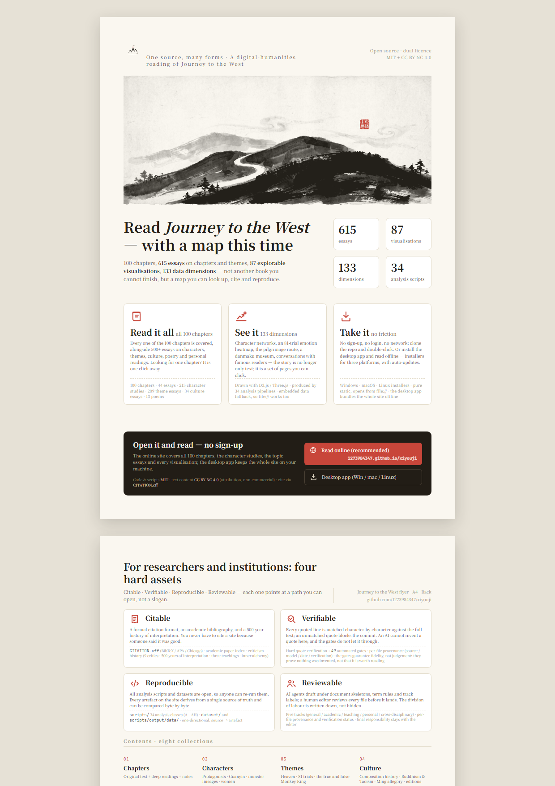

# 📖 Journey to the West · Annotated

[English](README.en.md) | [简体中文](README.md)

> **One source, many forms** — a digital-humanities reading of the 100 chapters of *Journey to the West*, written both for readers who want to go deep into the novel and for those who just want a taste.
> **How to read this file**: general readers can start with “Start in 30 Seconds” and “Browse by Section” below. Developers and agents can jump straight to the developer section at the bottom.
>
> **A note on languages**: the online site ships a full English edition at [/en/](https://1273984347.github.io/xiyouji/en/). The long-form essays under `docs/` are written in Chinese — this file is the English front door to them.


[](https://1273984347.github.io/xiyouji/en/) [](LICENSE) [](.github/workflows/pages.yml) [](https://github.com/1273984347/xiyouji/actions)

---

## 📖 For General Readers

### ⏱️ Start in 30 Seconds

| What you want to do | Go straight to |
|:---|:---|
| Browse at random, just for fun | [Online site](https://1273984347.github.io/xiyouji/en/) — every chapter, character, topic and visualization is one click away |
| Install it and read offline | [Releases](https://github.com/1273984347/xiyouji/releases/latest) — Windows / macOS / Linux installers, with automatic updates |
| Read a particular chapter | [100 chapter-by-chapter readings](docs/01-全书逐回解读/) — full coverage, with the original text, deep commentary and notes |
| Look up a character or demon lineage | [Character deep-dives](docs/02-人物深度分析/) — the protagonists, Guanyin, demon genealogies, female characters |
| See what the data looks like | [87<!--stats:visualization_pages--> visualization pages](site/data/) — D3.js charts, danmaku museum, sentiment heatmaps, AI celebrity dialogues |
| Look up an internal-alchemy term | [Glossary](docs/00-导读/术语表.md) — “mind-ape”, “wood-mother”, “yellow granny” and friends |

### 🗺️ What This Project Is

The project organises its work on *Journey to the West* as **one source, many forms**:

- **Documents (docs/)** — Markdown essays: chapter readings, character analyses, thematic topics, cultural background, poetry appreciation, personal writing
- **Site (site/)** — browsable HTML pages: navigation, timelines, character relationship graphs and more
- **Data visualization** — every data dimension ships with a D3.js page (classical rice-paper palette #faf7f2/#c8463a/#3a6b8c): line, bar, sankey, radar, scatter, pie, heatmap and matrix charts, covering 34<!--stats:script_classes--> thematic families (A–AH), plus a criticism-history diptych, a danmaku museum and a set of tool-oriented pages

**The full data panorama (133 dimensions)**:

| Phase | Family | Dimensions | Highlights |
|---|---|---|---|
| Phase 1–4 + v0.6 completion | A–L | 42 | chapter statistics · word frequency · eighty-one ordeals · route map · faction distribution · “mind-ape” curve · risk assessment · MBTI · book of life and death · organisational comparison |
| Phase 5 M–U | M–U | 28 | cave-abode real estate · magical-energy conservation · Wukong's fashion curve · commentary danmaku · villain matrix · translation bias |
| Phase 6 V–AH | V–AH | 43 | corporate jargon · MBTI · battle cards · IPO prospectus · causal dominoes · narrative cards · scent map · availability heuristic · invasive species · sentencing economics · artefact materials · spell structure |
| Phase 7 Q+ criticism diptych | Q+ | 8 | nine critic dossiers · schools-of-interpretation river · three-teachings debate · author candidates · inner-alchemy cipher · apparatus metadata · Li Zhi's danmaku · Möbius strip |
| Phase 7 Q++ danmaku museum | Q++ | 8+3 | four eras of celebrity profiles (Ming/Qing, Republican, modern, contemporary) · four age cohorts · century dialogues · celebrities on the present · international danmaku · global adaptations |
| Phase 7 Q+++ tool pages | Q+++ | 1 | sentiment heatmap (8 critics × 20 ordeals) · interactive timeline (authorship, editions, cultural reach) · AI celebrity dialogues |

> **Counting note**: 133 is the total of the dimension inventory (including the playful experimental dimensions). The algorithm is documented in [Counting conventions](docs/00-导读/统计口径说明.md).
> **Stratification of material**: A–L and Q+ are academic-facing; M–U, V–AH and Q++ contain deliberately cross-disciplinary experiments (corporate jargon, MBTI, cards, prospectuses) — judge by dimension name before citing; Q+++ is tool-facing (search, timeline, heatmap). The playful dimensions are a consciously kept “雅集” ingredient and carry no argumentative weight.

### 📊 Visualization Samples

Every data dimension is drawn with D3.js. Below are representative samples; the site ships both a light and an original ink-on-rice-paper dark theme.

<p align="center">

</p>

<p align="center">

</p>

### 🚀 Read It Online

**Nothing to install — open and read** 👉 [**https://1273984347.github.io/xiyouji/en/**](https://1273984347.github.io/xiyouji/en/)


*If images load slowly, just click the link above.*

**Locally**: clone the repository and open `site/en/index.html` in a browser (a fully static site — it opens straight from `file://`, with no software to install).

### 📥 Desktop App (installable · auto-updating)

**No Node/Python required** — install once and read everything offline (87<!--stats:visualization_pages--> visualization pages + 615<!--stats:a1_a6_docs--> essays built in) 👉 [**Download the latest release**](https://github.com/1273984347/xiyouji/releases/latest)

| Platform | File | Notes |
| --- | --- | --- |
| Windows | [xiyouji-desktop-win-x64.exe](https://github.com/1273984347/xiyouji/releases/latest/download/xiyouji-desktop-win-x64.exe) | NSIS installer (x64) |
| macOS | [xiyouji-desktop-mac-universal.dmg](https://github.com/1273984347/xiyouji/releases/latest/download/xiyouji-desktop-mac-universal.dmg) | Intel / Apple Silicon universal |
| Linux | [xiyouji-desktop-linux-x86_64.AppImage](https://github.com/1273984347/xiyouji/releases/latest/download/xiyouji-desktop-linux-x86_64.AppImage) | run after `chmod +x` |

**Automatic updates**: the app checks for updates 3 seconds after launch (then every 4 hours); “Help → Check for updates…” triggers a manual check, and the new build takes effect after a restart.

**Unsigned-app notice**: on macOS, right-click the app and choose “Open” the first time; on Windows, if SmartScreen appears choose “More info” → “Run anyway”. See [xiyouji-desktop/README.md](xiyouji-desktop/README.md).

### 📄 One-Page Flyer (A4, print-ready)

One sheet of A4, printed both sides: the front follows the general-reader path (claim · key visual · four numbers · three selling points · call to action), the back follows the academic and institutional path (four hard assets · content map · citation format · transparency and licence). Send it to a printer, or crop it into a social post.

| Asset | 中文 | English |
| --- | --- | --- |
| Print file (double-sided PDF · 2 pages<!--doc-sync:exempt--> A4) | [xiyouji-flyer-a4.pdf](assets/promo/output/xiyouji-flyer-a4.pdf) | [xiyouji-flyer-a4-en.pdf](assets/promo/output/xiyouji-flyer-a4-en.pdf) |
| Share images (150 dpi PNG) | [Front](assets/promo/output/xiyouji-flyer-a4-front.png) · [Back](assets/promo/output/xiyouji-flyer-a4-back.png) | [Front](assets/promo/output/xiyouji-flyer-a4-en-front.png) · [Back](assets/promo/output/xiyouji-flyer-a4-en-back.png) |
| Editable source (single source of truth) | [xiyouji-flyer-a4.html](assets/promo/xiyouji-flyer-a4.html) | [xiyouji-flyer-a4-en.html](assets/promo/xiyouji-flyer-a4-en.html) |

<p align="center">

</p>

- **Re-export after editing the copy**: `node scripts/_w892_export_flyer.mjs --en` — details in [assets/promo/README.md](assets/promo/README.md).
- **Social share images**: the site already ships fifteen 1200×630 share images (`site/static/images/og-*.webp`); crop from the PNG above for one-page posts.

### 🗂️ Browse by Section

- 📖 **Chapter-by-chapter readings**: all 100 chapters, with commentary and the original text → [docs/01-全书逐回解读/](docs/01-全书逐回解读/)
- 🕸️ **Character deep-dives**: Sun Wukong, Tang Sanzang, Zhu Bajie, Sha Wujing, Guanyin, demon genealogies, female characters → [docs/02-人物深度分析/](docs/02-人物深度分析/)
- 🗺️ **Themes and plots**: the heavenly rebellion, the eighty-one ordeals, the two Monkey Kings, team dynamics on the road → [docs/03-主题与情节专题/](docs/03-主题与情节专题/)
- 📚 **Cultural and historical background**: authorship, Buddhist and Daoist thought, Ming-dynasty allegory, the history of editions → [docs/04-文化与历史背景/](docs/04-文化与历史背景/)
- 📜 **Poetry and song**: appreciation of the novel’s verse, couplets, original compositions → [docs/05-诗词歌赋/](docs/05-诗词歌赋/)
- 💭 **Personal essays**: modern readings, workplace analogies, the novel through changing times (44<!--stats:a2_docs--> pieces) → [docs/06-个人随笔/](docs/06-个人随笔/)
- 📊 **Data visualization**: 87<!--stats:visualization_pages--> D3.js pages (danmaku museum, sentiment heatmap, AI celebrity dialogues, full-text search) → [site/data/](site/data/)
- 🔍 **Glossary**: inner-alchemy terms such as “mind-ape”, “wood-mother”, “yellow granny” → [Glossary](docs/00-导读/术语表.md)

> **Two tracks, one standard**: every document opens with a `>轨标：大众普及 / 学术研究 / 教学讲解 / 个人创作 / 跨界趣谈` marker, so you can pick the register you want; the track standard is defined in the [documentation spec](docs/00-导读/文档规范.md).
>
> **Counting conventions**: the algorithm behind every number quoted here (essays / pages / dimensions / citations) is documented in [Counting conventions](docs/00-导读/统计口径说明.md).

### 🎯 Who It’s For

- **General readers**: start at “Read It Online”, then move between `docs/00-导读/` and `site/`
- **Chapter readers**: all 100 chapters in `docs/01-全书逐回解读/` (opening · apprenticeship · the Dragon Palace · the heavenly rebellion · departure · team assembly · the rift · mid-journey duels · reintegration · the Flaming Mountains · the lion and elephant ridge · recognising the demons late · the final chapter)
- **Researchers**: focus on `docs/02-04/` and `references/`; if this helps your work, please cite via [CITATION.cff](CITATION.cff)
- **Criticism-history scholars**: [criticism-history.html](site/data/criticism-history.html) — five centuries of interpretation, nine critics, the three-teachings debate, the inner-alchemy cipher; plus [concept-device.html](site/data/concept-device.html) on conceptual apparatus (prism, radio, Möbius strip, cipher card, danmaku re-screening, detective wall)
- **Teachers**: `docs/01-全书逐回解读/` and `timeline/`
- **Fellow creators**: `docs/05-诗词歌赋/` and `docs/06-个人随笔/` are open ground
- **Visualization enthusiasts**: 87<!--stats:visualization_pages--> visualization pages under `site/data/` (including the V3 tag-cloud navigation across the whole site)
- **Interdisciplinary researchers**: the 13 V–AH families<!--doc-sync:exempt--> (cognitive psychology, ecology, law-and-economics, material archaeology, linguistics and more)
- **Every age**: the Q++ celebrity danmaku museum — sticker walls for children, debate prompts for teenagers, political-allegory decoding for high-schoolers, academic genealogies for students, and Jin Santan’s anti-involution rants for the working adult

---

## 🔧 For Developers & Maintainers

> Engineering and maintenance material — general readers can skip it entirely. If you came for the content, head back to [For General Readers](#-for-general-readers).

> **📖 Reading contract**: general readers read “For General Readers” top to bottom; agents and developers read only the developer section and the AI disclosure. Read “what and why” first, then follow the paths.
>
> **Versioning**: batch numbers in this project are **W###** (monotonic, never reused, the single reconciliation key); the `v2.3` label is a qualitative content-stage tag (no patch component, not SemVer). Historical `vX.Y.Z` numbers up to W710 are kept verbatim. To see what a given batch changed, read the top section of [CHANGELOG.md](CHANGELOG.md).
>
> **Maintenance contract**: the version line is maintained by `bump_version.py`; every change lands in the CHANGELOG, and this file **must not accumulate milestone or batch notes**. Structural edits (sections / directory tree / count declarations) must stay consistent with STRUCTURE, the project overview and `verify_delivery.py`.
>
> **Keeping this file in sync**: this English README is the English front door of the project. It mirrors the structure of [README.md](README.md); the Chinese file is the authoritative version, and the two are revised together.

<details>
<summary>Expand: engineering and maintenance documentation</summary>

### Tech Stack

- **Visualization**: D3.js (charts), Three.js (3D pages)
- **Text analysis**: Python (word frequency / co-occurrence / sentiment / terminology NLP)
- **Frontend**: plain HTML/CSS/JS (fully static · opens straight from `file://`)
- **Web Agent**: a home-grown OpenAI-compatible engine, wired to mainstream model endpoints (`xiyouji-agent-web/`)
- **CI/CD**: GitHub Actions (pytest / Playwright / Lighthouse / pip-audit / npm-audit)

### Directory Structure

```
xiyouji/
├── docs/                  # Markdown documents (numbered boards 00-12 + special-purpose dirs)
│   ├── 00-导读/           # project overview, reading guide, version digest, glossary
│   ├── 01-全书逐回解读/   # 100 chapter readings
│   ├── 02-人物深度分析/   # genealogy analyses of the main characters
│   ├── 03-主题与情节专题/ # the heavenly rebellion, the eighty-one ordeals, and other topics
│   ├── 04-文化与历史背景/ # authorship, Buddhist/Daoist thought, Ming allegory
│   ├── 05-诗词歌赋/       # appreciation of the novel's verse + original compositions
│   ├── 06-个人随笔/       # modern readings, personal notes
│   ├── 07-学以致用/       # learning paths, decision models, leadership, crisis response
│   ├── 08-提升认知/       # role-based thinking models, counterfactual training, metacognitive maps
│   ├── 09-精神塑造/       # the eighty-one ordeals as life metaphors, self-integration, value coordinates, meaning of suffering
│   ├── 10-方法论沉淀/     # DRL real loop / three-skill closure / the E1 rule / dual-index rework
│   ├── 11-方案报告/       # unified archive for review / audit / research reports
│   ├── S2-外部分享/       # curated releases for distribution (S2 stage)
│   ├── S2-学术投稿/       # academic submissions (S2 stage)
│   ├── S3-方法论外部分享/ # methodology for external sharing (S3 stage)
│   ├── S4-学术投稿/       # academic submissions (S4 stage)
│   ├── superpowers/       # spec/plan archives from the development process
│   ├── _dev/              # internal development docs (not public)
│   └── _templates/        # content templates (decoupled from the live structure · do not apply as-is)
├── dataset/               # structured data JSON (source for visualizations and the API)
├── source/                # the novel and citations (full text / per-chapter split + academic index and curated web readings)
├── site/                  # browsable HTML site (D3.js driven · index/dashboard/chapters/characters/themes/data/static)
├── scripts/               # Python text-analysis scripts (34 families A–AH + utils + output)
├── timeline/              # timeline topics (the route, the chronicle, character timelines)
├── assets/                # font sources, images and other static resources
├── references/            # bibliography
├── tools/                 # helper tools (chapter splitting and friends)
├── hyperframes/           # HTML video experiments (W200 leftovers · pending a cleanup decision)
├── mcp-server/            # MCP services (xiyouji_drl_spotcheck and others)
├── tests/                 # pytest suites + Playwright E2E
├── xiyouji-agent-web/     # Web Agent "Journey to the West · Crossing at the Ferry" (OpenAI-compatible engine)
├── xiyouji-desktop/       # desktop client (Electron offline client for the whole site)
├── .github/workflows/     # CI / Security / Deploy Pages / Lighthouse / screenshot review
├── README.md              # the Chinese file (user manual + developer section)
├── README.en.md           # this file (English front door)
├── STRUCTURE.md           # detailed directory structure
├── CHANGELOG.md           # change log (see the top section for the current batch)
└── LICENSE                # dual-licence declaration
```

See [STRUCTURE.md](STRUCTURE.md) for the detailed breakdown.

### Running the Analysis Scripts

```bash
cd scripts
pip install -r requirements.txt
python word_frequency.py --input ../source/原文/西游记-全文.txt --output output/data/word_freq.json
```

### Tests (pytest + Playwright E2E)

```bash
# full pytest run (including MCP tool tests)
pytest tests -q

# three-layer E2E: smoke / deep interaction / visual regression
cd scripts
npm install
npm run test:e2e
```

### Screenshot Review (automatic layout checks before release)

```bash
cd scripts
npm install          # playwright + chromium
npm run screenshots  # batch capture + layout assertions + automatic slicing
python detect_unwrapped_tables.py   # static table scan (the second half of the dual track)
```

The detailed record of convergence rounds lives in the matching W section of [CHANGELOG.md](CHANGELOG.md).

### Document Index (two indexes, fully traceable)

- **Forward index (timeline)**: [CHANGELOG.md](CHANGELOG.md) — changes in batch order; every section carries a unique W### ID plus its four-part record (source / files / verification / status). Archiving conventions are described at the head of the CHANGELOG.
- **Reverse index (by file)**: [scripts/output/file-index.md](scripts/output/file-index.md) — for a given file, how often it changed and against which W entry.

**W### numbering**: W001–W099 map to v0.1–v2.0.72; W100 and later map to v2.1.0+. New W entries update both indexes. The full mapping lives in [CHANGELOG.md](CHANGELOG.md).

**Use cases**:
1. “What changed at time T” → read the forward timeline in the CHANGELOG
2. “How often did this file change” → look it up in the reverse file index
3. “What was the full blast radius of that W entry” → cross-reference both indexes

### Documentation Maintenance Rules

- Before editing project docs, read the [documentation spec](docs/00-导读/文档规范.md) (anti-bloat · archiving rules · Keep a Changelog / SemVer / Conventional Commits / Diátaxis)
- The cross-session handover flow is described in [HANDOVER.md](HANDOVER.md)

</details>

---

## Citation

If this project helps your research or writing, please cite it in the format given in [CITATION.cff](CITATION.cff); the academic bibliography lives in the [academic paper index](source/引用与网络解读/学术论文索引.md).

## Contributing

See [CONTRIBUTING.md](CONTRIBUTING.md); participation means you accept the [code of conduct](CODE_OF_CONDUCT.md). Updates can also be followed via [RSS](site/rss.xml).

## AI Disclosure

The content of this project is produced under an “AI agent collaboration + human review” model. For transparency:

- **How it is produced**: documents and data are drafted or reorganised by AI agents under a document skeleton, a terminology standard and track markers; a maintainer then reviews each piece before it is admitted. Every piece records its generation source, model, date and verification state in its header metadata block (unrecorded fields are honestly marked “not recorded”).
- **Citation verification**: every quotation line in the format `> 原文引文（第N回）` is matched verbatim against the full-text dataset of the original novel by script; a miss blocks the commit, which is what stops AI-hallucinated quotations.
- **Gate system**: every commit has to pass 49<!--stats:gate_count--> automated gates (terminology consistency, content consistency, CSP, accessibility and more). The collaboration flow and verification standards are in [CONTRIBUTING.md](CONTRIBUTING.md); the gate inventory is in [AGENTS.md](AGENTS.md).
- **Responsibility boundary**: AI drafts and reorganises; the maintainer chooses, verifies and finally owns the content.
- **What the gates do and do not guarantee**: the automated gates secure the **machine-checkable formal layer** — quotations are real (verbatim against the source), structures agree (six documents from one source), terminology is consistent, the site is reachable and safe. They **do not** guarantee judgement — whether an argument is original, whether it is well made, whether the interpretation has life in it; that rests with the author, and the pieces differ in depth. **A gate count is not a warrant for scholarly quality**: it shows that nothing was fabricated, not that it is worth reading.

## License

This project is **dual-licensed**:

- **Source code and project documentation** (Python/JavaScript/HTML sources, configuration, the code structure of the HTML/CSS/JS under `site/`, GitHub Actions workflows, and top-level README/STRUCTURE/CHANGELOG files): [MIT License](LICENSE)
- **Text content** (the A1–A6 content boards under `docs/` plus 07–09, the S1 methodology, the S2/S3/S4 submission candidates and external sharing pieces; the same original interpretive text rendered in `site/` pages): [CC BY-NC 4.0](LICENSE-CONTENT.md) (attribution, non-commercial)

The text of *Journey to the West* itself is in the public domain. Quoted external web readings remain the copyright of their original authors and are used only as index entries and excerpts, outside this project’s licence.

## 💬 Feedback

Questions, corrections and ideas are welcome — open an [Issue](https://github.com/1273984347/xiyouji/issues) or leave a comment on the online site.

---

> Project created on 2026-07-21 and updated continuously. The full change history lives in [CHANGELOG.md](CHANGELOG.md).
