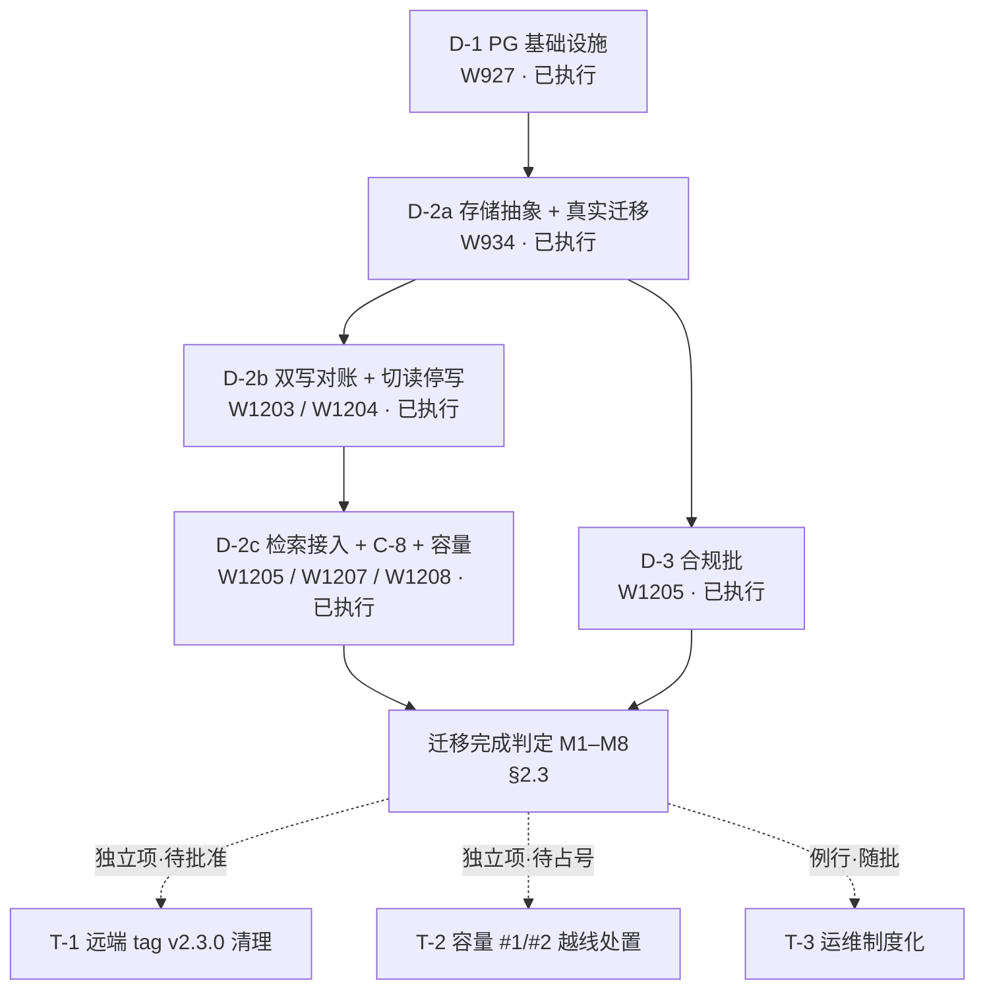

# 系统架构 v2 迁移施工手册（现有架构 → 目标态 · 可执行 · 可复核）

> **版本**：W1221（v1.0 定稿；版本号语义为发布批次编号，不适用 SemVer）
> **日期**：2026-11-13
> **来源**：用户令「关于现有架构进行新架构的迁移方案」，经三项确认——① 新架构 = v2 目标态（全量重述，不依赖读者另行阅读目标态原文）② 形态 = 施工执行手册 ③ 范围 = 全系统（含静态站与治理面）
> **状态**：定稿入库（数字均为 2026-11-13 当批实测，复算命令见附录 A；独立审查 2 个 P0 已修正并如实标注）
> **读者**：团队协作 Agent（默认无对话上下文，可独立执行与复算）

---

## 目录

1. [执行摘要（先给答案）](#1-执行摘要先给答案)
2. [迁移定义与边界](#2-迁移定义与边界)
3. [目标态架构（自包含重述）](#3-目标态架构自包含重述)
4. [阶段总览](#4-阶段总览)
5. [已执行阶段复核](#5-已执行阶段复核)
6. [待执行项与建议批次](#6-待执行项与建议批次)
7. [执行规程（Agent 操作规程）](#7-执行规程agent-操作规程)
8. [回滚与失败处置](#8-回滚与失败处置)
9. [验收标准](#9-验收标准)
10. [附录 A 命令与证据索引](#附录-a-命令与证据索引)
11. [附录 B 与目标态文档的章节映射](#附录-b-与目标态文档的章节映射)

---

## 1. 执行摘要（先给答案）

### 1.1 一句话迁移

**把 L3 服务层的有状态数据（会话 / 消息 / 反馈 / 审计）从单文件 SQLite 迁到自建单机 PostgreSQL 16，并同步落地合规横切面（数据分级 / 审计留痕 / 加密 / 留存期）与服务地址注入机制；L0–L2（内容真源与静态站）不迁移，只受三条硬边界约束。**

### 1.2 三步上手（执行 Agent 最短路径）

| 步 | 动作 | 命令 / 判据 |
|:--:|:---|:---|
| 1 | **核对基线**：确认自己接手的工作树已包含迁移主体（W1204 及以后） | `py -3 scripts/agent_start.py`（本机 PowerShell 侧）或 `python scripts/agent_start.py`（CI / Unix）；输出中的现役批次 ≥ W1204 |
| 2 | **定位任务归属**：复核既有迁移 → §5；执行剩余项 → §6 + §7 | 读 §4.1 阶段表：状态列「已执行」的只复核，不重做 |
| 3 | **执行或复核并留证** | 复核：直接跑 §5 各小节的命令，期望输出逐条对表；新批次：按 §7.1 开批流程，收官链不可跳步 |

### 1.3 当前状态速览

> 数据来源：2026-11-13 当盘实测（`scripts/output/stats.json`、`scripts/check_capacity_budget.py --no-json`、各守卫 `--gate` 实跑）。**仓库体积口径** = `.git` 目录全部文件字节和（含 pack / loose；若存在 `.git/lfs` 对象也计入），由容量工具实测；`git count-objects` 的 `size-pack` 只反映 pack 文件，不是本口径。

| 阶段 | 内容 | 状态 | 实测依据 |
|:---|:---|:---:|:---|
| D-1 | PG 16 自建单机基础设施（配置基线 / 初始化 / 备份 / 恢复演练） | **已执行** | W927；静态校验 **98/98**、反向验证 **23/23**（2026-11-13 复跑） |
| D-2a | 存储层抽象（M12）+ 真实数据迁移 | **已执行** | W934；现役库 70 会话 / 134 消息 / 4 反馈迁入 PG，三重对账全等（证据 `_w934_d2a_migrate.json`） |
| D-2b | 双写对账 + 切读 + 停写旧库 + 回滚 | **已执行** | W1203 / W1204；迁移后对账 74/74 · 142/142 · 4/4（JSON 证据）；150/150 等修复后读数为叙事记录（无独立 JSON）；停写单向门实证（`_w1204_cutover_evidence.json`） |
| D-2c（收尾） | 检索层接入（O-4）+ C-8 地址注入 + 容量实测 | **已执行** | W1205 / W1207 / W1208；第 70 槽违规 **0**、第 71 槽违规 **0**（2026-11-13 复跑） |
| D-3 | 合规批（四级分级 / 审计 / 加密 / 留存 / 部署基线） | **已执行** | W1205；合规 9 项基线自检 + 合规测试随 `test:server` 全跑 |
| — | 仓库体积治理（LFS 迁移，取代「改写历史」路径） | **已执行** | W1209 / W1211；`.git` 实测 **602.02 MB < 1 GB** 阈值（余量 41.2%） |
| T-1 | 远端 tag `v2.3.0` 清理 | **未执行** | `git tag` 仍有 `v2.3.0`；属远端破坏性动作，待批准（§6.3） |
| T-2 | 容量阈值 #1/#2 越线处置（单页 HTML / 内联 CSS） | **未执行** | 今日实测：448.89 KB > 200 KB（+124.4%）、73.27 KB > 60 KB（+22.1%） |
| T-3 | 例行运维制度化（审计缺口窗口登记 / 月度恢复演练） | **未执行** | 需写入每批收官检查项与月检清单（§6.2） |

### 1.4 本手册不回答什么

- **不再论证「为什么选 PostgreSQL」**：9 个存储候选的逐项裁定与量化触发条件已在目标态文档 §7.1 定稿；本手册只负责执行与复核。
- **不覆盖静态站内容生产与视觉设计**：归内容批次与 `DESIGN.md`；本手册只界定静态站的「不迁移边界」（§2.4）。
- **不给出日历排期**：批次节奏由用户口令与台账决定；本手册只给阶段顺序与闸门。
- **不包含需用户单独批准的破坏性动作**：改写 Git 历史、删除远端 tag / 分支等，只在 §6.3 登记批准门槛，不在正文给「直接执行」命令。

---

## 2. 迁移定义与边界

### 2.1 现状架构（As-Is）

> 2026-11-13 当盘实测；「现役」指读者接手时磁盘上的真实形态，不是方案写作时的形态。

| 面 | 现役形态 | 关键实现 / 开关 |
|:---|:---|:---|
| L0 内容真源 | `docs/` + `source/` + `dataset/` 的 Git 文件树 | 无外部数据库；Markdown / JSON 可 diff |
| L1 加工 | 34 类分析器 + 生成器 | `scripts/`，产物落 `scripts/output/data/*.json` |
| L2 交付 | 861 个 HTML 页静态站 | `file://` 直开 + 数据页 EMBEDDED 回退 |
| L3 服务 | Express 5 + Node.js（`xiyouji-agent-web/`） | 存储层工厂 `server/storage/index.ts`：`AGENT_WEB_DB_BACKEND` 未设 ⇒ **sqlite**；设 `postgres` ⇒ PG |
| 数据面 | 会话 / 消息 / 反馈 / 审计 | `server/storage/` + `server/compliance/` |
| 地址面 | 构建期占位符 `__XIJ_SERVICE_BASE__` + 部署期注入 | 第 70 槽守卫（C-8） |
| 治理面 | 71 槽门禁 + W 批次台账 | `scripts/verify_delivery.py` |
| 合规面 | 四级分级 / 审计 / 加密 / 留存 / 部署基线自检 | `server/compliance/`（默认关闭，`AGENT_WEB_COMPLIANCE_BASELINE=1` 启用） |

### 2.2 目标架构（To-Be）

**一句话**：五层（L0 事实源 / L1 加工 / L2 交付 / L3 服务 / L4 消费）+ 双横切面（G 治理 / A 合规），依赖单向向下；静态优先不变，PG 与 Node 只承担长尾流量。

相对 As-Is 的**六个关键变化点**：

| # | 面 | As-Is | To-Be | 判定方式 |
|:--:|:---|:---|:---|:---|
| 1 | 存储 | SQLite 单文件（默认） | PG 16 自建单机；SQLite 降级为桌面 / 单机形态实现 | `AGENT_WEB_DB_BACKEND=postgres` 起服成功 |
| 2 | 鉴权 | 可选 `AGENT_WEB_TOKEN` | 私有化部署基线：`AGENT_WEB_REQUIRE_TOKEN=1` 且未设 token ⇒ **拒绝启动** | 起服 exit 1 + FATAL 日志 |
| 3 | 审计 | 单文件 JSONL、fail-open 静默 | 只追加 + 11 字段 + 留存 ≥ 180 天 + 写失败告警（合规降级，不静默） | 合规自检 8/8；审计测试全过 |
| 4 | 地址 | 静态产物硬编码回环地址 | 构建期占位符 + 部署期注入；`127.0.0.1` 仅开发者本机档且显式标记 | 第 70 槽违规 0 |
| 5 | 备份 | 2 件（会话库 + 审计日志） | 7 件（新增 PG 数据目录 + WAL 归档等） | 恢复演练逐表行数一致 |
| 6 | 观测 | 4 层（代码 / 交付 / 运行 / 业务） | 5 层（新增合规层：审计成功率 / 分级覆盖率 / 缺口窗口） | `/api/ready` 的 `compliance.audit` 字段 |

### 2.3 什么算「迁移完成」

**判定 = 下列 8 条同时成立**（任一不成立即未完成，不得对外宣称「已切 PG」）：

| ID | 判据 | 命令 / 证据 | 期望输出 |
|:--:|:---|:---|:---|
| M1 | 服务可切 PG 后端 | `AGENT_WEB_DB_BACKEND=postgres npm run server`（`xiyouji-agent-web/` 下） | 起服日志 `数据库: PostgreSQL 16`；`GET /api/ready` 返回 200 |
| M2 | 数据三重对账全等（行数 / 主键集合逐位 / 逐行内容摘要） | 在 `xiyouji-agent-web/` 下：`node --import tsx deploy/pg/bin/reconcile-dualwrite.ts --sqlite <路径> --pg <连接串>` | 退出码 **0**、三重全部相等；**仅在切流前 / 双写期有效**——停写后旧库必然落后、对账必然不等（见 M3） |
| M3 | 停写前最后一次对账 = 0 | 同上，在停写**之前**跑 | 退出码 0；停写后对账必然不等，属**预期**（旧库落后） |
| M4 | 静态产物无硬编码服务地址 | `py -3 scripts/check_no_hardcoded_endpoint.py --gate` | `---- 第 70 门禁 产物服务地址：违规 0 · OK ----` |
| M5 | 占位符不在 CSP 哈希载体上 | `py -3 scripts/check_placeholder_hash_carrier.py --gate` | `---- 第 71 门禁 占位符哈希载体：违规 0 · OK ----` |
| M6 | 合规基线 **9 项**自检全过 | 按 §5.5 的完整环境变量起服 | 起服成功（9/9 通过）；任一要素缺失 ⇒ `ComplianceError` 拒绝启动 |
| M7 | 静态站三条硬边界未破 | §2.4 三条判据 | 三条全绿 |
| M8 | 全量门禁与推送判据全绿 | `python scripts/verify_delivery.py`；`python scripts/pre_push_gate.py` | 0 FAIL；四步全绿（无「判据降级」标注） |

> **环境变量写法**：bash / CI 用 `AGENT_WEB_DB_BACKEND=postgres npm run server`；本机 PowerShell 用 `$env:AGENT_WEB_DB_BACKEND='postgres'; npm run server`。两种写法语义相同，复制时按当前 shell 选择。**M6 注意**：只设 `AGENT_WEB_COMPLIANCE_BASELINE=1` + 示例配置文件会因 `auth.token` / `transport.client_tls` / `crypto.column_encryption` 三项违规而**拒绝启动**（示例文件要求满配）；完整可过配方见 §5.5。

### 2.4 不迁移边界（三条硬边界 + 机器判据）

> 这三条是「静态站与内容真源不迁移」的具体含义；违反任一条即视为迁移越界，不得以「顺手优化」为名豁免。

| # | 硬边界 | 允许 | 禁止 | 机器判据 |
|:--:|:---|:---|:---|:---|
| B1 | **不做全站框架化** | 新可视化页可局部构建化（Vite + TS + `vite-plugin-singlefile`，内联后仍须 `file://` 可开）；存量页不迁 | 向 `site/` 引入 React / Vue / Svelte 等框架运行时；把静态站改成 SPA | `rg -n "react(\.production)?\.min\.js|vue(\.global)?\.min\.js|svelte" site/` ⇒ **0 命中**（任意等价全文检索均可；本地 D3 / Three 除外）；新增页须经 `file://` 直开验证 |
| B2 | **`file://` 直开 + 零外域** | 数据页内嵌 `EMBEDDED` 回退；D3 / Three 一律本地引用 | 引用 CDN；新页无 EMBEDDED 回退；新增外域（唯一既有例外：GoatCounter 回传域） | 第 9 槽数据漂移（fetch / EMBEDDED 双形态）；`python scripts/generate_csp.py --check` 0 漂移；外域白名单唯一定义在 `scripts/generate_csp.py` |
| B3 | **L2 产物不得内嵌 L3 部署事实** | 构建期占位符 `__XIJ_SERVICE_BASE__`；部署期已声明地址；开发者本机档显式标记 | 硬编码回环地址 / 内网 IP / 裸域名；占位符落进内联 `<script>` 或 `<script src>` | 第 70 槽 + 第 71 槽 `--gate` 均违规 0 |

---

## 3. 目标态架构（自包含重述）

### 3.1 分层定义（L0–L4 + 双横切面）

| 层 | 名称 | 职责 | 唯一产出 | 失败语义 |
|:--:|:---|:---|:---|:---|
| **L0** | 事实源 | 承载「人可读的真」 | `source/` `docs/` `dataset/` | 内容不完整 ⇒ 下游全部降级，不得掩盖 |
| **L1** | 加工 | 确定性变换：分析抽取 / 生成 / 门禁校验 | `scripts/output/data/*.json`、`site/data/*.html`、门禁报告 | 变换失败 ⇒ 产物不更新，旧产物继续服务 |
| **L2** | 交付 | 零服务端静态产物 | `site/`（861 页，2026-11-13 实测） | 产物缺失 ⇒ 回退上一部署版本 |
| **L3** | 服务 | 有状态交互：会话 / 流式 / 工具 / 权限 / 检索 | PG 数据 + SSE 流 + JSONL 审计流水 | 进程崩溃 ⇒ 静态层零影响，问答不可用 |
| **L4** | 消费 | 谁在用、用什么协议 | — | — |
| **G** | 治理横切面 | 把「不可回归」变成机器断言 | 门禁报告、W 台账、四件套文档 | 门禁红 ⇒ 提交被拒 + CI 阻断 |
| **A** | 合规横切面 | 分级 + 审计 + 加密 + 留存 | 分级标签、审计流水、销毁留证 | 审计中断 ⇒ 告警并标记合规降级（不静默） |

**层间铁律（6 条）**：① 依赖单向向下（L3 可读 L0；L2 只由 L1 写）；② 产物不得反向成为事实源；③ 服务层不产出静态内容；④ 数据分级标签随数据流；⑤ 审计只追加不修改；⑥ 迁移必须可逆且留证。

### 3.2 模块组与数据面归属

**六个模块组（21 个模块）**：

| 组 | 模块 | 归属层 |
|:---|:---|:---|
| M-A 内容 | M01 事实源 · M02 分析加工 · M03 生成器 | L0 / L1 |
| M-B 交付 | M04 静态站 · M05 门禁 · M06 批次治理 | L2 / G |
| M-C 服务 | M07 API 网关 · M08 会话服务 · M09 问答引擎 · M10 检索服务 · M11 权限与工具 | L3 |
| M-D 数据 | M12 PG 存储层 · M13 审计流水 · M14 备份恢复 | L3 / A |
| M-E 合规 | M15 分级目录 · M16 加密与密钥 · M17 数据留存 | A |
| M-F 消费 | M18 Web 前端 · M19 桌面端 · M20 MCP 工具 · M21 检索客户端 | L4 |

**依赖矩阵读法**：M-A 不依赖任何组；M-B 不依赖 M-C / M-D / M-E；M-E 可依赖全部组，但其余组不得依赖 M-E 的内部实现（合规以横切方式注入）。

**数据面归属**：

> **编号防混**：本节与 §3.1 的 `L0–L4` 是**分层编号**；下表「分级」列的 `L1–L4` 是**数据敏感级**（L1 公开 / L2 内部 / L3 受限 / L4 敏感）。两套编号同形但含义不同——例如「反馈 = L2 内部」说的是数据分级，不是「反馈属于交付层」。

| 数据 | 存储 | 分级 |
|:---|:---|:---|
| 原著原文、解读文档、公开数据集 | Git 文件树 | L1 公开 |
| 分析中间产物 | `scripts/output/data/*.json`（gitignore，可重建） | L1 公开 |
| 会话与消息 | PG `sessions` / `messages` | L3 受限 |
| 反馈 | PG `feedback` | L2 内部 |
| 审计事件 | JSONL 流水 + PG 归档 | L4 敏感 |
| 备份快照 | 仓外备份目录 | 随源数据分级 |

### 3.3 契约清单（C-1 ~ C-8）

| 契约 | 内容 | 落点 / 判据 |
|:---|:---|:---|
| C-1 | 层间只经由显式数据契约（JSON schema / SQL DDL）交互 | 不得直接读对方内部文件 |
| C-2 | 事实源变更必须触发门禁重跑 | 无重跑即视为未落地 |
| C-3 | 所有派生数据必须带版本戳（W 号或 schema 版本） | 生成器 |
| C-4 | 服务端对外错误分类可枚举，前端按类渲染 | `server/compliance/errors.ts` 等 |
| C-5 | 内联脚本哈希与 CSP meta 一致 | `python scripts/generate_csp.py --check` |
| C-6 | 数据入库必带分级标签 | 各级入库校验（缺标签拒收） |
| C-7 | 审计事件字段集只增不改 | 11 字段（`ts` / `event_id` / `actor` / `action` / `target` / `decision` / `result` / `data_class` / `trace_id` / `source_ip` 等） |
| C-8 | 静态产物中的服务端地址必须由部署期配置注入，禁硬编码回环 / 内网地址 | 第 70 槽；占位符载体约束见第 71 槽 |

### 3.4 禁止依赖形态（8 条）

| # | 禁止形态 | 实证来源 |
|:--:|:---|:---|
| 1 | 服务层生成 `site/` 下文件 | 产物回写即漂移源 |
| 2 | 手工改 `site/data/*.html` 的 `EMBEDDED_DATA` | 同名数据副本 47 份中 24 份曾漂移 |
| 3 | 模块间用字符串拼接的运行时调用替代 import | MCP 曾调用已弃用脚本，只查 import 会漏 |
| 4 | 审计写失败静默吞错且不告警 | 现役 `audit.ts` 曾 fail-open |
| 5 | 存储层变更绕过迁移清单 | SQLite 改表定义对存量库无效 |
| 6 | 前后端各存一份系统提示词 / 工具名词表 | 工具名 12 个中 3 个曾对不上 |
| 7 | 页面聚合数字不入任何扫描域 | 首页自称 772 篇 vs 实测 834 条 |
| 8 | 在 L2 静态产物里硬编码 L3 服务地址 | `rag-chat.js` 曾硬编码 `127.0.0.1:8777` |

---

## 4. 阶段总览

### 4.1 阶段表

| 阶段 | 主题 | 批次 | 状态 | 前置 | 本手册落点 |
|:--:|:---|:---|:---:|:---|:---|
| **D-1** | PG 16 自建单机基础设施（配置 / 初始化 / 备份 / 恢复演练） | W927 | **已执行** | 无 | §5.1 |
| **D-2a** | 存储层抽象（M12）+ 真实数据迁移 | W934 | **已执行** | D-1 | §5.2 |
| **D-2b** | 双写对账 + 切读 + 停写旧库 + 回滚 | W1203 / W1204 | **已执行** | D-2a | §5.3 |
| **D-2c** | 检索层接入（O-4）+ C-8 地址注入 + 容量实测 | W1205 / W1207 / W1208 | **已执行** | D-2b | §5.4 |
| **D-3** | 合规批（分级 / 审计 / 加密 / 留存 / 部署基线） | W1205 | **已执行** | D-2a | §5.5 |
| **T-1** | 远端 tag `v2.3.0` 清理 | 待占号 | **未执行·待批准** | 无 | §6.1 |
| **T-2** | 容量阈值 #1 / #2 越线处置 | 待占号 | **未执行** | 无 | §6.1 |
| **T-3** | 例行运维制度化（审计缺口窗口 / 月度恢复演练） | 随批落地 | **未执行** | 无 | §6.2 |

> **批号与阶段不是一一对应**：W1205 一批内同时交付了 D-2c（检索接入 / C-8 / 容量）与 D-3（合规批）两块内容。阶段按「交付主题」拆分，批次按「提交单元」编号；同一 W 号出现在两个阶段属正常，不代表顺序颠倒。

### 4.2 顺序纪律（为什么不可颠倒）

1. **先备份 → 再迁移 → 再切流**：PG 数据目录是新增的「不可重建且不可再生」数据面；跳过备份的迁移不可回滚。
2. **先对账 → 再切读 → 再停写**：停写旧库是**单向门**——停写期间只进新库的数据不会自动回旧库；只有「对账零差异 + 双写观察通过」才允许停写。
3. **先有审计载体 → 再打分级标签**：否则分级要重标两次数据（D-3 排在 D-2a 之后而非之前）。
4. **D-1 → D-2 → D-3 不可颠倒**：先有 PG 与备份（否则迁移不可回滚），再迁应用（否则审计无载体），最后合规。
5. **静态站不参与迁移链**：L2 零服务端，任何迁移阶段都不得把静态站作为前置依赖；静态站只需保持 §2.4 三条硬边界。

### 4.3 阶段流转图



---

## 5. 已执行阶段复核

> 每阶段固定五栏：交付物 / 复核命令 / 期望输出 / 证据文件 / 当时读数。读者按命令可自行确认「迁移确实发生过」。

### 5.1 D-1 PG 基础设施批

| 栏 | 内容 |
|:---|:---|
| **交付物** | `xiyouji-agent-web/deploy/pg/`：根目录配置基线 ×2（`postgresql.conf.base` / `pg_hba.conf.base`）+ `README.md`；`bin/` 下脚本 ×3（`initdb-bootstrap.sh` / `backup.sh` / `restore-drill.sh`）+ 静态校验器 `verify-baseline.py` + 反向验证器 `_mutation_test.py`；`migrations/0001_baseline.sql` |
| **复核命令** | `py -3 xiyouji-agent-web/deploy/pg/bin/verify-baseline.py`<br>`py -3 xiyouji-agent-web/deploy/pg/bin/_mutation_test.py` |
| **期望输出** | 静态校验 `---- D-1 部署基线静态校验：98/98 通过 · 0 FAIL ----`；反向验证 `---- 反向验证：23/23 变异可证伪 ----` |
| **证据文件** | `scripts/output/_w927_pg_baseline.json`、`scripts/output/_w927_pg_runtime_evidence.txt` |
| **当时读数** | 幂等初始化连跑两次通过；`pg_basebackup` rc=0；PITR 恢复后逐表行数一致；WAL 归档连续无缺口（证据文件读数：段数 37；备份轮转 39 → 39 段）；备份与数据目录同盘被脚本如实拦下；TLSv1.3 实握手 |
| **边界提醒** | 静态校验与变异测试只证明「配置形态正确」，**不证明运行时可用**；运行时结论以 `_w927_pg_runtime_evidence.txt` 为准。本机无 PG 时只跑前两条命令即可完成复核。 |

### 5.2 D-2a 存储抽象与真实数据迁移

| 栏 | 内容 |
|:---|:---|
| **交付物** | `server/storage/`（`types.ts` 接口 + `sqlite.ts` + `postgres.ts` + `index.ts` 工厂）；`server/db.ts` 降为门面（16 个现役导出名齐备）；迁移器 `deploy/pg/bin/migrate-sqlite-to-pg.ts`；迁移序列 `migrations/0002_app_tables.sql` |
| **复核命令** | `cd xiyouji-agent-web && node --import tsx --test server/storage/storage.test.ts`<br>真实迁移（需 PG 凭据）：`node --import tsx deploy/pg/bin/migrate-sqlite-to-pg.ts --sqlite ./data/chat.db --json ../../scripts/output/_w934_d2a_migrate.json` |
| **期望输出** | 双后端契约测试：**同一套断言**在 SQLite 与 PostgreSQL 两个后端均通过（2/2）；**未配置 PG 凭据时 PG 两例 skip、只有 SQLite 例通过**，不算完成复核；迁移器退出码 0，`schema_migrations` 记账 version / checksum 正确 |
| **证据文件** | `scripts/output/_w934_d2a_migrate.json`（三重对账）、`_w934_d2a_grants.txt`（授权实查）、`_w934_d2a_residue_before.txt`（清理前快照） |
| **当时读数** | 70 会话 / 134 消息 / 4 反馈迁入 PG 16.4；逐表行数相等 + 主键集合逐位相等 + 逐行内容摘要一致；时间列 278/278 逐字节相等；5 张表 owner = `xiyouji_app`，只读账号仅 SELECT 且写入被拒 |
| **纪律** | 迁移器**不借道应用写接口**（应用侧 `createMessage` 会刷新 `updated_at`）；必须参数化 SQL 直写以保证逐字节保真。 |

### 5.3 D-2b 双写对账与切读停写

| 栏 | 内容 |
|:---|:---|
| **交付物** | `server/storage/dualwrite.ts`（双写层）、`server/storage/reconcile-core.ts`（判定核心）、`deploy/pg/bin/reconcile-dualwrite.ts`（CLI 适配）、`deploy/pg/bin/dualwrite-drill.ts`（造写入，不做判定）、6 例契约测试；`deploy/pg/README.md` 内「切读 → 停写旧库」流程与回滚路径 |
| **复核命令** | `cd xiyouji-agent-web && node --import tsx --test server/storage/dualwrite.test.ts deploy/pg/bin/reconcile-dualwrite.test.ts`<br>真实对账（需 PG 凭据）：`node --import tsx deploy/pg/bin/reconcile-dualwrite.ts --sqlite <路径> --pg <连接串>` |
| **期望输出** | 契约测试全过（一致全等 / **假对账被抓住** / 同行内容错位 / 时间列规范化 / 编排层异步 / 编排层不吞差异）；对账器退出码 **0**（行数 + 主键集合逐位 + 逐行内容摘要三重全等） |
| **证据文件** | `_w1204_migrate_backfill.json`（迁移后三重对账 74/74 · 142/142 · 4/4；时间列 148/142/4）· `_w1204_cutover_evidence.json`（切读 / 停写 / 回滚运行读数）· `_w1204_drill_dual.json` / `_w1204_drill_dual_fixed.json`（**写入探针**：只造数据 + 报读数，**不含对账判定**） |
| **当时读数** | 迁移后对账 74/74 · 142/142 · 4/4 有 JSON 证据；修复时间戳缺陷后的 150/150 · 143/143 · 5/5 为当时**控制台对账读数**，仅存于 CHANGELOG / HANDOVER 叙事，**无独立 JSON 证据**（如实标注，勿当作可复算文件）；切读起服日志 `数据库: PostgreSQL 16`；停写后对账如实报「仅在目标侧」；回滚读不到停写期写入。`_w1204_cutover_evidence.json` 逐步读数：step3 切读 `ready 200` · step4 停写 `write_mode=primary` · step5 回滚 `sqlite` |
| **闸门口径** | **停写前**最后一次对账必须为 0；停写后旧库必然落后 ⇒ 对账必然不等，那是**预期**而非故障。不得把「停写后仍为 0」当闸门。 |

### 5.4 D-2c 检索接入 + C-8 地址注入 + 容量实测

| 栏 | 内容 |
|:---|:---|
| **交付物** | `/api/retrieval` 路由（引用守卫四道判据 + 段落级逐字溯源）；C-8 注入机制（构建期占位符 `__XIJ_SERVICE_BASE__` + 部署期替换，两档 fail-closed + 开发者本机档显式标记）；容量测量器 `scripts/check_capacity_budget.py`；第 70 / 71 槽常驻门禁 |
| **复核命令** | `py -3 scripts/check_no_hardcoded_endpoint.py --gate`<br>`py -3 scripts/check_placeholder_hash_carrier.py --gate`<br>`py -3 scripts/check_capacity_budget.py --no-json`<br>`cd xiyouji-agent-web && node --import tsx --test server/retrieval.test.ts` |
| **期望输出** | 第 70 槽 `违规 0 · OK`；第 71 槽 `违规 0 · OK`（非哈希载体登记 7 处，均为合法载体）；容量 #1 / #2 触发、#3 / #4 / #6 未触发；检索契约测试全过 |
| **证据文件** | `scripts/output/_w1205_capacity_audit.json`、`_w1205_retrieval_endpoint.json`、`_w1205_scorecard_alerts.json`、`_w1207_spec.json`、`_w1208_spec.json` |
| **当时读数** | 检索路由契约测试全过；真实 Python 后端当时在控制台报告 1319 ms / 3 命中 3 可溯源，但 `_w1205_retrieval_endpoint.json` 的 `real_backend_run.raw_head` 为空 ⇒ **该读数无机器证据，仅作叙事记录**；C-8 存量 26 处硬编码（17 文件）→ 0（有 JSON 证据）；CSP 860 页零漂移（914 个内联脚本哈希）；2026-11-13 复跑第 70 / 71 槽均违规 0 |
| **注意** | 容量测量器第 5 / 8 / 9 / 10 条依赖外部输入（门禁耗时 / PG 凭据）；缺输入时输出「待回填」并退出码 2，**不得当作未触发**。 |

### 5.5 D-3 合规批

| 栏 | 内容 |
|:---|:---|
| **交付物** | `server/compliance/`：`data-class.ts`（四级分级）、`audit-event.ts`（11 字段）、`audit-archive.ts`（只追加归档）、`retention.ts`（≥ 180 天硬下限 + 销毁留证）、`baseline.ts`（部署基线 **9 项**自检）、`errors.ts`；`server/storage/encryption.ts`（AES-256-GCM 列级加密）；迁移 `migrations/0003_compliance_columns.sql` |
| **复核命令** | `cd xiyouji-agent-web`<br>`node --import tsx --test server/compliance/compliance.test.ts server/compliance/audit-archive.test.ts server/storage/encryption.test.ts`<br>基线自检（PowerShell 逐行设置后起服）：<br>`$env:AGENT_WEB_COMPLIANCE_BASELINE='1'`<br>`$env:AGENT_WEB_COMPLIANCE_BASELINE_FILE='server/compliance/baseline.example.json'`<br>`$env:AGENT_WEB_REQUIRE_TOKEN='1'`<br>`$env:AGENT_WEB_TOKEN='<≥32 字符令牌>'`<br>`$env:AGENT_WEB_TLS_TERMINATED='1'`<br>`$env:AGENT_WEB_DATA_KEY='<base64 或 64 位 hex 的 32 字节密钥>'`<br>`npm run server`<br>（若用 PG：另设 `AGENT_WEB_DB_BACKEND=postgres` + `AGENT_WEB_PG_SSL=require`；SQLite 下 PG TLS 项按「非 PG 后端」自动通过） |
| **期望输出** | 合规测试全过：缺分级标签拒收 6 例 / 非法标签 2 例；审计 11 字段只增不改；留存 180 天硬下限；错误密钥 0 泄露；基线 **9/9** 通过后起服成功；缺任一项 ⇒ `ComplianceError` 拒绝启动 |
| **证据文件** | `scripts/output/_w1205_compliance.json` |
| **当时读数** | 加密在双写层之上只做一次 ⇒ 两侧同密文 ⇒ 对账不被阻断；审计 `UPDATE` 拒 / `TRUNCATE` 拒 / `DELETE` 按留存期允许；AAD 绑列、幂等 |
| **边界提醒** | 合规基线**默认关闭**（`AGENT_WEB_COMPLIANCE_BASELINE` 未设 ⇒ 不改现役单机行为）；「默认关闭」是兼容性设计，不是合规验收通过。私有化部署必须显式置 1。 |

---

## 6. 待执行项与建议批次

### 6.1 待批执行项清单

> **已消解项（不要重复执行）**：目标态文档曾把「仓库体积 1.80 GB、需改写历史」列为待决策项。**该问题已由 W1209 / W1211 的 LFS 迁移解决**：2026-11-13 实测 `.git` 为 **602.02 MB < 1 GB 阈值**（余量 41.2%）。**改写历史不再是必要路径**，本手册不再将其列为待办。

#### T-1 远端 tag `v2.3.0` 清理

| 栏 | 内容 |
|:---|:---|
| 现状 | `git tag` 实测仅剩 `v2.3.0`；`git branch -a` 实测仅 `main` / `origin/main`（旧分支已清） |
| 动作 | 删除远端 tag 与本地 tag；删除前**必须**记录该 tag 指向的 commit hash |
| 预检 | ① `git ls-remote --tags origin` 确认 tag 存在；② 全仓检索 `v2.3.0` 是否被 workflow / Release / 文档引用；③ 记录 `git rev-parse v2.3.0` 结果到批次证据 |
| 验收 | `git ls-remote --tags origin` 不再输出 `v2.3.0`；`git tag` 为空 |
| 回滚 | 用预检记录的 hash 重建 tag 并推送 |
| 批准门槛 | **用户单独批准**（远端破坏性 + 可能影响 Release 引用），未批准前禁跑 |

#### T-2 容量阈值 #1 / #2 越线处置

| 栏 | 内容 |
|:---|:---|
| 现状（2026-11-13 实测） | #1 单页 HTML **448.89 KB** > 200 KB（+124.4%，最大页 `site/data/search.html`）；#2 单页内联 CSS **73.27 KB** > 60 KB（+22.1%，最大页 `site/en/concept-device.html`）。阈值由 `check_capacity_budget.py` 以**字节**实算（1 KB = 1024 B），KB 仅为展示单位 |
| 根因方向 | #1 与页内嵌搜索索引机制耦合；#2 与「全站 CSS 重内联」机制耦合（两者均为既有机制，不是本批引入） |
| 建议动作 | 单独开批评估拆包：搜索索引外置为本地 JS（`file://` 仍可用）或按页加载；内联 CSS 抽离须保证 `file://` 直开；**不得引入框架运行时** |
| 验收 | 容量 #1 ≤ 204800 B、#2 ≤ 61440 B；#3 全站体积不恶化；`file://` 直开通过；`python scripts/generate_csp.py --check` 0 漂移；第 70 / 71 槽仍违规 0 |
| 批准门槛 | 正常占号开批；但因涉及全站 CSS / 搜索索引连锁，**须先出评估结论再动全站**，禁在内容批里顺手改 |

### 6.2 例行运维条目

| 频率 | 动作 | 判据 / 命令 |
|:--:|:---|:---|
| 审计降级发生时 | 登记「审计缺口窗口」到 HANDOVER：起止时间、影响范围、恢复动作、是否可补记 | 缺口窗口必须可见；不得静默 |
| 每月 | PG 恢复演练：恢复到临时实例并断言行数一致 | `bash xiyouji-agent-web/deploy/pg/bin/restore-drill.sh`；逐表行数相等（Windows 需 git-bash 且 PG 实例运行中） |
| 每季度 | 审计归档回放 + 克隆重建演练 | 归档可读；重建后门禁全绿 |
| 每半年 | 等保自查：留存期执行率 + 分级覆盖率 + 审计缺口窗口复核 | 三项均 = 100% / 缺口窗口 = 0 |
| 每次提交 | `python scripts/verify_delivery.py --scope auto` | 0 FAIL |
| 每批收官 | `python scripts/batch_closeout.py --spec scripts/output/_wNNNN_spec.json` | 收官链全绿（cascade → … → gate） |
| 推送前 | `python scripts/pre_push_gate.py` | 四步全绿，无「判据降级」标注 |

### 6.3 批准门槛表

| 动作 | 门槛 | 理由 |
|:---|:---|:---|
| 删除远端 tag / 分支 | 用户单独批准 | 不可逆；可能影响 Release / workflow 引用 |
| 改写 Git 历史 | 用户单独批准 | 破坏可追溯性；**当前无必要**（体积已达标） |
| 新增门禁槽 / 新增豁免 / 白名单 | 用户批准 | 项目铁律 16-⑦ |
| 全站 CSS / 内联机制 / 搜索索引改动 | 用户批准 + 全站视觉与 `file://` 验证 | 连锁影响 861 页 |
| 新增运行时依赖 | 需证明离线可用 + 不引入外域 | `file://` 铁律与私有化约束 |
| 修改迁移器 / 对账器判定核心 | 同批必须补契约测试与负样本 | 判定只有一份实现，改错即全线失守 |

---

## 7. 执行规程（Agent 操作规程）

### 7.1 开批流程

> **最小术语表（项目批次协议）**：**W 号** = 发布批次编号（非 SemVer），每批唯一；**占号** = 用 `reserve_w.py` 预留一个 W 号，24h 内须交付；**touches** = 本批要改的共享文件清单，用于并行批次互斥；**spec** = 本批「应动文件全集」JSON（第 51 槽据此判断是否夹带他方在途件）；**收官链** = `batch_closeout.py` 按序执行的落段 / 级联 / 登记 / 门禁序列；**门禁槽** = `verify_delivery.py` 中编号的独立判据，全量 71 槽。

| 步 | 动作 | 命令 | 判据 |
|:--:|:---|:---|:---|
| 0 | **占号**（未占号不动手） | `py -3 scripts/reserve_w.py` | stdout 给出本批 W 号；24h TTL；收官后 `py -3 scripts/reserve_w.py release W####` |
| 1 | **查在途交集** | `py -3 scripts/preflight_check.py --touches "<共享文件清单>" --self W####` | 与在途批次 touches 交集非空 ⇒ 拒绝并行 |
| 2 | **写 spec**（只写一次） | 落 `scripts/output/_w####_spec.json`：`file_index_rows` 为 markdown 表行，第 1 格 = 仓库相对路径 | `file_index_rows` = 本批应动全集；按**最终** `git status` 生成 |
| 3 | **执行 + 局部判据** | 按 §7.2 对照表跑对应门禁 | 局部判据全绿才进入收官 |
| 4 | **收官链** | `py -3 scripts/batch_closeout.py --spec scripts/output/_w####_spec.json` | cascade 链首 → … → gate 链尾；`--steps` 自查；`--dry-run` 只预检不落盘 |
| 5 | **推送判据** | `py -3 scripts/pre_push_gate.py` | 四步全绿；`--skip-pytest` 属迭代期，**不算推送判据** |
| 6 | **提交** | `py -3 scripts/safe_commit.py --expect-spec scripts/output/_w####_spec.json -F <提交信息文件> <pathspec...>` | 暂存集只含本批件（防代提） |
| 7 | **推送** | 一次 push 带齐全部内容 | 禁「先提交再补产物」；当日一 PR 一 push |

### 7.2 迁移相关门禁槽对照表

> 全量 71 槽由 `verify_delivery.py` 统一执行；下表只列与本迁移**直接相关**的槽，避免读者误以为需要逐槽手跑。

| 槽 | 名称 | 与本迁移的关系 | 何时必跑 |
|:--:|:---|:---|:---|
| 8 | CSP 漂移 | 占位符注入 / 内联脚本哈希 | 改 `site/` 任何内联脚本或占位符 |
| 9 | 数据漂移 | 数据页 fetch / `EMBEDDED` 双形态 | 改 `site/data/` 或数据源 |
| 10 | 内联脚本语法 | 新增 / 修改内联 JS | 改 `site/` 任意 HTML 脚本块 |
| 11 | CSS 结构平衡 | 内联 CSS 抽离 / 重排 | 改 CSS（含内联） |
| 43 | 可视化数据断言 | 图表数值与数据源一致 | 改图表页或数据 |
| 51 | 提交范围 | spec 应动全集与实际暂存集对拍 | **每批提交** |
| 62 | reader 完整性 | `site/reader/` 生成页 | 改 `docs/` 或 reader 生成器 |
| 63 | 数据集清单 | dataset 快照与 `_schema` | 改 `dataset/` |
| 67 | 统计事件契约 | 统计事件清单与落点 | 改统计调用 / 事件名 |
| 70 | 产物服务地址（C-8） | 禁硬编码 L3 地址 | **任何 `site/` 产物改动** |
| 71 | 占位符哈希载体 | 占位符不得落 `inline_script` / `script src` | **任何占位符 / 注入改动** |

### 7.3 命令模板（可整块复制）

```powershell
# 仓根执行；本机 PowerShell 侧统一 py -3，CI / Unix 把 py -3 换成 python
py -3 scripts/agent_start.py --task
py -3 scripts/reserve_w.py
py -3 scripts/preflight_check.py --touches "AGENTS.md,HANDOVER.md,CHANGELOG.md" --self W####

# ……执行改动，按 §7.2 跑局部判据……

py -3 scripts/batch_closeout.py --spec scripts/output/_w####_spec.json --steps
py -3 scripts/batch_closeout.py --spec scripts/output/_w####_spec.json
py -3 scripts/pre_push_gate.py
py -3 scripts/safe_commit.py --expect-spec scripts/output/_w####_spec.json -F <提交信息文件> <pathspec...>
```

> **占位符取值表（尖括号不是省略命令，必须替换）**：
>
> | 占位符 | 取值方式 | 示例 |
> |:---|:---|:---|
> | `W####` | `reserve_w.py` stdout 返回的本批号 | `W1221` |
> | `W####_spec.json` | 本批 spec 文件 | `_w1221_spec.json` |
> | `<共享文件清单>` | 本批要改的共享文件，逗号分隔 | `"AGENTS.md,HANDOVER.md,CHANGELOG.md"` |
> | `<提交信息文件>` | 用 Write 落盘的提交信息文件路径（推荐仓内 `tmpe/`，禁 heredoc） | `tmpe/commit_msg_w1221.txt` |
> | `<pathspec...>` | 本批实际改动路径，可多个、空格分隔 | `docs/11-方案报告/README.md CHANGELOG.md` |
> | `<路径>`（§2.3 / §5.2 / §5.3） | SQLite 库文件路径 | `./data/chat.db` |
> | `<连接串>`（§2.3 / §5.3） | PG DSN；也可省略 `--pg`，改从环境变量读：`AGENT_WEB_PG_HOST` / `AGENT_WEB_PG_PORT` / `AGENT_WEB_PG_USER` / `AGENT_WEB_PG_PASSWORD` / `AGENT_WEB_PG_DATABASE`（或 libpq 标准 `PGHOST` / `PGPORT` / `PGUSER` / `PGPASSWORD` / `PGDATABASE`） | `postgres://xiyouji_app@127.0.0.1:5432/xiyouji?sslmode=require` |
>
> **为什么推送判据排在提交前**：让唯一一次 commit 只包含已验证的产物；提交后只 push，不再追加提交（当日一 PR 一 push）。

### 7.4 禁止动作清单

1. **禁跳过备份直接迁移**：PG 数据目录不可重建；迁移前必须先有可恢复备份。
2. **禁把「停写后对账为 0」当闸门**：停写后旧库必然落后，对账必然不等；闸门是**停写前**最后一次对账。
3. **禁借道应用写接口迁移**：`createMessage` 会刷新 `updated_at`，破坏逐字节保真；必须用迁移器参数化 SQL 直写。
4. **禁在 L2 产物里写死服务地址**：包括回环地址、内网 IP、裸域名；也禁把占位符放进内联 `<script>` 或 `<script src>`。
5. **禁把「合规基线默认关闭」当合规验收通过**：私有化部署必须显式 `AGENT_WEB_COMPLIANCE_BASELINE=1`。
6. **禁一批混做迁移核心与静态站改版**：迁移批只动服务层 / 数据面；静态站改版单独开批（避免 CSP 哈希与视觉连锁混在一起）。
7. **禁宣称「已切 PG」而默认后端仍是 SQLite**：`AGENT_WEB_DB_BACKEND` 未设即 sqlite；对外表述必须以实际起服日志为准。
8. **禁在未批准前执行破坏性动作**：删远端 tag / 分支、改写历史、新增门禁豁免，均按 §6.3 先取批准。

---

## 8. 回滚与失败处置

### 8.1 分层回滚路径表

| 层 | 动作 | 耗时 | 数据影响 |
|:---|:---|:---:|:---|
| 内容层 | `git revert <commit>` + 重跑部署 | ≤ 30 min | 无 |
| 站点层 | 部署控制台回退上一版 | ≤ 10 min | 无 |
| 桌面端 | 发新版本；旧用户保留旧版并收提示 | 按用户节奏 | 无 |
| 服务层 | 回退镜像 + 数据库 PITR 回滚点 | ≤ 30 min | 丢失回滚点之后的会话数据 |
| 合规层（审计数据） | **不可回滚**（审计只追加） | — | 审计不可撤销（设计如此） |

### 8.2 失败语义（三类，不得混用）

| 语义 | 适用 | 表现 | 处置 |
|:---|:---|:---|:---|
| **fail-closed** | 存储后端非法值 / 双写副库写失败 / 合规基线缺失 / 注入默认档拒绝回环地址 | 抛错、拒绝启动、退出码非 0 | 修配置或回退版本；不得改为静默降级 |
| **静态层降级** | L3 不可用（PG / LLM 端点） | 静态站零影响；问答不可用或降为「只检索」 | 恢复依赖后自动回到正常路径 |
| **合规降级（可见）** | 审计写入失败 | 服务继续可用；`/api/ready` 的 `compliance.audit` 标记降级 | 告警 + 登记缺口窗口；**不得静默** |

> **禁止把「不可测」当「未触发」**：容量测量的 #5 / #8 / #9 / #10，以及未配置 PG 凭据时的取数失败，必须如实写「待回填 / 取数失败」，不得写成「未触发」。

### 8.3 阶段专属回滚步骤

| 阶段 | 触发场景 | 回滚动作 | 注意事项 |
|:---|:---|:---|:---|
| D-1 | 配置基线导致 PG 起不来 | 用上一版 `postgresql.conf` / `pg_hba.conf` 覆盖后 reload | 先保留现场副本；恢复演练实例不受影响 |
| D-2a | 迁移后对账不等 | 迁移器幂等，可重跑；测试环境可重建 schema 后重迁 | 生产环境不得 `DROP`，走备份恢复 |
| D-2b | 双写期副库写失败 | 去掉 `AGENT_WEB_DB_WRITE_MODE=dual` ⇒ 回单写旧库 | 副库落后，需对账后重放 |
| D-2b | 切读后发现 PG 异常 | `AGENT_WEB_DB_BACKEND=sqlite` 读回旧库 | 双写期旧库未停写 ⇒ 无数据缺口 |
| D-2b | 停写旧库后需回退 | ① 重开 dual ② **先用迁移器补齐差额** ③ 再切回 | **不回灌历史**：停写期间只进新库的数据不会自动回旧库 |
| D-2c | 地址注入错误 | 回退产物到上一版（CSP 哈希须同步重生成） | `python scripts/generate_csp.py` 不可跳 |
| D-2c | 检索不可用 | 关闭路由或降为「只检索」 | 降级必须声明是同源（可溯源引用）还是异源（换引擎） |
| D-3 | 合规基线误拦 | 仅在开发 / 单机形态关闭**启动自检开关** `AGENT_WEB_COMPLIANCE_BASELINE` | 关闭的是启动开关，**不是回滚审计数据**（审计数据仍不可回滚）；私有化部署不得关闭，关闭须在批次记录写明理由 |
| D-3 | 加密密钥错误 | 恢复正确密钥；**不能靠回滚数据解决** | 密文不可逆；密钥必须仓外备份 |

---

## 9. 验收标准

### 9.1 手册自身验收

| ID | 验收项 | 检查方式 | 期望输出 |
|:--:|:---|:---|:---|
| AC-01 | 自包含：读者不读目标态文档也能执行 | 通读 §2–§7 | 分层 / 模块 / 契约 / 阶段 / 命令均在本文内 |
| AC-02 | 每个已执行阶段可复核 | 按 §5 逐条跑命令 | 命令可执行，期望输出与实测一致 |
| AC-03 | 每个待执行项有批准门槛 | 读 §6.3 | 破坏性动作全部标注「用户单独批准」 |
| AC-04 | 三条硬边界有机器判据 | 读 §2.4 | B1 / B2 / B3 各有命令或门禁槽 |
| AC-05 | 命令可整块复制 | 读 §7.3 | 命令本体完整；所有尖括号占位符均在 §7.3 取值表给出取值方式 |
| AC-06 | 迁移完成定义可判定 | 读 §2.3 | M1–M8 每条含命令 + 期望输出 |
| AC-07 | 回滚覆盖全部层 | 读 §8.1 / §8.3 | 内容 / 站点 / 桌面 / 服务 / 合规五层齐备 |
| AC-08 | 文档头五要素齐备 | 读文档头 | 版本 / 日期 / 来源 / 状态 / 读者 |
| AC-09 | 链接无断裂 | `python scripts/lint_links.py --dir .` | `0 broken` |
| AC-10 | 无裸露的过期现役数字 | 对照 §附录 A | 每个数字带「2026-11-13 实测」或命令出处 |

### 9.2 迁移完成验收（按序一次跑完）

| 序 | 验收 | 命令 | 通过判据 |
|:--:|:---|:---|:---|
| 1 | 服务可切 PG | `cd xiyouji-agent-web` + `AGENT_WEB_DB_BACKEND=postgres npm run server` | 日志 `数据库: PostgreSQL 16`；`GET /api/ready` 200 |
| 2 | 数据一致 | `cd xiyouji-agent-web && node --import tsx deploy/pg/bin/reconcile-dualwrite.ts --sqlite <路径> --pg <连接串>` | 退出码 0 |
| 3 | 产物地址 | `py -3 scripts/check_no_hardcoded_endpoint.py --gate` | 第 70 槽违规 0 |
| 4 | 占位符载体 | `py -3 scripts/check_placeholder_hash_carrier.py --gate` | 第 71 槽违规 0 |
| 5 | 合规测试 | `cd xiyouji-agent-web && node --import tsx --test server/compliance/compliance.test.ts server/compliance/audit-archive.test.ts server/storage/encryption.test.ts` | 全过 |
| 6 | 合规基线自检 | 按 §5.5 的完整环境变量起服 | **9/9** 通过后起服成功；缺要素时拒绝启动 |
| 7 | 静态站边界 | §2.4 B1 / B2 / B3 三条判据 | 三条全绿 |
| 8 | 全量门禁 | `python scripts/verify_delivery.py`；`python scripts/pre_push_gate.py` | 0 FAIL；四步全绿 |

> **2026-11-13 复跑记录（W1221）**：M1 已在本机 PG 16.4 实例上实跑通过——起服日志 `数据库: PostgreSQL 16`，`GET /api/ready` 返回 200 且 `compliance.audit.degraded=false`。M2 需先有与 PG 一致的对照库（停写后旧库落后，对账必然不等，属预期）；M6 需按 §5.5 配齐 9 项基线环境。

---

## 附录 A 命令与证据索引

| # | 事实 | 命令 | 期望输出（2026-11-13 实测） |
|:--:|:---|:---|:---|
| A-01 | 门禁槽数 | 读 `scripts/output/stats.json` 的 `gate_count.value` | `71` |
| A-02 | 全站 HTML 页数 | `py -3 scripts/check_capacity_budget.py --no-json` | 扫描 `site/**/*.html` **861** 个文件 |
| A-03 | PG 部署基线静态校验 | `py -3 xiyouji-agent-web/deploy/pg/bin/verify-baseline.py` | `---- D-1 部署基线静态校验：98/98 通过 · 0 FAIL ----` |
| A-04 | 反向验证（变异测试） | `py -3 xiyouji-agent-web/deploy/pg/bin/_mutation_test.py` | `---- 反向验证：23/23 变异可证伪 ----` |
| A-05 | C-8 产物地址守卫 | `py -3 scripts/check_no_hardcoded_endpoint.py --gate` | `违规 0 · OK` |
| A-06 | 占位符载体守卫 | `py -3 scripts/check_placeholder_hash_carrier.py --gate` | `违规 0 · OK`（非哈希载体登记 7 处） |
| A-07 | 容量 #1 单页 HTML | `py -3 scripts/check_capacity_budget.py --no-json` | 448.89 KB / 阈值 200 KB ⇒ **触发**（+124.4%，最大页 `site/data/search.html`） |
| A-08 | 容量 #2 单页内联 CSS | 同上 | 73.27 KB / 阈值 60 KB ⇒ **触发**（+22.1%，最大页 `site/en/concept-device.html`） |
| A-09 | 容量 #6 仓库体积 | 同上 | 602.02 MB / 阈值 1 GB ⇒ **未触发**（余量 41.2%） |
| A-10 | D-2a 迁移对账 | 读 `scripts/output/_w934_d2a_migrate.json` | 逐表行数 / 主键集合 / 内容摘要全等；时间列 278/278 |
| A-11 | D-2b 切读停写证据 | 读 `scripts/output/_w1204_migrate_backfill.json` + `_w1204_cutover_evidence.json` | 机器证据：迁移后 74/74 · 142/142 · 4/4；cutover step3/4/5 运行读数。**150/150 等读数仅存于 CHANGELOG / HANDOVER 叙事，无 JSON 证据** |
| A-12 | D-3 合规证据 | 读 `scripts/output/_w1205_compliance.json` | 分级 / 审计 / 加密 / 留存读数 |
| A-13 | 链接完整性 | `python scripts/lint_links.py --dir .` | `0 broken`（提交前必跑，以当批输出为准） |

> **复算纪律**：A-03 – A-09 为只读命令，可随时复跑；A-10 – A-12 是历史证据文件，读数为**当时快照**，不得用它们替代当批复测。**退出码提示**：容量测量器在未配置 PG 凭据时 #8 / #9 / #10 取数失败 ⇒ 整体退出码 **2**；此时 #1 / #2 / #6 的读数仍然有效，不得因退出码非 0 而当作命令失败。

---

## 附录 B 与目标态文档的章节映射

> 目标态文档 = [系统架构方案v2-目标态与落地路线-2026-10-25.md](系统架构方案v2-目标态与落地路线-2026-10-25.md)。本手册是它的**执行面重述**：读者不必回读原文即可执行；需要「为什么这样设计」时再回查原文对应章节。

| 本手册 | 目标态文档章节 | 关系 |
|:---|:---|:---|
| §1.1 / §2.2 | §1.1 一句话架构 / §1.3 六条要点 | 重述并收敛为执行口径 |
| §2.1 / §3 | §3 现状盘点 / §4 分层 / §5 模块 / §6 数据流 / §7 存储 | 重述；数字改为 2026-11-13 当批实测 |
| §2.3 | §14 验收标准 | 改写为「迁移完成」8 条判定 |
| §2.4 | §5.4 禁止依赖形态 #8 / §6.6 / §10.6 | 归纳为三条硬边界 + 机器判据 |
| §4 | §8.2 档 2 施工顺序 | 展开为阶段表与顺序纪律 |
| §5.1 | §13.5 + `deploy/pg/README.md` §4 | 可复核化（命令 + 期望输出） |
| §5.2 | §13.6 | 可复核化 |
| §5.3 | §13.7 | 可复核化 |
| §5.4 | §13.8 / §13.9 / §13.10 | 可复核化 |
| §5.5 | §13.8 D | 可复核化 |
| §6 | §13.8–§13.12「明确未做」 | **现状订正**：仓库体积已由 LFS 迁移消解；旧分支已清，仅剩 tag |
| §8 | §9 容灾 / §10.4 回滚 | 收敛为可执行回滚表 |

**冲突裁定**：设计理由与取舍 → 以目标态文档为准；执行命令、复核读数、当前状态 → 以本手册当批实测为准。
