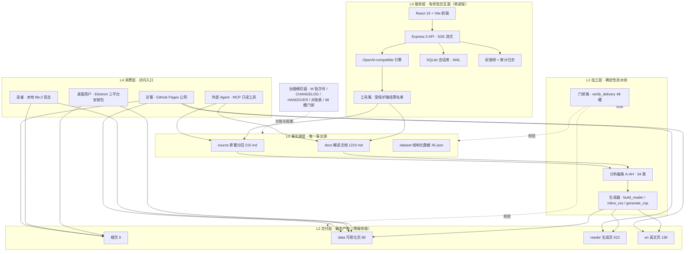
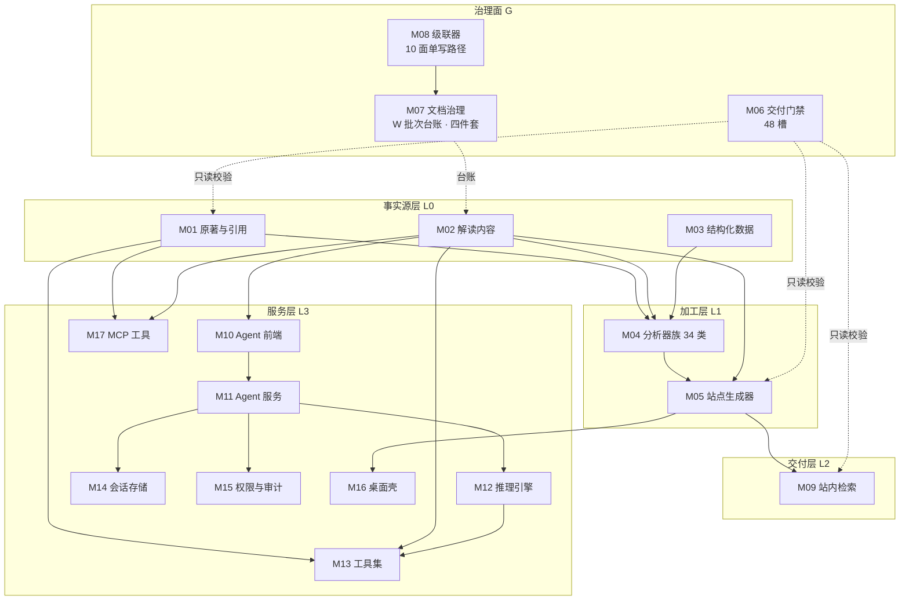
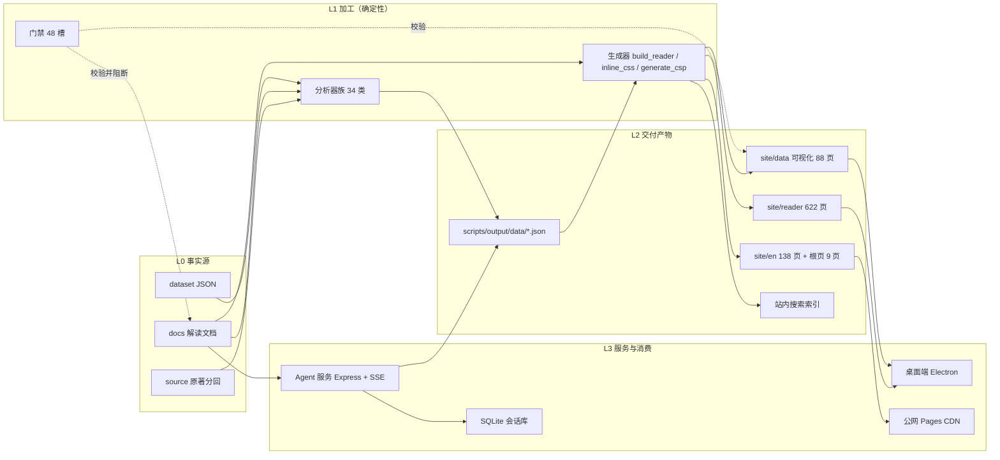
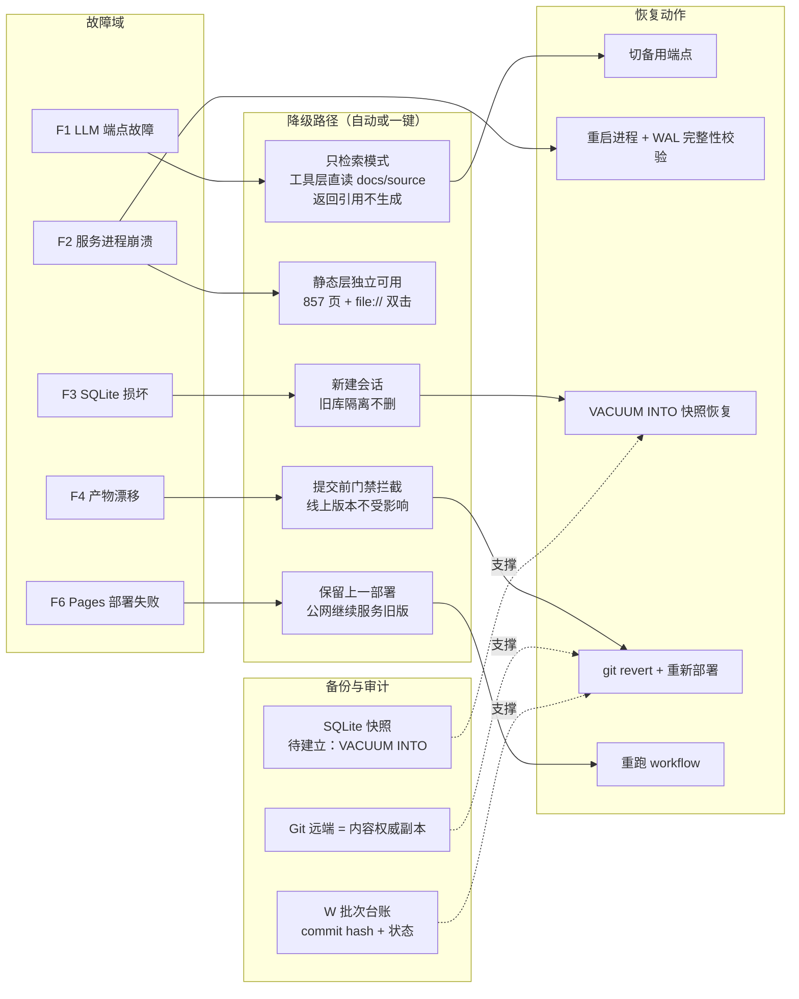
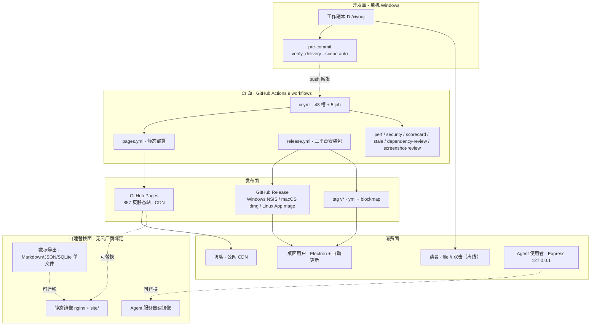

# 系统架构方案（分层 · 模块 · 数据流 · 存储 · 扩展 · 容灾 · 部署 · 监控）

> **版本**：W820（撰写时现役批次 W818 在途、W819 在途；版本号语义为发布批次编号，不适用 SemVer，现役值以 [CHANGELOG.md](../../../CHANGELOG.md) 顶段为准）
> **日期**：2026-10-20
> **来源**：用户令「帮我设计一套系统架构方案：整体分层、模块拆分与依赖、数据流与存储选型、扩展性与容灾、部署与监控都写到位，附几张架构图说明图」，并经四项确认（业务场景与规模 = 基于当前仓库 xiyouji / 技术栈 = 沿用现有栈 / 硬约束 = 极低成本且无云厂商绑定 + 合规审计可回滚可溯源 / 交付形态 = Markdown 方案文档 + Mermaid 架构图落盘 `docs/11-方案报告/`）
> **状态**：方案定稿；本批为**只读盘点 + 新增文档 + 一份级联 spec**，未改 `site/` 任何页面、未改 `xiyouji-agent-web/` 代码、未改管控脚本（`scripts/verify_delivery.py` 等按 [文档规范 §11.2](../../00-导读/文档规范.md) 禁擅改）、未改 `archive/**`
> **读者**：项目维护者 / 后续 Agent / 架构决策者（默认无对话上下文，可独立执行与复算）
> **轨标**：教学讲解
> **生成来源**：人工撰写
> **生成模型**：MiniMax M3.1（本地 Agent 会话 2026-10-20）
> **生成日期**：2026-10-20
> **核验状态**：已核验（全部现状计数、体积、模块数取自 2026-10-20 当盘实跑；复算命令见 [附录 A](#附录-a复算命令与证据索引)）

---

## 目录

1. [执行摘要（先给答案）](#1-执行摘要先给答案)
2. [范围、约束与处理声明](#2-范围约束与处理声明)
3. [现状盘点（2026-10-20 实测）](#3-现状盘点2026-10-20-实测)
4. [目标架构：整体分层](#4-目标架构整体分层)
5. [模块拆分与依赖](#5-模块拆分与依赖)
6. [数据流](#6-数据流)
7. [存储选型](#7-存储选型)
8. [扩展性](#8-扩展性)
9. [容灾与降级](#9-容灾与降级)
10. [部署](#10-部署)
11. [监控与可观测](#11-监控与可观测)
12. [风险登记与未决项](#12-风险登记与未决项)
13. [验收标准](#13-验收标准)
14. [附录 A 复算命令与证据索引](#附录-a复算命令与证据索引)

---

## 1. 执行摘要（先给答案）

### 1.1 一句话架构

**本项目是「一源多形」系统：L0 事实源（Markdown + JSON）单向流经 L1 确定性加工层，产出 L2 零服务端静态站；L3 有状态服务层（Web Agent / 桌面端 / MCP）挂在 L0 与 L2 之上做交互与问答；治理面（48 槽门禁 + W 批次号 + 四件套文档）作为横切面贯穿 L0–L3，把「不可回归」变成机器可判的断言。**

### 1.2 五条关键裁定

| # | 裁定 | 一句话理由 |
|:--|:---|:---|
| 1 | **依赖单向向下，产物不得反向成为事实源** | `site/` 与 `dataset/` 是产物；`docs/` 与 `source/` 是事实源。产物回写事实源即引入漂移源，门禁无法收敛 |
| 2 | **存储沿用「Git 文件树 + JSON + 单文件 SQLite」三件套，不引入外部数据库/缓存/对象存储** | 当前 DAU 百级、站点零服务端；引入 Postgres/Redis 即需常驻服务，与「极低成本 + 无云厂商绑定」硬约束直接冲突 |
| 3 | **扩展走「三档触发式演进」，不预先建设** | 每档以量化门槛（DAU、页体积、语料量、门禁时长）为开关，未触发的档位不写代码 |
| 4 | **容灾的主战场是「降级可用」而非「备份恢复」** | 静态站与文档本就可离线可用；真正需要保障的是问答链路降级为「只检索」与产物漂移的回滚 |
| 5 | **监控即门禁**：零付费前提下，把可观测性做进 48 槽门禁与 CI 5 个 job | 付费 APM/SaaS 与「极低成本」冲突；门禁产出已是结构化报告，且有失败即阻断的强制力 |

### 1.3 明确不做（避免范围蔓延）

- 不引入 Kubernetes、消息队列、微服务拆分 —— 当前单进程可承载，拆分只增加部署面与故障面。
- 不引入 Redis / Elasticsearch / 向量数据库 —— 无热点缓存需求，615 篇语料用「关键词检索 + 分层路由」足够（升级触发条件见 §7.2、§8.2）。
- 不做全站前端框架化 —— 与 [W818 选型批结论](静态站前端框架化选型对比-2026-10-20.md) 一致：维持现役原生管线，新页局部构建化。
- 不把 SQLite 升为服务端数据库 —— 未触发 §8.2 档 2 的量化门槛。
- 不改 `site/` 页面与 `xiyouji-agent-web/` 代码 —— 本批是方案批，不是施工批。

---

## 2. 范围、约束与处理声明

### 2.1 本方案解决什么

| 问题 | 本方案的回答 | 落点 |
|:---|:---|:---|
| 整体怎么分层 | L0 事实源 / L1 加工 / L2 交付 / L3 服务 / L4 消费 五层 + 治理横切面，依赖单向向下 | §4 |
| 模块怎么拆、依赖怎么管 | 17 个模块的职责与依赖矩阵 + 6 条禁止形态 | §5 |
| 数据怎么流 | 三条主链路（内容生产 / 交付发布 / 问答交互）+ 一条治理审计链路 | §6 |
| 存储选什么 | 8 个候选逐项裁定，每项给出「升级触发条件」 | §7 |
| 怎么扩展 | 三档路线，每档带量化开关；8 个容量阈值 | §8 |
| 出了事怎么办 | 8 个故障域的降级矩阵，逐条给 RTO / RPO / 演练方式 | §9 |
| 怎么部署 | 4 条交付通道 + 发布流水线 + 回滚路径 | §10 |
| 怎么监控 | 4 层观测面 + 14 条指标与阈值 + SLO + 零付费告警路径 | §11 |

### 2.2 硬性约束（用户确认项 + 仓内铁律）

**用户已确认的三项**：

1. **业务场景与规模**：基于当前仓库 xiyouji —— 文档真源 → 静态站点 → 可视化 → Web Agent 问答 + 桌面端；DAU 百级、内容千级、单机可承载。
2. **技术栈**：沿用现有栈（静态 HTML/CSS/JS + D3/Three、React 19 + Vite + TS + Express 5 + better-sqlite3、Python 工具链、GitHub Actions/Pages）。
3. **硬约束**：① 极低成本且无云厂商绑定（不买云托管服务、不上 K8s，用 GitHub Actions/Pages + 可自建镜像）；② 合规审计（全量留痕、可回滚、可溯源到发布批次 W###）。

**处理声明（两处，需显式记录）**：

- **`file://` 直开 + 零外域依赖**：用户未把该项列入本次四项确认的勾选范围，但它是 [AGENTS.md §6-5](../../../AGENTS.md) 第 5 条仓内铁律。本方案按**一票否决**处理：任何架构提议若破坏「双击即开、零外域依赖」，一律不采纳；§8、§9、§10 的所有设计均在该约束内成立。
- **性能硬指标**：用户未单列，本方案默认写入 SLO（§11.5）：首屏 < 1.5 s、可视化稳定 60 fps、问答首 token < 2 s。

### 2.3 与既有批次的关系（避免重复论证与冲突）

| 批次 | 主题 | 与本方案的关系 |
|:---|:---|:---|
| W818 | 静态站前端框架化五维选型 | **本方案不重复其论证**，§8.2 演进路线直接承接其「不做全面框架化 + 新页局部构建化」结论，并在 §5.2 依赖规则中补上「产物不得回写事实源」一条 |
| W816 / W817 | 门禁判据可信化、工具层边界加固 | §5.4 的禁止形态第 3、4 条直接引用这两批的实证教训（门禁自建即自曝、cwd 锚定可绕） |
| W819 | 界面视觉重设计 | 与本批无共享面冲突（新增文件 vs 共享面登记），两份报告在 `docs/11-方案报告/` 并列 |

---

## 3. 现状盘点（2026-10-20 实测）

### 3.1 资产规模表

**规模口径**：`scripts/stats.py` 磁盘实算（`scripts/output/stats.json`，实体化 tracked 文件）。

| 指标 | 现值 | 键名 | 归属层 |
|:---|---:|:---|:---|
| 全站 HTML 页 | 857<!--stats:html_total--> 页 | `html_total` | L2 |
| ├ 可视化页（不含模板壳） | 87<!--stats:visualization_pages--> 页 | `visualization_pages` | L2 |
| ├ `site/data/` 数据页 | 88<!--stats:site_data_html--> 页 | `site_data_html` | L2 |
| ├ `site/reader/` 生成页 | 622<!--stats:site_reader_html--> 页 | `site_reader_html` | L2 |
| ├ `site/en/` 英文页 | 138<!--stats:site_en_html--> 页 | `site_en_html` | L2 |
| └ `site/` 根页 | 9<!--stats:site_root_html--> 页 | `site_root_html` | L2 |
| 内联 CSS 覆盖页 | 330<!--stats:inline_css_pages--> 页 | `inline_css_pages` | L2 |
| CSP 覆盖页 | 856<!--stats:csp_covered--> 页 | `csp_covered` | L2 |
| A1–A6 内容文档 | 615<!--stats:a1_a6_docs--> 篇 | `a1_a6_docs` | L0 |
| A4 主题专题 | 209<!--stats:a4_docs--> 篇 | `a4_docs` | L0 |
| 分析脚本类 | 34<!--stats:script_classes--> 类 | `script_classes` | L1 |
| 交付门禁槽 | 49<!--stats:gate_count--> 槽 | `gate_count` | 治理面 |
| 报告类文档 | 56<!--stats:report_docs--> 篇 | `report_docs` | 治理面 |

**结构规模口径**：本次实跑（PowerShell 递归计数，含未跟踪文件）：

| 目录 | 计数 | 说明 |
|:---|---:|:---|
| `docs/**/*.md` | 1,210 | 全部 Markdown 文档（含 `10-方法论沉淀`、`11-方案报告`、`superpowers` 等） |
| `site/**/*.html` | 857 | 与 `stats.json` 的 `html_total` 一致 |
| `site/**/*.js` | 16 | 含本地化的 `d3.v7.min.js`、`three.r128.min.js`、`text-search-app.js` |
| `site/**/*.css` | 2 | `tokens.css` + `system.css`（设计令牌与组件层唯一源） |
| `scripts/**/*.py` | 348 | 分析器、生成器、门禁、工具链 |
| `scripts/**/*.js` | 1,370 | 含 `site/scripts/` 下的浏览器侧脚本与 E2E |
| `tests/**/*.py` | 38 | pytest 单元与集成用例 |
| `.github/workflows/*.yml` | 9 | CI / Pages / Release / perf / security / scorecard / stale / dependency-review / screenshot-review |
| `dataset/*.json` | 45 | 结构化数据（可视化与 API 数据源） |
| `source/**/*.md` | 215 | 原著分回文本与引用索引 |

**一致性交叉核验**：`site/**/*.html` 实测 857 与 `stats.json` 的 `html_total` 857 相等，两条独立路径同值。

### 3.2 运行形态与边界

| 形态 | 入口 | 有状态 | 出网 | 规模依据 |
|:---|:---|:---|:---|:---|
| 公网站点 | GitHub Pages（`pages.yml`） | 无 | 只出读 | CDN 承接，站点无服务端逻辑 |
| 本地离线站 | `file://` 双击 `site/index.html` | 无 | 零外域 | 88 页含 EMBEDDED 回退，fetch 失败仍渲染 |
| 桌面端 | Electron（`xiyouji-desktop/`） | 有（本地 127.0.0.1 随机端口静态服务） | 仅更新检查 | 三平台安装包 + `electron-updater` 自动更新 |
| Web Agent | Express 5 + React 19（`xiyouji-agent-web/`） | 有（SQLite 会话/消息/反馈） | 调 LLM 端点 | 仅绑定回环地址 `127.0.0.1`，默认不暴露局域网/公网 |
| MCP 工具 | `mcp-server/xiyouji_mcp.py` | 无 | 无 | 只读工具（标注 READONLY） |

### 3.3 现状能力与缺口矩阵

| 能力面 | 现役状态 | 缺口 | 本方案对应落点 |
|:---|:---|:---|:---|
| 内容真源 | ✅ `docs/` + `source/` 单一事实源 | 无 | §4 L0 |
| 加工可重跑 | ✅ 34 类分析器 + 生成器，幂等 | `scripts/output/data/*.json` 被 gitignore → **fresh clone 必挂**（W726 实证） | §7.2 存储裁定 + §11.4 巡检 |
| 交付零服务端 | ✅ 静态站 + `file://` 回退 | 无 | §4 L2 |
| 交付门禁 | ✅ 48 槽 + 5 个 CI job | 本地绿 ≠ CI 绿的历史分裂（W700 教训） | §11.1 |
| 交互问答 | ✅ SSE 流式 + 工具集 + 权限四模式 | LLM 端点单点；无降级路径 | §9.2 降级矩阵 |
| 会话存储 | ✅ SQLite（WAL）+ 三表 | 明文存储，未加密；无备份机制 | §7.3 生命周期 + §9.2 |
| 审计留痕 | ✅ `audit.ts` + W 批次号 + 四件套文档 | 审计与发布批次未统一到一条时间轴 | §9.5 |
| 监控告警 | ✅ 门禁即报告 | 无「统一观测面」与 SLO 文档 | §11 |
| 水平扩展 | ✅ 静态层天然横向（CDN） | 服务层无横向能力（未触发门槛） | §8.2 |

---

## 4. 目标架构：整体分层

### 4.1 分层定义与职责

| 层 | 名称 | 职责 | 唯一产出 | 失败语义 |
|:--|:---|:---|:---|:---|
| **L0** | 事实源层 | 承载「人可读的真」：原著分回、解读文档、结构化数据集 | `source/` `docs/` `dataset/` | 内容不完整 → 下游全部降级，不得掩盖 |
| **L1** | 加工层 | 确定性变换：分析抽取、渲染生成、门禁校验 | `scripts/output/data/*.json`、`site/data/*.html`、门禁报告 | 变换失败 → 产物不更新，旧产物继续服务 |
| **L2** | 交付层 | 零服务端静态产物，供人直接消费 | `site/`（857 页） | 产物缺失 → 回退上一部署版本 |
| **L3** | 服务层 | 有状态交互：会话、流式、工具、权限 | SQLite 会话库 + SSE 流 | 进程崩溃 → 静态层零影响，问答不可用 |
| **L4** | 消费层 | 谁在用、用什么协议 | — | — |
| **G** | 治理横切面 | 把「不可回归」变成机器断言 | 门禁报告、W 批次台账、四件套文档 | 门禁红 → 提交被拒（pre-commit）+ CI 阻断 |

### 4.2 分层图（图 1）



### 4.3 层间依赖规则（六条铁律）

1. **依赖单向向下**：允许 L4→L3、L3→L0、L1→L0；禁止 L0→L1、L0→L2、L1→L2 的**反向读取**（L1 的产物写回 L0 的内容）。
2. **产物不得反向成为事实源**：`site/` 与 `dataset/` 的内容不得被 `docs/` 当作权威引用；`docs/` 的引用只能指向 `source/`。引用真实性由门禁第 20 槽（原著引文硬验证）机器校验。
3. **数据生成只能向上游追溯**：`site/data/*.html` 中的 `EMBEDDED_DATA` 只能来自 `scripts/output/data/*.json`，后者只能由分析器从 `docs/` + `source/` 派生。
4. **治理面只读事实、不读产物判定**：`verify_delivery.py` 的判据可以读取 `site/`（它是被检对象），但**不得**用 `site/` 的派生值反推 `docs/` 的正确性。
5. **服务层不得直接触达交付层**：`xiyouji-agent-web/` 只能读 `docs/`、`source/` 与受限工具面，不得把 `site/` HTML 当作数据源解析（那会把展示层耦合进数据层）。
6. **横切面只在 L0 与 L1 之下生效**：治理面可拦截任何层的写入（pre-commit 拦截 L0–L2），但不得成为任何层的运行时依赖（站点页面不依赖门禁脚本运行）。

### 4.4 现状 → 目标映射

| 目标层 | 现役对应物 | 差距 | 是否本批施工 |
|:---|:---|:---|:---|
| L0 | `source/` `docs/` `dataset/` | 已成形 | 否 |
| L1 | `scripts/` 348 py + 1,370 js | 已成形 | 否 |
| L2 | `site/` 857 页 | 已成形 | 否 |
| L3 | `xiyouji-agent-web/` + `xiyouji-desktop/` + `mcp-server/` | 已成形 | 否 |
| G | `scripts/verify_delivery.py` 48 槽 + 9 个 workflow + W 批次台账 | 已成形 | 否 |

**结论**：本仓的目标架构不是「待建蓝图」，而是「**把已成形的隐式结构显式化**」。本方案的价值在于把依赖方向、降级路径、存储触发条件写成可执行断言，而不是引入新组件。这是「极低成本」约束下的正解 —— **架构升级 = 规则升级，不是组件升级**。

---

## 5. 模块拆分与依赖

### 5.1 模块清单

| 模块 | 层 | 职责 | 技术/位置 | 依赖（上游） | 主要产物 |
|:---|:--:|:---|:---|:---|:---|
| M01 原著与引用 | L0 | 原著分回文本、学术论文索引、引用网络解读 | `source/`（215 md） | 无 | 引用池 |
| M02 解读内容 | L0 | A1–A6 六板块文档、导读与规范 | `docs/`（1,210 md） | M01 | 文档真源 |
| M03 结构化数据 | L0 | 章节/人物/主题/难序等数据集 | `dataset/`（45 json） | M02 | JSON 数据源 |
| M04 分析器族 | L1 | A–AH 34 类分析（词频/共现/情感/术语/难序…） | `scripts/[A-Z]_*` | M01 M02 M03 | `scripts/output/data/*.json` |
| M05 站点生成器 | L1 | `build_reader.py` / `inline_css.py` / `generate_csp.py` | `scripts/` | M02 M04 | `site/**` 857 页 |
| M06 交付门禁 | L1 | 48 槽内容/结构/数据/编号/质量校验 | `scripts/verify_delivery.py` + 34 个 `check_*.py` | M01–M05（只读） | 门禁报告（exit code） |
| M07 文档治理 | G | W 批次号、对账台账、CHANGELOG/HANDOVER 四件套 | `docs/00-导读/W批次编号对账表.md` 等 | M02（只读） | 台账与交接文档 |
| M08 级联器 | G | 按 spec 单写路径改写 10 个治理面 | `scripts/batch_cascade.py` | M07 | 级联后的治理面文件 |
| M09 站点检索 | L2 | 站内搜索（构建期索引 + 客户端检索） | `site/static/js/text-search-app.js` | M05 | 搜索索引 |
| M10 Agent 前端 | L3 | React 19 + Vite 会话界面 | `xiyouji-agent-web/src/` | M02（内容约定） | 前端 bundle |
| M11 Agent 服务 | L3 | Express 5 API、SSE、路由、错误处理 | `xiyouji-agent-web/server/`（14 实现模块） | M10 M12 M14 | HTTP + SSE 响应 |
| M12 推理引擎 | L3 | OpenAI-compatible 端点适配、Agent 循环 | `server/engine/`（4 模块 + 2 mjs） | M11 M13 | 模型响应流 |
| M13 工具集 | L3 | 受保护路径黑名单下的仓库读写 | `server/engine/tools.ts` | M12 | 工具执行结果 |
| M14 会话存储 | L3 | SQLite（WAL）三表：sessions / messages / feedback | `server/db.ts` | M11 | `data/chat.db` |
| M15 权限与审计 | L3 | 权限四模式桥、挂起表、结构化审计日志 | `server/permissions.ts` `server/audit.ts` `server/logger.ts` | M11 M14 | 审计事件 |
| M16 桌面壳 | L3 | Electron 主进程、本地静态服务、更新器、崩溃日志 | `xiyouji-desktop/src/` | M05 | 三平台安装包 |
| M17 MCP 工具 | L3 | 只读校验工具（spotcheck / data_validate 等） | `mcp-server/xiyouji_mcp.py` | M01–M06（只读） | 校验结论 |

### 5.2 依赖矩阵（行 = 调用方，列 = 被调方；● = 直接依赖，○ = 契约级/间接）

| | M01 | M02 | M03 | M04 | M05 | M06 | M07 | M08 | M09 | M10 | M11 | M12 | M13 | M14 | M15 | M16 | M17 |
|:---|:--:|:--:|:--:|:--:|:--:|:--:|:--:|:--:|:--:|:--:|:--:|:--:|:--:|:--:|:--:|:--:|:--:|
| **M04 分析器** | ● | ● | ● | | | | | | | | | | | | | |
| **M05 生成器** | | ● | | ● | | | | | | | | | | | | |
| **M06 门禁** | ● | ● | ● | ● | ● | | | | | | | | | | | |
| **M08 级联器** | | ● | | | | | ● | | | | | | | | | | |
| **M09 检索** | | | | | | | | | | | | | | | | | |
| **M11 服务** | | ● | | | | | | | | | ● | ● | | ● | ● | | |
| **M12 引擎** | | | | | | | | | | | | | | ● | | | | |
| **M13 工具集** | ● | ● | | | | | | | | | | | | | | | | |
| **M16 桌面壳** | | | | | ● | | | | | | | | | | | | | |
| **M17 MCP** | ● | ● | ● | | | ● | | | | | | | | | | | |

**读法**（矩阵只登记「跨模块直接调用」）：① 矩阵上三角为空是刻意的 —— 它编码了「上层依赖下层」的方向性；② `M06 门禁` 是唯一横跨 L0–L2 的模块，因为它校验全链；③ `M11 服务` 同时依赖 M14/M15（存储与审计），但 M14/M15 **不反向依赖** M11 的业务语义（表结构不写死业务规则）。

### 5.3 依赖图（图 2）



### 5.4 禁止的依赖形态（六条，各附实证教训）

| # | 禁止形态 | 后果 | 实证教训 |
|:--|:---|:---|:---|
| 1 | `docs/` 引用 `site/` 或 `dataset/` 的派生值作为权威 | 展示层/派生层反向污染事实源，漂移不可收敛 | §4.3 铁律 2 |
| 2 | 手工改 `site/data/*.html` 的 `EMBEDDED_DATA` | 下次生成器运行即被覆盖，且改动不留痕 | 单页双源 |
| 3 | 门禁判据与被检对象同源（脚本自己生成数据再校验自己） | 门禁自建即自曝，形同虚设 | W760 实证「门禁自建即自曝」三例 |
| 4 | 受保护路径判据假定 cwd = 仓库根 | 换 cwd 即失配，黑名单可绕 | W817 实证五处同源绕过 |
| 5 | CI 依赖本地产物（`scripts/output/data/*.json` 被 gitignore） | fresh clone 必挂，本地绿 CI 红 | W726 实证 `make data-validate` 空目录 rc=1 |
| 6 | 服务层把 `site/` HTML 当数据源解析 | 展示层耦合进数据层，样式改动引发数据回归 | 本方案新增判定 |

### 5.5 契约（跨模块的稳定约定）

| 契约 | 定义 | 守护者 |
|:---|:---|:---|
| C-1 内容契约 | 文档元信息块 v2（生成来源/模型/日期/核验状态四字段） | 门禁第 18 槽 `check_frontmatter.py` |
| C-2 引文契约 | 引文须可回溯到原著语料，命中率 100% | 门禁第 20 槽 `check_citations.py` |
| C-3 数据契约 | `EMBEDDED_DATA` ↔ `scripts/output/data/*.json` 逐值相等 | 门禁第 39/43 槽 |
| C-4 样式契约 | 设计令牌 `tokens.css` + 组件层 `system.css` 内联进各页 | 门禁第 15 槽 |
| C-5 脚本契约 | 内联脚本哈希与 CSP meta 一致 | `scripts/generate_csp.py --check` |
| C-6 协议契约 | SSE 事件名与数据形态、REST 路径/方法/状态码 | `server/sse.ts` + 集成测试 |
| C-7 批次契约 | CHANGELOG 现役段 W 号 ↔ 对账表认领行 ↔ 工作树状态 | 门禁第 31 槽 C4/C4-e/C4-f |
| C-8 口径契约 | 聚合数字以 `stats.json` 为准，文档用 `<!--stats:key-->` 实体标记 | 门禁第 31 槽 C5/C5b/C5d |

---

## 6. 数据流

### 6.1 三条主链路 + 一条治理链路

**链路①内容生产流（L0 → L1 → L2）**

```
source/ 原著分回 ─┐
docs/ 解读文档  ─┼→ 分析器族 34 类 → scripts/output/data/*.json → 生成器 → site/data/*.html（EMBEDDED 内嵌）
dataset/ 结构化 ─┘                                    └→ build_reader.py → site/reader/ 622 页
```

关键性质：**单向、确定性、可重跑**。同输入必得同产物（幂等），因此产物可随时丢弃重建 —— 这是 §9 容灾「产物不备份」的依据。

**链路②交付发布流（L0/L1 → 公网）**

```
git push → CI（48 槽门禁 + 5 job：pages-smoke / lighthouse / a11y-audit / dependency-scan / code-quality）
        → pages.yml → GitHub Pages（原子部署，保留上一版本可回退）
        → tag v* → release.yml → 三平台安装包 + yml/blockmap → GitHub Release → 桌面端 electron-updater 拉取
```

**链路③问答交互流（L4 → L3 → L0）**

```
浏览器/桌面 → React → POST /api/chat（SSE）→ 引擎（OpenAI-compatible）→ 工具集（受限面读 docs/source）
            → 会话库 SQLite（sessions/messages/feedback）→ 审计事件 → 权限回执
```

**链路④治理审计流（G 横切）**

```
取号 → 认领行登记 → 施工 → spec → batch_cascade（10 面单写路径）→ 门禁复跑 → 提交（显式 pathspec）
     → 对账表回填 commit hash 与状态 → CHANGELOG/HANDOVER/file-index 对账
```

### 6.2 数据流图（图 3）



### 6.3 数据契约与单一事实源

| 数据 | 唯一事实源 | 派生副本 | 同步机制 |
|:---|:---|:---|:---|
| 章节/人物/主题数据 | `dataset/*.json` | `site/data/*.html` 的 `EMBEDDED_DATA` | 门禁第 39/43 槽逐值对拍 |
| 页面样式 | `site/tokens.css` + `site/system.css` | 各页内联 `<style>` | `scripts/inline_css.py` + 门禁第 15 槽 |
| 内联脚本哈希 | 页面脚本本体 | 各页 CSP meta | `scripts/generate_csp.py --check`（0 漂移） |
| 聚合数字 | `scripts/output/stats.json`（磁盘实算） | 各文档 `<!--stats:key-->` 标记 | `scripts/stats.py --w <批号>` 刷新 + 门禁第 31 槽 C5/C5d |
| 会话数据 | `xiyouji-agent-web/data/chat.db` | 无副本 | SQLite WAL，进程内唯一写入者 |
| 审计事件 | `server/audit.ts` 写库 + 会话记录 | 无副本 | 与批次号共同构成审计时间轴 |
| 批次台账 | `docs/00-导读/W批次编号对账表.md` | CHANGELOG / HANDOVER / file-index | `scripts/batch_cascade.py` 单写路径 |

### 6.4 增量与缓存策略（现役判定）

| 问题 | 现役答案 | 依据 |
|:---|:---|:---|
| 站点是否需要缓存层 | **不需要**。静态资源由 Pages CDN 承接；`file://` 场景无网络 | 站点无服务端逻辑 |
| 分析结果是否缓存 | **不缓存**，每次实跑重算 | 数据规模小（615 篇），分析耗时秒级；缓存会带来「缓存与真源不一致」的新失效面 |
| 产物 JSON 是否入库 | **不入库**（`scripts/output/data/*.json` 被 gitignore），靠生成器重建 | 可重建产物入库会制造第二事实源；**代价**：fresh clone 必须先跑生成命令，否则 `make data-validate` 必挂（W726 实证）→ 对策见 §11.4 巡检第 1 条 |
| 会话是否缓存 | **不缓存**，SQLite 本身即本地存储 | — |

---

## 7. 存储选型

### 7.1 候选与裁定

| # | 候选 | 现役是否在用 | 裁定 | 理由 | 升级触发条件（量化） |
|:--:|:---|:--:|:---|:---|:---|
| S1 | **Git 文件树**（`docs/` `source/` `site/` `scripts/`） | ✅ | **采纳为唯一内容存储** | 可 diff、可回滚、可审计、零运维、无供应商锁定；内容与代码同仓使「发布批次」成为原子单位 | 不适用（已采纳） |
| S2 | **JSON 数据集**（`dataset/` + `scripts/output/data/`） | ✅ | **采纳为中间层** | 无服务依赖、可 diff、可单测；派生层与真源层物理分离 | 不适用（已采纳） |
| S3 | **SQLite**（`better-sqlite3`，WAL） | ✅ | **采纳为运行态存储** | 单文件、零运维、可 `file` 拷贝备份；会话量级（百级活跃）远未达需服务型 DB 的门槛 | 改用 Postgres 的触发条件见 §8.2 档 2 |
| S4 | 对象存储（S3 / R2 / MinIO） | ❌ | **不采纳** | 静态产物已有 Pages CDN 承载；引入即产生出网费用与供应商绑定 | 需要存放 > 5 GB 原始媒体且需跨区访问时再评估 |
| S5 | 关系库（Postgres / MySQL） | ❌ | **不采纳** | 当前无跨进程写入、无多租户隔离需求；引入需常驻服务 + 备份运维，与「极低成本 + 无云厂商绑定」冲突 | DAU > 5,000 或并发写会话 > 50 或需要多用户鉴权与租户隔离 |
| S6 | 缓存（Redis / Memcached） | ❌ | **不采纳** | 无热点键、无会话粘性需求；站点与工具集均为本地/本地磁盘访问 | 单机 QPS > 1,000 且存在热点键（如同一大 JSON 被高频读） |
| S7 | 搜索引擎（Elasticsearch / Meilisearch） | ❌ | **不采纳** | 站内检索以构建期索引 + 客户端检索实现，615 篇规模无需常驻索引服务 | 语料 > 20,000 篇或需要跨字段模糊检索且客户端检索延迟 > 300 ms |
| S8 | 向量库（Qdrant / Chroma / Milvus） | ❌ | **不采纳（W844 已裁决）** | 仓内复算（现役索引 768 篇 · 100 题）：off 档 recall@5 = **0.573**，dense 档（bge-small-zh-v1.5 + 双路 RRF）= **0.712**，人工 30 题子集 0.382 → **0.446**。**旧论据「dense 仅 +0.003」作废**——那是在 T-01 冻结索引（1,077 篇）上测的，与现役索引面不可混用（详见 `scripts/rag/README.md` 复算记录）。维持不启用默认档的理由改为**成本与可移植性**：dense 需 numpy + sentence-transformers + 约 96 MB 模型 + 124 MB 向量产物（合计约 220 MB·均已 gitignore），离线/CI 不可复算，与「零依赖 + 可溯源」硬约束冲突 | 外部向量库维持不采纳（常驻服务 + 供应商绑定）；**Q5 已裁决（W848）：dense 升为显式可选档，默认仍 off**——增益真实（现役 100 题 0.573→0.712·人工题 +0.06·标题派生题 +0.17），适用边界与代价写进 `scripts/rag/README.md` 的裁决段 |

### 7.2 存储裁定说明（三条关键论证）

1. **为什么 Git 文件树足够**：本系统的内容是「文本 + 关系 + 时间」，Git 提供版本、时间轴、作者与回滚四件事，且这三者恰好就是合规审计要求的（可溯源到批次 W###、可回滚、可留痕）。引入数据库存储内容反而会丢掉这四件事。
2. **为什么 SQLite 够用且不升级**：会话表三张（`sessions` / `messages` / `feedback`），单文件、进程内唯一写入者、无跨进程并发写。WAL 模式已开。**并发写的上限场景是「多人共用一台机器」**，这与本项目「单机自用 + 公网站点」形态不符 —— 触发点在 §8.2 档 2，而不是「感觉以后会用」。
3. **为什么不预先做缓存**：静态站 + 本地 SQLite 的读路径都不经过网络，加缓存层只会新增「缓存与真源不一致」这一类失效，而当前无一处热点。

### 7.3 会话数据生命周期（合规要点）

| 阶段 | 机制 | 现状 |
|:---|:---|:---|
| 写入 | 进程内唯一写入者，WAL 模式，参数化 SQL | 已具备 |
| 存储 | 明文单文件 `data/chat.db`（含 `-wal` / `-shm` 旁文件） | **未加密** —— 合规待办见 §12 R4 |
| 备份 | 文件级拷贝（须停进程或用 `VACUUM INTO` 快照，避免只拷主文件丢 WAL） | **无自动备份**，属 §9 演练缺口 |
| 保留 | 无自动清理；会话随用户手动删除 | 无保留期策略 |
| 导出/迁移 | `sqlite3 .dump` 可全量导出为文本，无锁定 | 天然可迁移（无供应商锁定） |
| 删除 | 删 `data/chat.db` 即彻底删除 | 简单直接 |

**裁定**：会话库按「本地明文单文件」管理，**但必须补两条**（列入 §12 未决项）：① 备份必须用 `VACUUM INTO` 快照（不能只拷主文件）；② 明确保留期（如 90 天）以限制明文暴露窗口。

### 7.4 存储演进路线（与 §8.2 同源，此处只讲数据侧）

```
S1+S2+S3（现状）
   │  触发：DAU > 5,000 或并发写会话 > 50
   ▼
S1+S2+S5（内容仍留 Git，会话迁 Postgres；引入 Redis 仅当出现热点键）
   │  触发：需要多租户隔离 / 跨机部署
   ▼
S1+S2+S5+S6(+S4 用于原始媒体)
```

**任何一档都保留 S1**：内容真源永不因规模迁出 Git —— 这是审计与可回滚的底线。

---

## 8. 扩展性

### 8.1 容量模型与瓶颈预测

| 维度 | 现值 | 增长驱动 | 首个瓶颈（预测） | 预测依据 |
|:---|---:|:---|:---|:---|
| 站点页数 | 857 页 | 每批新增 1–3 页 | **构建与 CI 时长**（pages-smoke 全页 HTTP 200 + lighthouse 跑全站） | 页数线性增长，CI job 时长随之线性增长 |
| 站点体积 | 47.05 MB | 每批 +0.1–0.3 MB | 单页体积（`site/data` 均值 107.9 KB，最大 373 KB） | 大单页拉高首屏时间与 Pages 传输 |
| 内容文档 | 615 篇（A1–A6） | 每批 +1–5 篇 | 检索索引体积（`text-search-app.js` 已 2.18 MB） | 索引随语料线性增长并内联进站点 |
| 门禁耗时 | 48 槽全量 | 随内容与页数增长 | **门禁执行时长**（本地绿 ≠ CI 绿的历史分裂根源） | 48 槽 × 全量扫描 |
| 仓库体积 | `.git` 7,921 个对象文件 | 每批提交 | 仓库膨胀 → `git gc` 成本与克隆成本 | 已有 `release.py` 的 1 GB 告警 |
| 会话量 | SQLite 单文件 | 长期累积 | 无（百级活跃远未触顶） | WAL + 单文件 |

### 8.2 三档演进路线（每档带量化开关）

| 档位 | 触发条件（满足任一即进入） | 动作 | 不做的事 |
|:--:|:---|:---|:---|
| **档 0：维持现役** | 当前状态 | 维持静态站 + 本地服务 + 单文件 SQLite；每批走门禁 | 不引入任何新组件 |
| **档 1：局部构建化** | 新建可视化页 ≥ 3 个且均需组件化 | 新页可走 Vite + TypeScript + `vite-plugin-singlefile`（内联后仍须 `file://` 可用）；**存量 87 页不迁** | 不迁存量页、不引入框架运行时 |
| **档 2：服务化** | DAU > 5,000 **或** 并发写会话 > 50 **或** 需要多租户隔离 | 会话迁 Postgres；按需引入 Redis（仅当出现热点键）；静态层仍走 CDN | 不拆微服务、不上 K8s |
| **档 3：规模化** | DAU > 50,000 **或** 需要跨地域部署 | 服务层多副本 + 对象存储 + 独立检索服务 | 不改变 S1 内容真源 |

> **档 2 的「多租户隔离」触发条件细化（W844 · Q3 裁决回填）**：不预加字段（YAGNI），但触发条件写死为**任一条命中即实施**——
> ① 出现**第 2 个**真实使用者需要各自的会话视图；
> ② 需按用户执行**导出 / 删除**（合规删除权）；
> ③ 会话数 > **5,000**（此时无归属列的历史数据治理成本开始高于加字段成本）。
>
> **代价清单（提前记账，避免将来推诿成「顺手加个字段」）**：迁移脚本 + `sessions`/`messages`/`feedback` **三表改 schema** +
> 会话查询路径全部加 `WHERE` + **老会话归属规则**（历史数据归谁，须业务裁定）+ 审计事件加租户维度 +
> 单测 + 门禁 schema 断言更新 ≈ **1 批工作量**。不预加的理由：加字段会污染现役 schema，且老数据归属未定前加列等于留一堆 NULL。

### 8.3 容量阈值（触发评审的量化线）

| 指标 | 阈值 | 触发动作 |
|:---|---:|:---|
| 单页 HTML 体积 | > 200 KB | 拆包评审（不得直接引入框架运行时，见档 1） |
| 单页内联 CSS | > 60 KB | 抽离评审（须保证 `file://` 仍可开） |
| 全站体积 | > 120 MB | 资源分片评审 |
| 站内搜索脚本 | > 3 MB | 索引分片或改为按页加载 |
| 门禁全量耗时 | > 600 s | 引入按 scope 增量门禁（`verify_delivery.py --scope auto` 已是雏形） |
| 仓库体积 | > 1 GB | `git gc` + 归档复核（`scripts/release.py` 已有 1 GB 告警） |
| 单批提交文件数 | > 500 | 拆分批次（避免级联清单超长） |

### 8.4 预留扩展点（已存在的接口，不新增组件）

| 扩展点 | 位置 | 预留能力 | 触发条件 |
|:---|:---|:---|:---|
| 引擎端点适配 | `server/engine/openai-compat.ts` | 换模型/换供应商不改上层 | 立即可用 |
| 工具集策略 | `server/engine/tools.ts` + `server/permissions.ts` | 权限四模式与受保护路径可扩展 | 立即可用 |
| 双态数据加载 | `site/data/*.html` 的 `fetch` + `EMBEDDED` 回退 | http 模式可用实时数据，file 模式回退内嵌 | 立即可用 |
| 产出格式 | `scripts/output/*.json` + `scripts/index.md` | 新分析类目按目录约定接入 | 新增分析类时 |
| 发布通道 | `.github/workflows/pages.yml` / `release.yml` | 换托管方只需替换 workflow，产物格式不变 | 需要迁出 GitHub 时 |

---

## 9. 容灾与降级

### 9.1 故障域清单

| # | 故障域 | 影响面 | 现有防线 |
|:--:|:---|:---|:---|
| F1 | 上游 LLM 端点不可用/限流 | 问答链路全断 | 无（**待补**） |
| F2 | Agent 服务进程崩溃 | 问答不可用（静态层零影响） | `server/shutdown.ts` 优雅关闭；WAL 保护数据完整性 |
| F3 | SQLite 文件损坏 | 会话丢失 | WAL + 单文件拷贝；**无自动备份** |
| F4 | 产物漂移（生成器与源不一致） | 站点数据错误 | 门禁第 39/43 槽提交前阻断 + CI 全量复验 |
| F5 | Git 远端不可用 | 无法推送/CI | Git 分布式：本地继续开发，暂不发布 |
| F6 | Pages 部署失败 | 公网版本滞后 | Pages 部署原子性：保留上一版本继续服务 |
| F7 | CI 依赖/环境缺失 | 门禁无法执行 | `pip-audit`/Playwright 依赖登记；本地与 CI 双跑 |
| F8 | 本机磁盘故障 | 工作副本丢失 | 远端 Git 为权威副本；**本地未跟踪件丢失不可恢复** |

### 9.2 降级矩阵

| # | 故障 | 用户可见表现 | 降级路径 | RTO | RPO | 恢复动作 | 演练方式 |
|:--:|:---|:---|:---|:---:|:---:|:---|:---|
| F1 | LLM 端点故障 | 问答不可用，站点与文档照常 | **降级为「只检索」**：工具层直读 `docs/`/`source/` 返回引用，不生成 | ≤ 5 min（切备用端点或进入只检索模式） | 0 | 恢复端点后自动回到生成模式 | 断开 `LLM_API_BASE` 后请求，断言返回引用而非 5xx |
| F2 | Agent 进程崩溃 | 问答不可用 | 静态站与 `file://` 完全不受影响；重启进程即恢复 | ≤ 2 min | 0（已落库消息不丢） | 重启；`/api/ready` 探针转绿 | 强杀进程后重启，断言 WAL 内消息完整 |
| F3 | SQLite 损坏 | 会话不可读 | 降级为「新建会话」；旧库隔离不删 | ≤ 30 min | **≤ 24 h**（依赖备份，未建立前为「不可恢复」） | 用 `VACUUM INTO` 快照恢复 | 每月一次快照 + 恢复演练（§9.4） |
| F4 | 产物漂移 | 站点数据错误 | 门禁在**提交前**阻断，线上版本不受影响；若已发布则回退上一部署 | ≤ 30 min | 0（回退即恢复上一正确版本） | `git revert` + 重新部署 | 篡改一份 `EMBEDDED_DATA` 断言门禁变红 |
| F5 | Git 远端不可用 | 无法发布 | 本地继续开发与提交；发布推迟 | 依赖恢复 | 0（本地提交未推送部分保留） | 远端恢复后推送 | 断网提交 → 恢复后推送成功 |
| F6 | Pages 部署失败 | 公网版本滞后 | 上一版本继续在线（原子部署） | ≤ 30 min | 0 | 重跑 workflow | 触发一次失败部署，断言线上仍可访问 |
| F7 | CI 依赖缺失 | 门禁无法执行 | 本地门禁（`verify_delivery.py --scope auto`）先行拦截，**不得**以「CI 绿」替代 | ≤ 1 h | 0 | 修复依赖后补跑 | 断开依赖源跑一次，断言本地门禁仍红 |
| F8 | 本机磁盘故障 | 工作副本丢失 | 以远端 Git 重建；**未跟踪件不可恢复**（本地工地） | ≤ 2 h | 未跟踪件不可恢复 | `git clone` + 重建脚本环境 | 季度演练：克隆后跑通复算命令（附录 A） |

### 9.3 容灾拓扑图（图 4）



### 9.4 备份与恢复演练（RTO / RPO 的落地方式）

| 对象 | 备份方式 | 频率 | 保留 | 演练 | 目标 RTO / RPO |
|:---|:---|:---|:---|:---|:---:|
| 内容与代码（`docs/` `source/` `site/` `scripts/`） | Git 远端 | 每次推送 | 永久（历史可回溯） | 季度：`git clone` 后跑通附录 A 全量复算 | ≤ 2 h / 0 |
| 会话库（`chat.db`） | `VACUUM INTO` 快照 | **待建立**：建议每日 | 7 份滚动 | 每月：快照恢复到临时库并断言 `sessions`/`messages`/`feedback` 行数一致 | ≤ 30 min / ≤ 24 h |
| 分析中间产物（`scripts/output/data/*.json`） | **不备份** | — | — | — | 可重建，RTO 等于重建耗时（秒级） |
| 审计事件 | 随会话库存档 | 同会话库 | 同会话库 | 同上 | 同上 |
| 发布产物（Pages / Release） | 托管方保留上一版本 + Git tag | 每次发布 | 上一版本 | 每季度一次回退演练 | ≤ 30 min / 0 |

**关键裁定**：**只有「不可重建」的东西才需要备份**。本系统里不可重建的只有两件 —— 内容真源（已有 Git）与会话库（缺备份）。因此备份工作的全部重点是会话库这一项；其余靠「可重跑 + 可回退」解决。

### 9.5 审计与可回滚（合规硬约束的落地）

| 要求 | 落地机制 | 可验证判据 |
|:---|:---|:---|
| 全量留痕 | 每次发布一个 W 批次号，绑定：主题 / 关联 commit / CHANGELOG 版段 / 状态 / 认领会话 / touches | 对账表每行六列非空；门禁第 31 槽 C4 校验 |
| 可溯源到批次 | CHANGELOG 现役段 ↔ 对账表认领行 ↔ 工作树文件行 三方对账 | `check_doc_sync.py` C4 / C4-e / C4-f |
| 可回滚 | ① 内容层：`git revert <commit>` ② 站点层：Pages 回退上一部署 ③ 桌面端：`electron-updater` 拉上一版本 ④ 会话层：快照恢复 | 每条回滚路径各有演练项（§9.4） |
| 不可篡改历史 | CHANGELOG 历史段、归档件、门禁脚本受管控，改动须用户批准（文档规范 §11.2） | 门禁 + 人工审批双锁 |

---

## 10. 部署

### 10.1 部署拓扑图（图 5）



### 10.2 四条交付通道

| 通道 | 产物 | 触发 | 更新方式 | 离线可用 | 供应商依赖 |
|:---|:---|:---|:---|:--:|:---|
| ① 公网站点 | `site/` 857 页 | `main` 推送 → `pages.yml` | 原子部署，保留上一版 | 否 | GitHub Pages（可自建镜像替换） |
| ② 本地离线站 | `site/` 同源 | 无（工作副本直接双击） | 随仓库更新 | **是** | 无 |
| ③ 桌面端 | 三平台安装包 + `blockmap` | `tag v*` → `release.yml` | `electron-updater` 启动 3 s 后首检、此后每 4 h 复查 | 是（安装后本地运行） | GitHub Releases（可换源） |
| ④ Web Agent | Express + React 进程 | 本地 `npm run dev` / 打包 | 手动重启 | 是（除 LLM 端点） | **仅 LLM 端点**（引擎已做 OpenAI-compatible 适配，可换） |

### 10.3 发布流水线与回滚

```
① 本地提交前：pre-commit → verify_delivery.py --scope auto（分类档）→ 不通过则拒绝提交
② 推送后：CI 全量 48 槽 + 5 job（pages-smoke 全页 HTTP 200 / lighthouse / a11y-audit 双 OS 双 Python / pip-audit / ruff+black+mypy+内联 JS 语法）
③ main 推送 → pages.yml → Pages 原子部署（失败保留上一版）
④ tag v* → release.yml → 版本一致性闸门（tag 与 package.json 严格相等 + 从 CHANGELOG 首段提取内容批次）→ 三平台构建 → Release
⑤ 桌面端：electron-updater 拉 yml + blockmap → 进度回显 → 重启安装
```

**回滚路径（按影响面选）**：

| 情形 | 回滚动作 | 生效时间 | 数据影响 |
|:---|:---|:---|:---|
| 内容层错误 | `git revert <commit>` + 重跑 pages.yml | ≤ 30 min | 无（历史可回溯） |
| 站点层错误 | Pages 控制台回退到上一部署 | ≤ 10 min | 无 |
| 桌面端错误 | 发布新版本（旧用户保留旧版并收到升级提示） | 按用户升级节奏 | 无 |
| 会话层错误 | 快照恢复（§9.4） | ≤ 30 min | 丢失快照之后的消息 |

### 10.4 「无云厂商绑定」的可验证口径

| 维度 | 现状 | 迁移代价 |
|:---|:---|:---|
| 内容格式 | Markdown + JSON | 零成本迁移（纯文本） |
| 产物格式 | 静态 HTML + 内联 CSS/JS | 零成本迁移（任意静态服务器可托管） |
| 会话数据 | 单文件 SQLite | 低（`sqlite3 .dump` 全量导出为文本） |
| 构建工具 | Python 3.11+ / Node ≥ 20，均为开源工具链 | 低（无专有构建服务） |
| 托管 | GitHub Pages / Releases / Actions | 中（迁出需替换 3 个 workflow；产物格式不变，§8.4 已预留） |
| LLM | OpenAI-compatible 适配层 | 低（换 base URL + key） |
| 监控 | 门禁产出结构化报告 + CI artifact | 低（报告是文本/JSON） |

**结论**：真正的绑定点只有「托管方」与「LLM 供应商」两处，二者均有已验证的替换路径；内容与数据格式全部开放。

---

## 11. 监控与可观测

### 11.1 四层观测面

| 层 | 观测什么 | 现役载体 | 失败后果 |
|:--|:---|:---|:---|
| ① 代码层 | 静态质量与类型 | `ruff` / `black` / `mypy` / `tsc` / 内联 JS 语法检查 | 提交被拒 |
| ② 交付层 | 内容与结构契约 | `verify_delivery.py` 48 槽（含自测）+ doc-sync + stats 对账 | 提交被拒 / CI 阻断 |
| ③ 运行层 | 服务存活与行为 | `/api/health`、`/api/ready`、`logger.ts` 结构化日志、`audit.ts` 审计、`requestId.ts` 贯穿 | 用户侧错误 |
| ④ 业务层 | 读者体验 | pages-smoke 全页 200、lighthouse 性能/a11y/bp/seo、`a11y_audit.py`、`perf_monitor.py` 预算 | 体验退化但无人察觉 |

### 11.2 指标与阈值表（14 条）

> 指标 ID 前缀 `OBS-`（observability），与 §5.1 的模块 ID `M01–M17` 分属两个命名空间，避免交叉引用误读。

| # | 指标 | 采集来源 | 阈值 | 触发动作 | 现役状态 |
|:--:|:---|:---|:---|:---|:---|
| OBS-01 | 交付门禁 FAIL 数 | `verify_delivery.py` | = 0 | 阻断提交 | ✅ 已强制 |
| OBS-02 | 门禁自测通过率 | 各门禁 `--self-test` | = 100% | 阻断提交 | ✅ 已强制 |
| OBS-03 | 全站页面 HTTP 200 率 | `pages.yml` pages-smoke | = 100% | CI 阻断 | ✅ 已强制 |
| OBS-04 | 内联 JS 语法错误数 | `check_js_syntax.py --all` | = 0 | CI 阻断 | ✅ 已强制 |
| OBS-05 | CSS 结构平衡 | `check_structure.py` | = 0 不平衡 | CI 阻断 | ✅ 已强制 |
| OBS-06 | CSP 哈希漂移 | `generate_csp.py --check` | = 0 页 | CI 阻断 | ✅ 已强制 |
| OBS-07 | 链接断裂数 | `lint_links.py --dir .` | = 0 | CI 阻断 | ✅ 已强制 |
| OBS-08 | 聚合数字漂移 | `stats.py --check` | = 0 差异 | CI 阻断 | ✅ 已强制 |
| OBS-09 | 可访问性得分 | lighthouse + `a11y_audit.py` | a11y ≥ 0.95（硬门槛） | CI 阻断 | ✅ 已强制 |
| OBS-10 | 页面体积 | `perf_monitor.py` 预算 | 单页 ≤ 200 KB（§8.3） | 告警 + 评审 | ⚠️ 阈值本次新增·W850 起按批采样 |
| OBS-11 | 首屏加载 | lighthouse performance | LCP < 1.5 s（SLO） | 告警 | ⚠️ SLO 本次新增·W850 起按批采样 |
| OBS-12 | 服务存活 | `/api/health` | 持续 200 | 重启进程 | ✅ 已具备 |
| OBS-13 | 就绪状态 | `/api/ready` | 依赖就绪后转绿 | 阻断流量 | ✅ 已具备 |
| OBS-14 | 问答首 token 延迟 | 引擎流式首帧计时 | < 2 s（SLO） | 告警 | ⚠️ SLO 本次新增·W850 起按批采样 |

**指标纪律**：OBS-10–OBS-14 五条中三条是本次新增口径（阈值取自 §8.3 与 §11.5），它们**先作为告警级**存在，不阻断提交 —— 待连续 10 个批次实测稳定后再升为硬门槛（与「门禁先告警后阻断」的分级思路一致）。

**采样机制（W850 建·补上「等样本」此前的空转）**：`scripts/obs_sample.py` 把三条新指标的逐批采集变成一条命令——OBS-10 静态全站扫描（秒级·默认采）、OBS-11 复用 `perf_monitor.py` 实测 perf.yml 五页 LCP（`--lcp` 显式开·每页 3 次取中位数）、OBS-14 读 agent-web `/api/metrics` 滚动窗口（`--first-token` 显式开）。统一 `--record` 入库 `scripts/output/obs_samples.json`，`--status` 按指标分别报 n/10 进度。纪律：不猜数（没测记 `measured=false` + 原因）、不补历史、不判红（升降归 Q2 用户裁决）。**首笔样本（W850）**：OBS-10 最大 403,323 B（`en/relationships.html`·9/857 页超限·172 页超 100 KB）——若今天即升硬门槛第一天就红；OBS-11 五页中位 108–272 ms（远低于 1.5 s SLO·无节流本机口径仅同机可比）；OBS-14 服务未跑记「未测」。

### 11.3 告警路径（零付费）

```
代码/交付层失败 → pre-commit 直接阻断（本地即时反馈·无需通知服务）
              → CI job 失败 → GitHub 通知 + job artifact（结构化报告）
              → 门禁报告本身即告警内容（含 FAIL 槽号 + 期望输出 + 实际输出）
运行层异常     → 结构化 JSON 日志（logger.ts，带 requestId）+ /api/health 探针
业务层退化     → lighthouse / perf / a11y 的 CI artifact + 对比基线
```

**为什么不用付费 APM**：付费 SaaS 与「极低成本 + 无云厂商绑定」硬约束冲突；门禁产出已是结构化报告，且带失败即阻断的强制力 —— 在本仓形态下，**门禁就是最强的一档监控**。

### 11.4 巡检清单（按频率）

| 频率 | 动作 | 命令 / 判据 |
|:--:|:---|:---|
| 每次提交 | 分类档门禁 | `python scripts/verify_delivery.py --scope auto`（本地；PowerShell 侧用 `py -3`） |
| 每批收官 | 全量门禁 + 级联对账 | `python scripts/verify_delivery.py`（全量）+ `python scripts/check_doc_sync.py` |
| 每周 | 数据对账 | `python scripts/stats.py --check`（零差异）+ `python scripts/lint_links.py --dir .`（0 broken） |
| 每月 | 会话库快照与恢复演练 | `VACUUM INTO` 快照 + 恢复到临时库断言行数一致 |
| 每季度 | 全量复算演练 | 按附录 A 逐条跑，断言期望输出一致 |
| 每季度 | 克隆重建演练 | `git clone` → 跑生成命令 → 断言 `make data-validate` 不再空目录失败 |

**第 1 条巡检项的由来**：`scripts/output/data/*.json` 被 gitignore，fresh clone 后 `make data-validate` 会因空目录 rc=1（W726 实证）。因此「生成命令必须可从干净克隆跑通」是一条**架构级要求**，而非某次故障的补丁。

### 11.5 SLO（服务等级目标）

| SLO | 目标 | 测量 | 现状 |
|:---|:---|:---|:---|
| 站点可用性 | ≥ 99.5%（季度） | Pages 部署成功率 + pages-smoke | 公网托管形态天然满足 |
| 首屏加载 | LCP < 1.5 s | lighthouse performance | 未设门槛（本次立项） |
| 可视化流畅度 | 主交互 60 fps | 页面动效契约（≤600 ms 时长 + reduced-motion 守卫） | 契约已固化 |
| 问答首 token | < 2 s | 引擎首帧计时 | 未设门槛（本次立项） |
| 问答可用性 | ≥ 99%（问答时段） | `/api/health` 探针 | 未设门槛（本次立项） |
| 交付正确性 | 门禁 FAIL = 0 | `verify_delivery.py` | ✅ 已强制 |

---

## 12. 风险登记与未决项

### 12.1 风险登记

| ID | 风险 | 影响 | 概率 | 缓解 | 归属 |
|:--:|:---|:--:|:--:|:---|:---|
| R1 | **并行会话共享面冲突**：W818/W819 在途时同改对账表与 `docs/11-方案报告/README.md` | 同文件并行写 → 覆盖或冲突 | 高 | 本批延后动共享面至对方收官；跨会话书面告知让号依据与写顺序 | 本批已执行 |
| R2 | **单页体积膨胀**：框架化路线下单页体积 ×1.99 起（React 空页 214.7 KB vs 现役均值 107.9 KB，W818 实测） | 首屏变慢、Pages 传输增加 | 中 | §8.3 体积阈值 + 档 1 边界（仅新页、不得整体迁移） | §8 |
| R3 | **仓库体积增长**：`.git` 7,921 对象文件、本地工地 5,005 文件 | 克隆变慢、`git gc` 成本上升 | 中 | 季度归档复核 + `release.py` 1 GB 告警 | §8.3 |
| R4 | **会话明文且无备份**：SQLite 单文件明文 + 无自动备份 | 合规暴露 + 数据不可恢复 | 中 | §7.3 裁定补「`VACUUM INTO` 快照 + 保留期」两条 | **待用户裁决** |
| R5 | **LLM 端点单点**：问答链路唯一外部依赖 | 问答不可用 | 中 | §9.2 F1 降级为「只检索」模式 | §9 |
| R6 | **门禁时长增长**：48 槽全量随内容增长 | 本地/CI 时长上升 | 中 | §8.3 600 s 阈值 + `--scope` 增量档 | §8 |
| R7 | **产物可重建但重建有门槛**：中间 JSON 不入库 | 新人克隆后无数据可看 | 中 | §11.4 巡检第 1 条 + 附录 A 复算命令即重建入口 | §11 |

### 12.2 未决项与已裁决项（Q1/Q3/Q4 已由 W844 回填，Q2 仍待裁决）

> **状态口径（W848/W850 更新）**：本表首版四条全为「待裁决」。W844 落地后 Q1（备份）已实现、Q3（多租户不预加）与 Q4（检索默认档）已按实测裁定并回填落点；W848 把 Q5（dense 是否升可选档）也裁了——**升为显式可选档、默认仍 off**。**开放项只剩 Q2**（要等连续 10 批实测样本）；W850 已把「等样本」从口号变成可执行机制（`scripts/obs_sample.py` 按批采集，见 §11.2），首笔样本已入库——**Q2 从「无数据可裁」进入「样本积累中」**。

| ID | 未决问题 | 选项 | 本方案倾向 | 影响面 |
|:--:|:---|:---|:---|:---|
| Q1 | 会话库是否纳入备份与保留期策略 | ① 不备份（明文易失）② 每日 `VACUUM INTO` + 7 份滚动 + 90 天保留 | **已落地（W844）**：选 ②，`server/backup.ts` + 启动钩子 + 9 例回归；落点仓外 `%LOCALAPPDATA%\xiyouji\backups\` | §7.3、§9.4、R4 |
| Q2 | OBS-10–OBS-14 三条新指标何时从告警级升为硬门槛 | ① 立即硬门槛 ② 连续 10 个批次稳定后升 | 选 ②（避免无基线即阻断）——**仍为未决**：W850 已建成采集机制 `scripts/obs_sample.py`（三条指标分别计 10 批·`--status` 看进度）并落首笔样本；首笔即证伪「今天可升」——OBS-10 现役已有 9/857 页超 200 KB（最大 `en/relationships.html` 403,323 B），OBS-11 五页中位 108–272 ms 远低于 SLO。样本积累中（OBS-10 1/10·OBS-11 1/10·OBS-14 0/10），攒满再议 | §11.2 |
| Q3 | 是否在档 2 之前预留多租户隔离字段 | ① 现在加 ② 到门槛再加 | **已裁决（W844）**：选 ② **不预加**；三条触发条件与代价清单回填 §8.2 档 2 下方 | §8.2、§7.3 |
| Q4 | 检索增强是否需要向量召回 | ① 维持关键词 ② 建标注集实测后再定 | **已裁决（W844）**：标注集已实测 → **默认维持 off 档**（dense 增益真实：100 题 @5 从 0.573 升 0.712，但需四重依赖 + 约 220 MB 本地体积且离线不可复算）；**「dense 升为可选档」转 Q5 待裁决**。30 题评测集与复算脚本已入仓并扩至 100 题 | §7.1 S8 |
| Q5 | dense 档是否升为**可选档**（默认仍 off） | ① 保持隐藏 ② 做成显式可选档并写清产物构建步骤 | **已裁决（W848）：选 ②**——升为显式可选档，**默认仍 off**。理由：增益是真的（现役 100 题 @5 0.573→0.712，人工题 +0.064，标题派生题 +0.171），把它藏成「只有读源码才知道有这回事」对使用者不公平；写清代价（约 220 MB 产物 + 四重依赖 + 离线不可复算）让人自己选，比替他决定更合适。落点：`scripts/rag/README.md`「检索增强档」节新增裁决段（适用/不适用场景 + CPU 优先的本机纪律） | §7.1 S8、§5 |

---

## 13. 验收标准

> 判据全部可机器或人工复核；「期望输出」一列写明通过时的确切形态，避免「已完成」式自述。

| ID | 验收项 | 检查方式 | 期望输出 |
|:--:|:---|:---|:---|
| AC-01 | 架构图齐备 | 统计文档内 mermaid 围栏代码块（围栏标记行） | 恰好 5 处，分别对应分层、依赖、数据流、容灾、部署 |
| AC-02 | 分层依赖铁律成文 | 读 §4.3 | 6 条铁律，每条含「允许/禁止」的具体对象 |
| AC-03 | 禁止依赖形态成文 | 读 §5.4 | 6 条，每条附 1 个实证教训来源 |
| AC-04 | 存储选型覆盖完整 | 读 §7.1 表格行数 | 8 个候选行，每行含「裁定 + 理由 + 升级触发条件」三列且触发条件含量化阈值 |
| AC-05 | 降级矩阵覆盖故障域 | 读 §9.2 表格行数 | 8 行（对应 F1–F8），每行含 RTO、RPO、恢复动作、演练方式四列非空 |
| AC-06 | 监控指标成表 | 读 §11.2 表格行数 | 14 行，每行含采集来源与阈值，且来源为仓内真实脚本或 job 名 |
| AC-07 | 现状数字可复算 | 按附录 A 逐条执行 | 每条命令 rc=0，输出与 §3.1 表格一致 |
| AC-08 | 链接无断裂 | `python scripts/lint_links.py --dir .` | `0 broken` |
| AC-09 | 全量门禁通过 | `python scripts/verify_delivery.py` | `0 FAIL` |
| AC-10 | 未越界修改 | `git status` 与 `git diff --name-only` | 仅新增本报告与 spec；`site/`、`xiyouji-agent-web/`、管控脚本零改动 |

---

## 附录 A 复算命令与证据索引

> 全部命令在本机 PowerShell 侧用 `py -3` 调用（`python` 在本机指向应用执行存根，调用即静默失败）；仓库文档/CI 一律写可移植形态 `python`。

| # | 事实 | 命令 | 期望输出 |
|:--:|:---|:---|:---|
| A-01 | 聚合数字口径 | `py -3 scripts/stats.py --check` | 零差异（`OK`） |
| A-02 | 站点页数 | `py -3 scripts/stats.py` 输出 `html_total` | `857` |
| A-03 | 结构规模 | PowerShell 递归计数 `docs/**/*.md` / `site/**/*.html` / `scripts/**/*.py` | `1,210` / `857` / `348` |
| A-04 | 门禁槽数 | `py -3 scripts/stats.py` 输出 `gate_count` | `47` |
| A-05 | 链接完整性 | `py -3 scripts/lint_links.py --dir .` | `0 broken` |
| A-06 | 全量门禁 | `py -3 scripts/verify_delivery.py` | `0 FAIL` |
| A-07 | 文档口径 | `py -3 scripts/check_doc_sync.py` | `0 FAIL` |
| A-08 | 链接与目录文档 | `py -3 scripts/check_folder_docs.py` | exit 0 |
| A-09 | 会话库结构 | 读 `xiyouji-agent-web/server/db.ts` | 三表 `sessions` / `messages` / `feedback`，WAL 已开 |
| A-10 | CI 工作流清单 | `Get-ChildItem .github/workflows -Filter *.yml` | 9 个 yml |
| A-11 | 会话库快照命令 | `sqlite3 data/chat.db ".backup snapshot.db"`（或 `VACUUM INTO`） | 生成可独立打开的快照文件 |

**证据索引**：§3.1 的规模表 ↔ A-01/A-02/A-03；§11.2 的门禁指标 ↔ `scripts/verify_delivery.py` 48 槽清单（[docs/agent/gates.md](../../agent/gates.md)）；§5 的模块拆分 ↔ `xiyouji-agent-web/server/index.ts` 头部自述的拆分口径与 `server/engine/` 目录实况；§9.2 的 F4 实证 ↔ `scripts/check_citations.py` 等门禁的负样本自测机制（[docs/agent/pitfalls.md](../../agent/pitfalls.md) 记录同族教训）。
