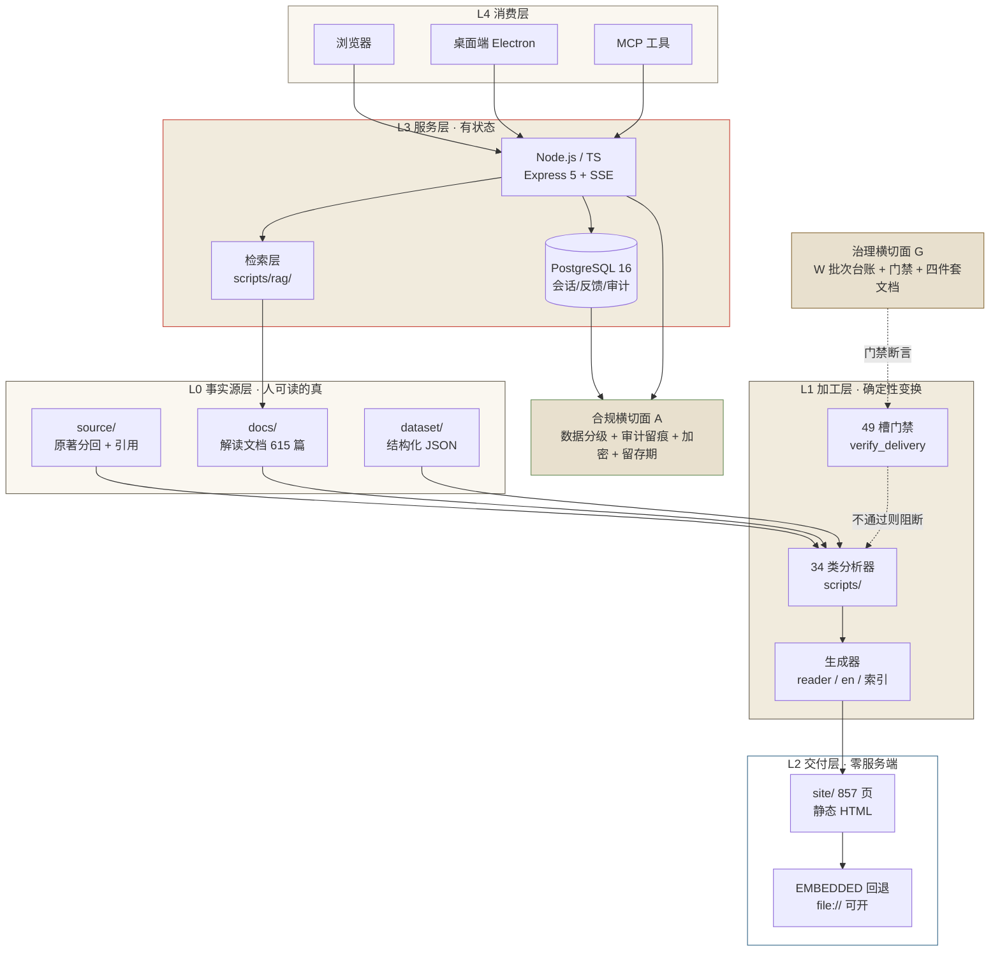
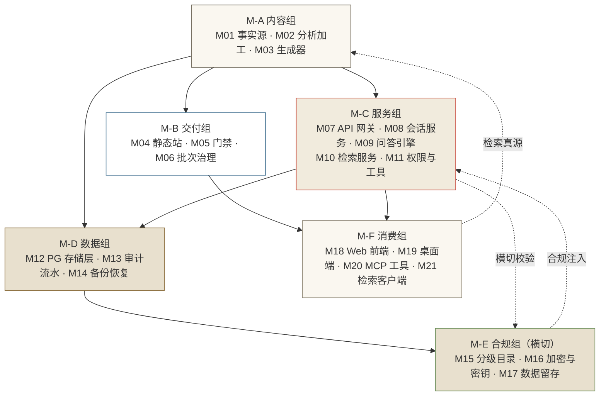
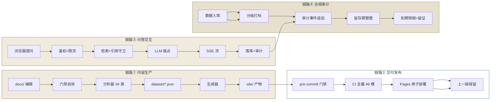
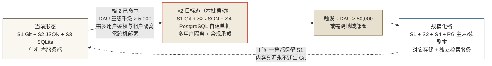
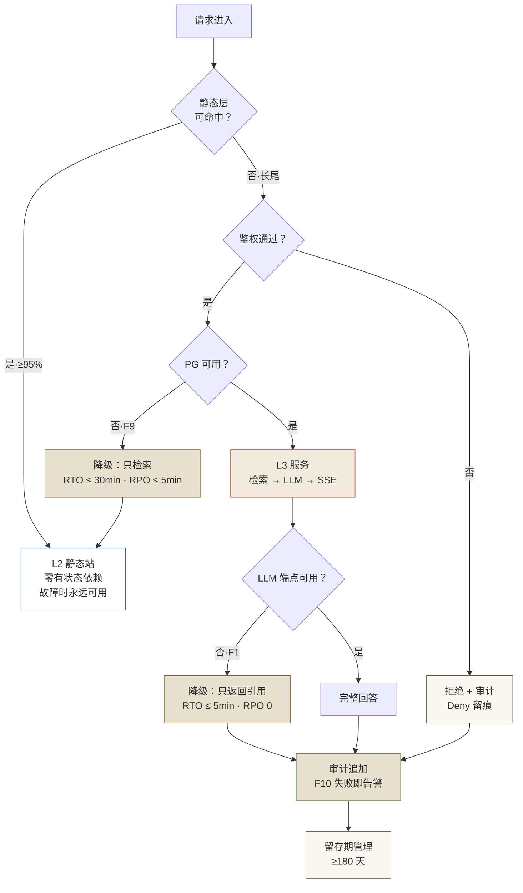
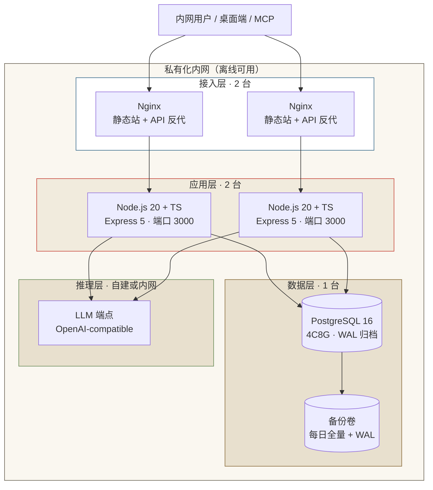

# 系统架构方案 v2 · 目标态与落地路线（分层 · 模块 · 数据流 · 存储 · 扩展 · 容灾 · 部署 · 监控）

> **版本**：W925（撰写时现役批次 W924 已收官；版本号语义为发布批次编号，不适用 SemVer，现役值以 [CHANGELOG.md](../../../CHANGELOG.md) 顶段为准）
> **日期**：2026-10-25
> **来源**：用户令「帮我设计一套系统架构方案：整体分层、模块拆分与依赖、数据流与存储选型、扩展性与容灾、部署与监控都写到位，附几张架构图说明图」，并经**四项确认**（业务场景与规模 = 内容/文档平台型 · 单机到 10 台 · 月活十万级 · 读多写少；技术栈 = TypeScript/Node.js 全栈 + PostgreSQL；硬性约束 = 私有化/离线部署禁外域依赖 + 成本敏感尽量少用托管服务 + 合规等保需审计日志与数据分级；交付形态 = HTML + Mermaid 源码 + PNG 三件套）。承 [W821 架构方案](系统架构方案-分层模块与部署-2026-10-20.md)（文档头自称 W820，台账登记为 W821）之增量修订。
> **状态**：方案定稿（**只读盘点 + 新增文档**；未改 `site/` 任何页面、未改 `xiyouji-agent-web/` 任何代码、未改管控脚本 `scripts/verify_delivery.py` 等、未改 `archive/**`）｜ **W927 更新**：四个开放项已由用户裁决（§13.2），D-1 离线施工件已交付（`xiyouji-agent-web/deploy/pg/`），并完成与 W926 交互审查的交叉对账（§13.4，新增 §10.6 配置面缺口 + 契约 C-8 + 禁止依赖形态 #8）｜ **W934 更新**：D-2 应用迁移批**第一子批**已交付并实跑（§13.6）——M12 存储层抽象落地 + 真实数据迁移（三重对账全一致）+ 授权模型三处缺陷修复；**D-2 整体仍未完成**（切读停写 → W935 · 检索接入与地址注入 → W936 · 容量实测 → W937）
> **读者**：项目维护者 / 后续 Agent / 架构决策者（默认无对话上下文，可独立执行与复算）
> **轨标**：教学讲解
> **生成来源**：人工撰写（Agent 起草）
> **生成模型**：MiniMax M3.1（本地 Agent 会话 2026-10-25）
> **生成日期**：2026-10-25
> **核验状态**：已核验（全部现状计数、体积、代码行数取自 2026-10-25 当盘实跑；复算命令见 [附录 B](#附录-b复算命令与证据索引)）

---

## 目录

1. [执行摘要（先给答案）](#1-执行摘要先给答案)
2. [范围、约束与处理声明](#2-范围约束与处理声明)
3. [现状盘点（2026-10-25 实测）](#3-现状盘点2026-10-25-实测)
4. [目标架构：整体分层](#4-目标架构整体分层)
5. [模块拆分与依赖](#5-模块拆分与依赖)
6. [数据流](#6-数据流)
7. [存储选型（含对 W821 的修订裁定）](#7-存储选型含对-w821-的修订裁定)
8. [扩展性](#8-扩展性)
9. [容灾与降级](#9-容灾与降级)
10. [部署](#10-部署)
11. [监控与可观测](#11-监控与可观测)
12. [合规与数据分级（等保向）](#12-合规与数据分级等保向)
13. [风险登记与未决项](#13-风险登记与未决项)
14. [验收标准](#14-验收标准)
15. [附录 A 架构图三形态与派生规则](#附录-a架构图三形态与派生规则)
16. [附录 B 复算命令与证据索引](#附录-b复算命令与证据索引)

---

## 1. 执行摘要（先给答案）

### 1.1 一句话架构

**本项目是「一源多形 · 静态优先」系统：L0 事实源（Markdown + JSON）单向流经 L1 确定性加工层，产出 L2 零服务端静态站；L3 有状态服务层（Node.js/TS 全栈 · Web Agent）在 L0 之上做问答与检索，其有状态数据落在 PostgreSQL；治理面（50<!--stats:gate_count--> 槽门禁 + W 批次台账 + 四件套文档）作为横切面贯穿 L0–L3，把「不可回归」变成机器可判的断言；合规面（数据分级 + 审计留痕）作为第二横切面覆盖 L3 的全部数据面。**

### 1.2 相对 W821 的**修订裁定**（本次唯一的结论性变更）

W821（2026-10-20）的五条裁定中，**三条保持、四条中的核心一条被修订**。修订的根因是**规模前提被改写**，不是偏好之争：

| # | W821 原裁定 | v2 裁定 | 变更根因 |
|:--:|:---|:---|:---|
| 1 | 依赖单向向下，产物不得反向成为事实源 | **保持** | 与技术栈、规模均无关，是本项目最稳的底层约束 |
| 2 | 存储沿用「Git 文件树 + JSON + 单文件 SQLite」三件套，**不引入外部数据库/缓存/对象存储** | **修订**：内容存储仍为 Git 三件套（不变）；**运行态存储新增 PostgreSQL 16 自建单机**，SQLite 降级为「桌面端/离线单机形态」的实现细节 | 原裁定理由明写「**当前 DAU 百级**、站点零服务端」——该前提已被规模改写（见 §2.2） |
| 3 | 扩展走「三档触发式演进」，不预先建设 | **保持，但档位前移一档**：档 2 由「触发后建设」提前为「本批启动」 | W821 档 2 触发条件（DAU > 5,000 或并发写会话 > 50 或需多租户隔离）**按新规模已命中**（见 §8.2 判定） |
| 4 | 容灾主战场是「降级可用」而非「备份恢复」 | **保持，并加一条**：PG 引入后，「备份恢复」重回主战场（静态站仍以降级为主） | PG 数据目录是新增的「不可重建且不可再生」数据面 |
| 5 | 监控即门禁，零付费前提下不做付费 APM | **保持**（并强化：合规审计面成为第二观测面） | 「成本敏感」约束未变，付费 APM 仍与约束冲突 |

> **关键澄清（避免误读为「推翻既有方案」）**：v2 **不推翻 W821 的任何根本裁定**。改动的是**存储裁定所依赖的一个规模前提**。W821 §7.1 S5 自己写明了升级触发条件（DAU > 5,000 或并发写会话 > 50 或需要多用户鉴权与租户隔离），且 §7.4 明确「档 2 动作 = 会话迁 Postgres + 代价清单 ≈ 1 批工作量」。本批做的只是**在前提命中时执行该档**，而非另起炉灶。

### 1.3 v2 目标态的六条要点

1. **分层仍是五层 + 双横切面**：L0 事实源 / L1 加工 / L2 交付 / L3 服务 / L4 消费；治理面（门禁 + 批次台账）+ 合规面（分级 + 审计）横切。新增的是**横切面**，不是新层级——避免层级膨胀带来的依赖复杂度。
2. **静态优先原则不变**：读多写少 + 私有化离线 ⇒ 绝大多数请求应命中静态层。PG 与 Node 服务承担的是**长尾**（问答、检索、会话、审计），不是全站流量。
3. **PostgreSQL 自建单机，不上托管**：成本敏感 + 私有化 ⇒ 单实例 + WAL 归档 + 每日 `pg_basebackup` 就满足十万月活；不上主从、不上分库分表、不上云 RDS。
4. **TS/Node 全栈只覆盖服务端**：现役 `xiyouji-agent-web` 已是 React 19 + Vite 8 + TS + Express 5 + better-sqlite3 ⇒ v2 的「TS 全栈」是**把该应用的服务端存储层换到 PG**，而非另起新栈。静态站**维持原生管线**（承接 W818 结论），不做全站框架化。
5. **合规面是本批最大增量**：数据分级四级 + 三类审计留痕 + 传输/静态加密口径 + 留存期与不可篡改要求，直接补上 W821 §7.3 自陈的「明文未加密、无保留期」缺口与 W855 评审的 A-7/A-5 缺口。
6. **架构图三形态单向派生**：Mermaid 源码为**事实源**，HTML 可视化页与 PNG 为**派生物**，派生物不得回写事实源（承接 W821 铁律 2）。

### 1.4 明确不做（避免范围蔓延）

- 不做全站前端框架化 —— 承接 [W818 选型批](静态站前端框架化选型对比-2026-10-20.md) 结论（维持现役原生管线 + 新页局部构建化）。
- 不引入 Redis / Elasticsearch / 向量库 —— 读多写少场景下无热点键需求，语料量级未触发门槛（量化触发条件见 §8.3）。
- 不上 Kubernetes / 微服务拆分 / 消息队列 —— 10 台以内规模，单机 + `systemd`/容器编排足够；拆分只增加故障面。
- 不引入付费 APM / SaaS 监控 —— 与「成本敏感 + 私有化」冲突（合规面用自建审计流水替代）。
- 不改 `site/` 任何页面、不改 `xiyouji-agent-web/` 任何代码、不改管控脚本 —— 本批是**方案批**，不是施工批。

---

## 2. 范围、约束与处理声明

### 2.1 本方案回答什么

| 问题 | 回答 | 落点 |
|:---|:---|:---|
| 整体怎么分层 | L0–L4 五层 + 治理面 + 合规面两条横切面，依赖单向向下 | §4 |
| 模块怎么拆、依赖怎么管 | 6 个模块组 + 依赖矩阵 + 7 条禁止形态 | §5 |
| 数据怎么流 | 四条主链路（内容生产 / 交付发布 / 问答交互 / 合规审计） | §6 |
| 存储选什么 | 9 个候选逐项裁定，每项带量化升级触发条件 | §7 |
| 怎么扩展 | 四档触发式演进 + 10 条容量阈值 | §8 |
| 出了事怎么办 | 9 个故障域的降级矩阵，逐条给 RTO / RPO / 演练方式 | §9 |
| 怎么部署 | 5 条交付通道 + 私有化拓扑 + 回滚路径 | §10 |
| 怎么监控 | 5 层观测面 + 18 条指标 + 6 条 SLO + 合规审计面 | §11 |
| 等保怎么落地 | 四级数据分级 + 三类留痕 + 加密口径 + 留存期 | §12 |

### 2.2 硬性约束（用户已确认项）与**规模前提的改写**

**用户已确认的四项**：

1. **业务场景与规模**：内容/文档平台型 —— 单机到 10 台 · 月活十万级 · 读多写少。
2. **技术栈**：TypeScript/Node.js 全栈 + PostgreSQL。
3. **硬约束**：① 私有化/离线部署（禁外域依赖）② 成本敏感（尽量少用托管服务）③ 合规等保（审计日志 + 数据分级）。
4. **交付形态**：架构图 HTML + Mermaid 源码 + PNG 三件套。

**规模前提改写（v2 相对 W821 的唯一结构性变化）**：

| 维度 | W821（2026-10-20） | v2（2026-10-25） | 是否触发既有裁定 |
|:---|:---|:---|:---|
| 用户规模 | DAU 百级 | 月活十万级 ⇒ DAU 量级千级 | **命中** W821 档 2 的「DAU > 5,000 或并发写会话 > 50」判据中的后两项与多租户判据 |
| 部署形态 | 单机可承载（站点零服务端） | 单机到 10 台，服务层需可水平扩展 | **命中** W821 档 2 的「需要跨机部署」前置 |
| 服务端技术栈 | 沿用现役（已含 TS + Express 5） | TS/Node.js 全栈 + PostgreSQL | 现役栈本就含 TS/Express ⇒ **不构成换栈**，只换存储实现 |
| 数据分级 | 原文未见 | 合规等保要求四级分级 + 审计留痕 | **新增横切面**（原文空白） |
| 交付形态 | Markdown + Mermaid | HTML + Mermaid + PNG | 派生产物链新增两环（§附录 A） |

**规模推算（显式假设，非实测）**：

- 月活十万级 ⇒ 按内容类站点常见 DAU/MAU 比 **3%–10%** 推算，**DAU ≈ 3,000–10,000**（取中位 5,000 量级）。
- 读多写少 ⇒ 写路径（问答会话）占比远低于读路径，预计 **写 QPS ≤ 1**、**读 QPS ≤ 50**（单机）。
- ⇒ **结论**：PG 单实例足够支撑一个数量级以上余量；Redis/ES/向量库**均无触发**。

> **假设声明**：上述 DAU/MAU 比率与 QPS 预估值是**行业经验区间推算**，非本项目实测（本站读者数据链自 2026-09-30 起中断，见 [读者数据复盘](../调研与数据复盘/读者数据复盘.md)）。方案中所有**容量阈值**均按此推算设定，且每条都写明「触发动作」，以便实测数据到位后直接对表核销。

### 2.3 处理声明（三处，需显式记录）

- **`file://` 直开 + 零外域依赖（一票否决）**：用户本次已把「禁外域依赖」列入硬约束，与 [AGENTS.md §6-5](../../../AGENTS.md) 仓内铁律同向。本方案按**一票否决**处理：任何架构提议若破坏「双击即开、零外域依赖」，一律不采纳。§附录 A 的 HTML 可视化页因此**不使用 CDN 版 mermaid.js**，改为**手写内联 SVG**（实测：全仓无本地 mermaid 副本，见附录 B）。
- **性能硬指标**：用户未单列，本方案写入 SLO（§11.5）：首屏 LCP < 1.5 s、可视化主交互 60 fps、问答首 token < 2 s。
- **本批只读边界**：不改 `site/`、不改 `xiyouji-agent-web/`、不改管控脚本。所有「目标态」均为**待施工设计**，落地顺序见 §8.2。

### 2.4 与既有批次的关系

| 批次 | 主题 | 与本方案的关系 |
|:---|:---|:---|
| W821 | 系统架构方案（分层/模块/数据流/存储/扩展/容灾/部署/监控） | **本方案是其增量修订版**：保持三条根本裁定，修订存储裁定的规模前提，新增合规横切面；承接其 §7.4 档 2 动作清单 |
| W855 | 架构评审报告（现役五维体检） | **不推翻其任何判定**；其 P0/P1 清单成为本方案 §5.4 禁止依赖形态与 §8.2 施工顺序的输入 |
| W818 | 静态站前端框架化选型 | **维持其结论**（不做全面框架化 + 新页局部构建化）；v2 的「TS 全栈」不触及静态站前端轴 |
| W823 | 数据库表设计审查（agent-web SQLite 四维审查） | **其 13 项发现是 PG 迁移的输入**（本方案 §7.4 列为迁移前置） |
| W844 | 会话库备份与保留期 | **被本方案 §7.4 修订**：PG 引入后备份对象集合扩大（W821 §9.4 裁定「只有不可重建的东西才需要备份」⇒ PG 数据目录进入该集合） |

---

## 3. 现状盘点（2026-10-25 实测）

### 3.1 资产规模表

**规模口径**：`scripts/stats.py` 磁盘实算（`scripts/output/stats.json`，实体化 tracked 文件）。

| 指标 | 现值 | 键名 | 归属层 |
|:---|---:|:---|:---|
| 全站 HTML 页 | 857<!--stats:html_total--> 页 | `html_total` | L2 |
| ├ 可视化页（不含模板壳） | 87<!--stats:visualization_pages--> 页 | `visualization_pages` | L2 |
| ├ `site/data/` 数据页 | 88<!--stats:site_data_html--> 页 | `site_data_html` | L2 |
| ├ `site/reader/` 生成页 | 622<!--stats:site_reader_html--> 页 | `site_reader_html` | L2 |
| ├ `site/en/` 英文页 | 138<!--stats:site_en_html--> 页 | `site_en_html` | L2 |
| └ `site/` 根页 | 9<!--stats:site_root_html--> 页 | `site_root_html` | L2 |
| 内联 CSS 覆盖页 | 330<!--stats:inline_css_pages--> 页 | `inline_css_pages` | L2 |
| CSP 覆盖页 | 856<!--stats:csp_covered--> 页 | `csp_covered` | L2 |
| A1–A6 内容文档 | 615<!--stats:a1_a6_docs--> 篇 | `a1_a6_docs` | L0 |
| A4 主题专题 | 209<!--stats:a4_docs--> 篇 | `a4_docs` | L0 |
| 分析脚本类 | 34<!--stats:script_classes--> 类 | `script_classes` | L1 |
| 交付门禁槽 | 50<!--stats:gate_count--> 槽 | `gate_count` | 治理面 |
| 报告类文档 | 85<!--stats:report_docs--> 篇 | `report_docs` | 治理面 |
| pytest 用例 | 945<!--stats:pytest_collected--> 例 | `pytest_collected` | 治理面 |

**结构规模（2026-10-25 实测）**：

| 对象 | 实测值 | 说明 |
|:---|---:|:---|
| `site/**/*.html` | 857 页 / **51.81 MB** | 与 `stats.json` 的 `html_total` 两条独立路径同值 |
| `xiyouji-agent-web/server/**/*.ts`（排除测试） | 24 文件 / **3,532 行** | 现役服务端全部实现 |
| `.github/workflows/*.yml` | **11** 个 | CI / Pages / Release / perf / security / scorecard / stale / dependency-review / screenshot-review 等 |

### 3.2 运行形态与边界

| 形态 | 入口 | 有状态 | 出网 | 规模依据 |
|:---|:---|:---|:---|:---|
| 公网站点 | GitHub Pages | 无 | 只出读 | CDN 承接，站点无服务端逻辑 |
| 本地离线站 | `file://` 双击 `site/index.html` | 无 | 零外域 | 数据页含 EMBEDDED 回退，fetch 失败仍渲染 |
| 桌面端 | Electron（`xiyouji-desktop/`） | 有（本地回环静态服务） | 仅更新检查 | 三平台安装包 + `electron-updater` |
| Web Agent | Express 5 + React 19（`xiyouji-agent-web/`） | 有（SQLite 会话/消息/反馈） | 调 LLM 端点 | 默认仅绑定 `127.0.0.1` |
| MCP 工具 | `mcp-server/xiyouji_mcp.py` | 无 | 无 | 只读工具（标注 READONLY） |

### 3.3 现状能力与缺口矩阵

| 能力面 | 现役状态 | 缺口（实证） | 本方案落点 |
|:---|:---|:---|:---|
| 内容真源 | ✅ `docs/` + `source/` 单一事实源 | 无 | §4 L0 |
| 加工可重跑 | ✅ 34 类分析器，幂等 | `scripts/output/data/*.json` 被 gitignore ⇒ **fresh clone 必挂** | §7.1 S2 · §11.4 |
| 交付零服务端 | ✅ 静态站 + `file://` 回退 | 无 | §4 L2 |
| 交付门禁 | ✅ 49 槽 + CI job | 覆盖面止步文档面（站点页脚聚合数曾漂移 62 条） | §11.1 |
| 交互问答 | ✅ SSE 流式 + 工具集 + 权限四模式 | LLM 端点单点；零重试零退避；SSE 无 `id:` ⇒ 断流整轮作废 | §9.2 F1 · §11.2 |
| 会话存储 | ✅ SQLite（WAL）+ 三表 + `user_version` 迁移框架 | **明文单文件未加密**；无多用户隔离；单机单进程 | §7.4 · §12.2 |
| 审计留痕 | ✅ `server/audit.ts` JSONL 追加写 | **单文件无留存期**、fail-open 不告警、非防篡改；与发布批次审计未统一时间轴 | §12.3 |
| 鉴权 | ✅ 可选 `AGENT_WEB_TOKEN` | **默认免认证**（未设 token 即不注册鉴权中间件）⇒ 私有化部署到内网即失守 | §12.2 |
| 备份 | ✅ `VACUUM INTO` 快照 + 每日 1 份 + 保留 7 份 | 备份对象仅会话库与审计日志；PG 数据目录未纳入 | §9.5 |
| 观测 | ✅ 进程内滚动窗口 + 结构化日志 + `/api/health` `/api/ready` | 无集中审计视图；无跨实例聚合 | §11.1 |
| 水平扩展 | ✅ 静态层天然横向（CDN） | 服务层无横向能力（SQLite 单文件 + 进程内状态） | §8.2 档 2 |

---

## 4. 目标架构：整体分层

### 4.1 分层定义与职责

| 层 | 名称 | 职责 | 唯一产出 | 失败语义 |
|:--|:---|:---|:---|:---|
| **L0** | 事实源层 | 承载「人可读的真」：原著分回、解读文档、结构化数据集 | `source/` `docs/` `dataset/` | 内容不完整 ⇒ 下游全部降级，不得掩盖 |
| **L1** | 加工层 | 确定性变换：分析抽取、渲染生成、门禁校验 | `scripts/output/data/*.json`、`site/data/*.html`、门禁报告 | 变换失败 ⇒ 产物不更新，旧产物继续服务 |
| **L2** | 交付层 | 零服务端静态产物，供人直接消费 | `site/`（857 页） | 产物缺失 ⇒ 回退上一部署版本 |
| **L3** | 服务层 | 有状态交互：会话、流式、工具、权限、检索 | PostgreSQL 数据 + SSE 流 + JSONL 审计流水 | 进程崩溃 ⇒ 静态层零影响，问答不可用 |
| **L4** | 消费层 | 谁在用、用什么协议 | — | — |
| **G** | 治理横切面 | 把「不可回归」变成机器断言 | 门禁报告、W 批次台账、四件套文档 | 门禁红 ⇒ 提交被拒（pre-commit）+ CI 阻断 |
| **A** | 合规横切面 | 数据分级 + 审计留痕 + 加密 + 留存期 | 分级标签、审计流水、留存与销毁记录 | 审计中断 ⇒ 告警并标记合规降级（不静默） |

> **为什么加横切面而不是加层级**：合规能力（分级、留痕、加密、留存）**横跨每一层的每个数据面**。若做成独立层，会迫使 L0–L3 反向依赖它（依赖方向被破坏，W821 铁律 1 失效）。做成横切面则依赖仍单向向下。

### 4.2 分层图（图 1 · 见 [附录 A](#附录-a架构图三形态与派生规则)）



### 4.3 层间铁律（6 条 · 每条含允许/禁止具体对象）

| # | 铁律 | 允许 | 禁止 |
|:--:|:---|:---|:---|
| 1 | 依赖单向向下 | L3 可读 L0；L2 只由 L1 写 | L0 读 L2/L3；L2 反向写 L0 |
| 2 | 产物不得反向成为事实源 | 从 `docs/` 重新生成 `site/` | 手工改 `site/data/*.html` 的 `EMBEDDED_DATA` |
| 3 | 服务层不产出静态内容 | 服务层只读写自身数据面 | 服务层生成 `site/` 下任何文件 |
| 4 | 数据分级标签随数据流 | 数据入库即带分级标签 | 无标签数据落库或落审计流水 |
| 5 | 审计只追加不修改 | 追加写审计事件 | 删除/改写既有审计行（留存期内） |
| 6 | 迁移必须可逆且留证 | 迁移脚本 + 回滚脚本 + 留证 | 原地改表定义不留迁移记录 |

---

## 5. 模块拆分与依赖

### 5.1 模块组划分（6 组 · 21 模块）

| 组 | 模块 | 职责 | 归属层 |
|:--:|:---|:---|:---|
| **M-A 内容** | M01 事实源 | `docs/` `source/` `dataset/` 的真源内容 | L0 |
| | M02 分析加工 | 34 类分析器，产出 `scripts/output/data/*.json` | L1 |
| | M03 生成器 | reader/en/搜索索引/可视化页生成 | L1 |
| **M-B 交付** | M04 静态站 | `site/` 857 页产物 + EMBEDDED 回退 | L2 |
| | M05 门禁 | 49 槽 `verify_delivery.py` + 各专项门禁 | G |
| | M06 批次治理 | W 号台账 + CHANGELOG + 四件套文档 | G |
| **M-C 服务** | M07 API 网关 | Express 5 路由 + 中间件（鉴权/限流/请求 ID） | L3 |
| | M08 会话服务 | 会话/消息/反馈读写 + 生命周期 | L3 |
| | M09 问答引擎 | OpenAI-compatible 适配 + SSE 流 + 重试退避 | L3 |
| | M10 检索服务 | `scripts/rag/` 接入 + 路由 + 引用守卫（**O-4 已裁决：纳入档 2，施工排 D-2**） | L3 |
| | M11 权限与工具 | 权限四模式 + 工具白名单 + 路径保护 | L3 |
| **M-D 数据** | M12 PG 存储层 | 连接池 + 迁移 + 事务 + 健康探针 | L3 |
| | M13 审计流水 | JSONL 追加 + 留存 + 只读回放 | L3 / A |
| | M14 备份恢复 | 快照编排 + 恢复演练 + 保留期 | L3 / A |
| **M-E 合规** | M15 分级目录 | 四级标签定义 + 字段映射 + 校验 | A |
| | M16 加密与密钥 | 传输 TLS + 静态加密 + 密钥管理 | A |
| | M17 数据留存 | 留存期 + 到期销毁 + 销毁留证 | A |
| **M-F 消费** | M18 Web 前端 | React 19 + Vite 8 + TS | L4 |
| | M19 桌面端 | Electron + 自动更新 | L4 |
| | M20 MCP 工具 | 只读工具集 | L4 |
| | M21 检索客户端 | 站内搜索 UI + 索引消费 | L4 |

### 5.2 依赖矩阵（行依赖列 ⇒ 允许）

| ↓依赖 → | M-A | M-B | M-C | M-D | M-E | M-F |
|:--|:--:|:--:|:--:|:--:|:--:|:--:|
| **M-A 内容** | — | ✗ | ✗ | ✗ | ✗ | ✗ |
| **M-B 交付** | ✓ | — | ✗ | ✗ | ✗ | ✗ |
| **M-C 服务** | ✓ | ✗ | — | ✓ | ✓ | ✗ |
| **M-D 数据** | ✓ | ✗ | ✗ | — | ✓ | ✗ |
| **M-E 合规** | ✓ | ✓ | ✓ | ✓ | — | ✓ |
| **M-F 消费** | ✓ | ✓ | ✓ | ✗ | ✓ | — |



**读法**：✓ = 允许依赖；✗ = 禁止依赖。关键三条：

1. **M-A 不依赖任何组**（事实源不被任何下游反向影响）。
2. **M-B 不依赖 M-C/M-D/M-E**（交付层零服务端 ⇒ 静态站不含任何运行时依赖）。
3. **M-E 合规组可依赖全部组，但其余组不得依赖 M-E 的内部实现**（合规以**横切关注点**方式注入，不成为被依赖的业务模块）。

### 5.3 数据面归属（哪些数据落在哪里）

| 数据 | 归属 | 存储 | 分级 |
|:---|:---|:---|:---|
| 原著原文、解读文档 | L0 | Git 文件树 | L1 公开 |
| 结构化数据集 | L0 | Git + JSON | L1 公开 |
| 分析中间产物 | L1 | `scripts/output/data/*.json`（gitignore） | L1 公开 |
| 会话与消息 | L3 | PostgreSQL `sessions` / `messages` | L3 受限（含用户输入） |
| 反馈 | L3 | PostgreSQL `feedback` | L2 内部 |
| 审计事件 | L3/A | JSONL 流水 + PG 归档 | L4 敏感 |
| 工具调用记录 | L3/A | 审计流水 | L4 敏感 |
| 备份快照 | L3/A | 仓外目录（现役 `%LOCALAPPDATA%`） | 随源数据分级 |

### 5.4 禁止依赖形态（8 条 · 每条附实证教训来源）

| # | 禁止形态 | 实证教训来源 |
|:--:|:---|:---|
| 1 | 服务层生成 `site/` 下文件 | W821 铁律 2：产物回写即漂移源 |
| 2 | 手工改 `site/data/*.html` 的 `EMBEDDED_DATA` | 同名数据副本 47 份中 24 份已漂移（138,214 B 不一致） |
| 3 | 模块间用**字符串拼接的运行时调用**替代 import | `mcp_server.py` 曾调用已标注弃用的脚本，只查 import 漏掉 |
| 4 | 审计写失败时静默吞错且不告警 | `audit.ts` 现役 fail-open（仅 `console.error`）⇒ 合规视角下审计缺口不可见 |
| 5 | 存储层变更绕过迁移清单 | SQLite 改表定义对存量库无效（W823 P0 之一）⇒ PG 侧必须先立迁移序列 |
| 6 | 前端与后端各存一份系统提示词/工具名词表 | 现役已漂移：工具名 12 个中 3 个对不上 |
| 7 | 页面聚合数字不入任何扫描域 | 站点首页自称「772 篇」vs 实测 834 条，差 62 |
| 8 | **在 L2 静态产物里硬编码 L3 的服务地址**（含回环地址 / 内网 IP / 域名） | W926 R-01（P0）实测：`site/static/js/rag-chat.js:17` 硬编码 `http://127.0.0.1:8777`，线上实抓一致 ⇒ 访客浏览器连的是**访客自己机器**上的服务；私有化部署的拓扑被构建期硬编码锁死（详见 §10.6） |

### 5.5 契约清单（C-1 ~ C-8）

| 契约 | 内容 | 落点 |
|:---|:---|:---|
| C-1 | 层间只经由**显式数据契约**（JSON schema / SQL DDL）交互，不得直接读对方内部文件 | §5.2 |
| C-2 | 事实源变更必须触发**门禁重跑**，无重跑即视为未落地 | M05 |
| C-3 | 所有派生数据必须带**版本戳**（W 号或 schema 版本） | M03 |
| C-4 | 服务端对外错误**分类可枚举**（现役 6 类），前端按类渲染 | M07 |
| C-5 | 内联脚本哈希与 CSP meta 一致（现役 856 页覆盖） | M04 |
| C-6 | 数据入库必带**分级标签** | M15 |
| C-7 | 审计事件字段集**只增不改**（对外契约） | M13 |
| C-8 | **静态产物中的服务端地址必须由部署期配置注入**（禁硬编码回环/内网地址；`127.0.0.1` 只允许开发者本机专用构建且须显式标记） | §10.6 |

---

## 6. 数据流

### 6.1 四条主链路



### 6.2 链路① 内容生产（唯一事实源路径）

`docs/` 编辑 → 门禁自测 → 34 类分析器 → `dataset/*.json` → 生成器 → `site/` 产物 → 门禁断言 → 提交。
**性质**：确定性、可重跑、幂等。**失败语义**：变换失败 ⇒ 产物不更新，旧产物继续服务（不产生半成品）。

### 6.3 链路② 交付发布（发布通道路径）

pre-commit（本地分级门禁）→ CI（全量 49 槽 + 11 个 workflow）→ 原子部署（保留上一版）→ 回滚路径。
**性质**：只进不退的可回滚发布。**失败语义**：部署失败 ⇒ 线上仍为上一版。

### 6.4 链路③ 问答交互（长尾路径 · 唯一有状态路径）

提问 → 鉴权/限流 → **检索 + 引用守卫**（保证引文可溯源）→ LLM 端点 → SSE 流式返回 → **落库 + 审计追加**。
**性质**：唯一有状态、唯一出网、唯一需要容灾的链路。
**v2 变更**：现役零重试零退避且 SSE 帧无 `id:` ⇒ 断流整轮作废；v2 要求**指数退避重试 + SSE `id:` 续传**（§9.2 F1）。

### 6.5 链路④ 合规审计（v2 新增 · 横切）

任何数据入库 ⇒ 打分级标签 ⇒ 追加审计事件 ⇒ 按留存期管理 ⇒ 到期销毁并**留销毁证据**。
**性质**：只追加、不可篡改。**失败语义**：审计写入失败 ⇒ **告警并标记合规降级**（不得静默；此为对现役 fail-open 的合规向修正，§12.3）。

### 6.6 读路径优先级（静态优先的量化表达）

| 序 | 路径 | 目标占比 | 说明 |
|:--:|:---|:---|:---|
| 1 | 静态站直出（CDN / 反代） | **≥ 95%** | 857 页静态产物，零服务端参与 |
| 2 | 站内检索（客户端索引） | 3%–4% | 构建期索引 + 客户端检索，命中即零服务端 |
| 3 | 问答服务（L3） | **≤ 1%** | 唯一有状态、唯一出网 |

> 这条占比是 v2 的**核心性能契约**：PG 与 Node 服务只承担长尾。若问答流量超过 1%，说明产品形态从「阅读平台」滑向「对话产品」，须重评 §8.2 档位。

---

## 7. 存储选型（含对 W821 的修订裁定）

### 7.1 九个候选的裁定

| # | 候选 | 裁定 | 理由 | 升级触发条件（量化） |
|:--:|:---|:--:|:---|:---|
| S1 | Git 文件树（`docs/` `source/` `site/`） | **采纳为唯一内容存储** | 可 diff、可回滚、可审计、零运维、无供应商锁定 | 不适用（已采纳） |
| S2 | JSON 数据集 | **采纳为中间层** | 无服务依赖、可 diff、可单测；派生层与真源层物理分离 | 不适用（已采纳） |
| S3 | SQLite（`better-sqlite3`，WAL） | **降级为单机/桌面形态实现** | 现役有效且零运维；**v2 保留其于桌面端与单用户离线场景** | 服务端形态改为 PG（本批已定） |
| S4 | **PostgreSQL 16（自建单机）** | **v2 新采纳（W927 O-1 已裁决：按 v2 档 2 施工）** | 十万月活需多用户会话隔离 + 并发写 + 可回滚备份；**自建而非托管**（成本敏感 + 私有化） | **已命中**：DAU 量级千级 > 5,000 且需多用户鉴权与租户隔离 → 施工拆 D-1/D-2/D-3 三批（D-1 离线施工件已落 `xiyouji-agent-web/deploy/pg/`） |
| S5 | Redis / Memcached | **不采纳** | 读多写少 + 静态层承 95% 流量 ⇒ 无热点键 | 单机读 QPS > 1,000 且存在热点键 |
| S6 | 对象存储（MinIO 等） | **不采纳** | 静态产物已有 CDN 承载；PG 备份用本地卷 + 归档文件即可 | 需存放 > 5 GB 原始媒体且需跨区访问 |
| S7 | Elasticsearch / Meilisearch | **不采纳** | 站内检索以构建期索引 + 客户端检索实现，615 篇规模无需常驻索引服务 | 语料 > 20,000 篇，或客户端检索延迟 > 300 ms |
| S8 | 向量库 | **不采纳** | 离线/CI 不可复算（模型 + 向量产物合计约 220 MB 且已 gitignore）+ 常驻服务 | 维持不采纳（Q5 裁决：dense 升显式可选档，默认 off） |
| S9 | 向量/嵌入索引（PG 内置扩展） | **不采纳（v2 新增候选）** | 同 S8；但若将来启用，优先用 PG 的 `pgvector` 而非独立服务（省一套运维） | 与 S8 同阈值 |

> **修订说明（诚实交代）**：W821 的 S5 行写的是「不采纳 · 理由：当前无跨进程写入、无多租户隔离需求；引入需常驻服务 + 备份运维，与极低成本冲突」。**其触发条件（DAU > 5,000 或并发写会话 > 50 或需要多用户鉴权与租户隔离）在 v2 规模下已命中**，且「成本敏感」不排斥**自建** PG（1 台 4C8G 足够），只排斥**托管** PG。故 v2 采「自建单机 + 不上托管 + 不上主从」。**若用户要求严格遵守 W821 原裁定，本方案的核心修订即应撤回**——该取舍留给 §13 的开放项 O-1。

### 7.2 为什么 PG 单机就够（容量测算）

| 项 | 估算 | 依据 |
|:---|---:|:---|
| DAU | 3,000–10,000 | 月活十万 × DAU/MAU 3%–10%（**假设**，见 §2.2） |
| 峰值读 QPS | ≤ 50 | DAU 10,000 × 人均 20 请求/日，集中在 20% 时段 |
| 峰值写 QPS | ≤ 1 | 仅问答会话写入，读多写少 |
| 会话行增量 | ≤ 50 万/月 | DAU 5,000 × 每人 2 会话 × 30 天 |
| 消息行增量 | ≤ 1,000 万/月 | 按每会话 20 消息估 |
| PG 主库体量（1 年） | **约 40–60 GB** | 按消息平均 2 KB 估 |
| 4C8G PG 可承载 | 千万行级表 + 索引 | 远超上表需求 |

**结论**：单实例 PG 的容量余量在 **一个数量级以上** ⇒ 无需主从复制、无需分库分表、无需读副本。

### 7.3 SQLite → PostgreSQL 迁移映射

| 现役 SQLite 对象 | PG 目标 | 迁移注意 |
|:---|:---|:---|
| `sessions`（WAL） | `sessions` 表 + `updated_at` 索引 | `TEXT PRIMARY KEY` → `TEXT` 或 `UUID`；保留 `sdk_session_id` 可空列 |
| `messages` | `messages` 表 + `(session_id, created_at)` 复合索引 | `role` CHECK 约束 → PG enum 或 CHECK，二者等价 |
| `feedback` | `feedback` 表 + `message_id` 唯一索引 | W919 已修的「同消息双 verdict」唯一维度**必须保留** |
| `user_version` 迁移框架 | PG `schema_migrations` 表 | **不沿用** SQLite 的 `PRAGMA user_version` 记账 |
| `VACUUM INTO` 快照 | `pg_dump` / `pg_basebackup` | 机制替换，备份对象集合扩大（§9.5） |
| WAL 模式 | WAL + `archive_mode=on` | PG WAL 用于 PITR，语义更宽 |

### 7.4 会话数据生命周期（7 阶段 · v2 新增分级与留存）

| 阶段 | 处理 | 时限 |
|:--|:---|:---|
| 1 创建 | 会话 + 首条用户消息入库，标分级 L3 | 即时 |
| 2 活跃 | 追加消息，更新 `updated_at` | 会话存活期 |
| 3 归档 | 连续 30 天无交互 ⇒ 标记归档 | 30 天 |
| 4 冷存 | 归档会话数据移入冷表/冷卷 | 90 天 |
| 5 留存到期 | 超过留存期（见 §12.5）⇒ **销毁** | 按 §12.5 口径 |
| 6 销毁留证 | 写「销毁事件」进审计流水（**只留事件，不留内容**） | 即时 |
| 7 备份清理 | 到期备份件同步删除 | 与留存期对齐 |

> **v2 相对 W821 的增量**：W821 §7.3 生命周期只有 6 阶段且止于「明确保留期」，v2 补上**分级标注入**（阶段 1）与**销毁留证**（阶段 6）两个合规向环节。

### 7.5 存储演进路线（v2）



`S1 + S2 + S3(单机/桌面)` →**本批**→ `S1 + S2 + S4(PG 自建单机)` →（触发：DAU > 50,000 或需跨地域）→ `S1 + S2 + S4 + PG 读副本/分片`
**任何一档都保留 S1：内容真源永不因规模迁出 Git。**

---

## 8. 扩展性

### 8.1 容量模型（7 维）

| 维度 | 现值 | 增长驱动 | 首个瓶颈 | 预测依据 |
|:---|---:|:---|:---|:---|
| 站点页数 | 857 页 | 每批新增内容页 | 构建耗时 + 门禁耗时 | 每批增量 |
| 站点体积 | 51.81 MB | 每批新增页 + 素材 | CDN 带宽 / 构建内存 | 每批增量 |
| 内容文档 | 615 篇 | 每批新增解读 | 检索索引体积 | 每批增量 |
| 门禁槽数 | 49 槽 | 每批新增门禁 | 门禁全量耗时（现 143.7–156.7 s） | 随槽数线性 |
| `.git` 体积 | 260.5 MB | 每次提交 | 仓库体积（阈值 1 GB） | 持续增长 |
| 会话数据 | 单文件 SQLite | 真实用户数 | **PG 主库体量** | §7.2 测算 |
| 问答并发 | 单进程 | 真实用户数 | Node 进程事件循环 | §7.2 测算 |

### 8.2 演进档位（4 档 · 档 2 提前为「本批启动」）

| 档位 | 触发条件 | 动作 | 不做的事 |
|:--:|:---|:---|:---|
| 档 0 维持现役 | 当前状态 | 静态站 + 本地服务 + SQLite | 不引入新组件 |
| **档 1 局部构建化** | 新建可视化页 ≥ 3 个且均需组件化 | 新页可走 Vite + TS + `vite-plugin-singlefile`（内联后仍须 `file://` 可用）；**存量 87 页不迁** | 不迁存量页 |
| **档 2 服务化（已启动·O-1 已裁决）** | **已命中**：DAU 量级千级 > 5,000 + 需多用户鉴权与租户隔离 + 需跨机部署 | 会话迁 PG（自建单机）· 强制鉴权 · 审计流水独立 · Node 服务可多副本 · **检索层接入（O-4 已裁决）** | 不拆微服务、不上 K8s、不上主从 |
| 档 3 规模化 | DAU > 50,000 或需跨地域部署 | PG 主从 + 读副本 + 对象存储 + 独立检索服务 | 不改变 S1 内容真源 |

**档 2 的施工顺序（3 批 · O-1 已裁决，档 2 正式启动）**：

1. **D-1 基础设施批**（W927 已交付**离线施工件**）：PG 自建单机部署基线 + 迁移序列 + 备份编排 + 恢复演练脚本 —— 落点 `xiyouji-agent-web/deploy/pg/`。**本批未实跑 PG**（本机无 `psql`/`pg_ctl`）⇒ 机器背书是静态校验器 66/66 + 反向验证 11/11，待实跑清单 9 项见该目录 README §4。
2. **D-2 应用迁移批**：存储层抽象（M12）+ 会话/消息/反馈三表迁移 + 双写对账期 + 切读 + 停写旧库 + **检索层接入（O-4）** + **静态产物服务地址注入机制（契约 C-8）** + 容量实测。
3. **D-3 合规批**：分级目录 + 强制鉴权 + 审计流水结构化 + 加密与留存期（O-2 口径）。

> **顺序理由**：先有 PG 与备份（否则迁移不可回滚），再迁应用（否则审计无载体），最后合规（否则分级要重标两次数据）。

### 8.3 容量阈值（10 条 · 触发评审的量化线）

| 指标 | 阈值 | 触发动作 |
|:---|---:|:---|
| 单页 HTML 体积 | > 200 KB | 拆包评审（不得直接引入框架运行时） |
| 单页内联 CSS | > 60 KB | 抽离评审（须保证 `file://` 仍可开） |
| 全站体积 | > 120 MB | 资源分片评审（现 51.81 MB，余量 57%） |
| 站内搜索脚本 | > 3 MB | 索引分片或改为按页加载（现 2.18 MB，余量 27%） |
| 门禁全量耗时 | > 600 s | 引入按 scope 增量门禁（现 143.7–156.7 s，余量 74%） |
| 仓库体积 | > 1 GB | `git gc` + 归档复核（现 260.5 MB） |
| 单批提交文件数 | > 500 | 拆分批次 |
| PG 主库体量 | > 200 GB | 归档分区 + 评估读副本 |
| PG 单表行数 | > 5,000 万 | 评估分区表（现预估 < 1,000 万/月） |
| 问答并发连接数 | > 500 | Node 多副本 + 负载均衡 |

### 8.4 预留扩展点（6 个）

| 扩展点 | 触发条件 | 状态 |
|:---|:---|:---|
| 引擎端点适配 | 立即可用 | 现役已有（OpenAI-compatible） |
| 工具集策略 | 立即可用 | 现役已有 |
| 双态数据加载 | 立即可用 | 现役已有（EMBEDDED + fetch） |
| 产出格式 | 立即可用 | 现役已有 |
| 发布通道 | 需要迁出 GitHub 时 | 现役已有（4 条通道） |
| 存储后端切换 | 本批启动（档 2） | **v2 新增**：M12 抽象隔离 PG 与 SQLite |

---

## 9. 容灾与降级

### 9.1 故障域清单（F1–F10 · v2 新增 F9/F10）

| # | 故障域 | 现状防线 | v2 后 |
|:--:|:---|:---|:---|
| F1 | 上游 LLM 端点不可用/限流 | **无（待补）** | 降级为「只检索」+ 指数退避重试 |
| F2 | Agent 服务进程崩溃 | 优雅关闭 + WAL checkpoint | 同 + 多副本自动重启 |
| F3 | 会话库损坏（SQLite） | `VACUUM INTO` 快照（已建立） | **改为 PG 侧 PITR** |
| F4 | 产物漂移 | 门禁提交前阻断 | 同（不变） |
| F5 | Git 远端不可用 | 本地继续开发 | 同（不变） |
| F6 | Pages 部署失败 | 原子部署保留上一版 | 同（不变） |
| F7 | CI 依赖/环境缺失 | 本地门禁先行拦截 | 同（不变） |
| F8 | 本机磁盘故障 | 远端 Git 重建 | **PG 数据目录纳入备份集合**（§9.5） |
| **F9** | **PG 实例故障/数据损坏** | **v2 新增** | 归档 + `pg_basebackup` 恢复；RPO ≤ 5 min |
| **F10** | **审计流水断裂** | **v2 新增** | 告警 + 合规降级标记（不得静默） |

### 9.2 降级矩阵（10 行 · RTO/RPO/恢复/演练齐全）

| # | 降级路径 | RTO | RPO | 恢复动作 | 演练方式 |
|:--|:---|:---:|:---:|:---|:---|
| F1 | 降级为「只检索」：工具层直读 `docs/` 返回引用 | ≤ 5 min | 0 | 恢复端点后自动回到生成模式 | 断开 `LLM_API_BASE` 后请求，断言返回引用而非 5xx || F2 | 静态站与 `file://` 完全不受影响 | ≤ 2 min | 0 | 重启；`/api/ready` 转绿 | 强杀进程后重启，断言消息完整 |
| F3 | 降级为「只读浏览」；旧库隔离不删 | ≤ 30 min | ≤ 24 h | PG 侧 PITR 恢复 | 每月恢复演练到临时实例 |
| F4 | 门禁在提交前阻断；线上不受影响 | ≤ 30 min | 0 | `git revert` + 重新部署 | 篡改 `EMBEDDED_DATA` 断言门禁变红 |
| F5 | 本地继续开发与提交；发布推迟 | 依赖恢复 | 0 | 远端恢复后推送 | 断网提交 → 恢复后推送成功 |
| F6 | 上一版本继续在线 | ≤ 30 min | 0 | 重跑 workflow | 触发失败部署，断言线上仍可访问 |
| F7 | 本地门禁先行拦截 | ≤ 1 h | 0 | 修复依赖后补跑 | 断开依赖源跑一次，断言本地门禁仍红 |
| F8 | 以远端 Git 重建 | ≤ 2 h | 未跟踪件不可恢复 | `git clone` + 重建环境 | 季度克隆重建演练 |
| **F9** | **PG 不可用 ⇒ 问答不可用，静态站零影响** | ≤ 30 min | **≤ 5 min**（WAL 归档间隔） | 从最近归档 + `pg_basebackup` 恢复 | 每月一次完整恢复演练（断言行数一致） |
| **F10** | **审计写入失败 ⇒ 服务继续但标记「合规降级」** | ≤ 15 min | **审计缺失期间不可补**（如实记录缺口窗口） | 恢复审计落盘；补记缺口窗口事件 | 注入审计写失败，断言产生告警而非静默 |

> **F1 降级的两种形态必须区分（W927 交叉对账补注 · R-06）**：
> ① **同源降级** = 服务不可达时改为「只检索」，仍返回**可溯源的引用**（本矩阵 F1 假设的形态，满足 §12.3 的引用可溯源要求）；
> ② **异源降级** = 服务不可达时改由**模板引擎**生成文本（现役「检索真实语料」按钮的实际行为，W926 R-06 实测）——**产出源已换**，返回内容不是语料检索结果 ⇒ 既不满足引用可溯源，也与「按钮承诺」不符。
> ⇒ **D-3 批前置确认项**：降级路径必须显式声明属于哪一种；异源降级须在 UI 上明示「这不是检索结果」并计入合规降级事件。**在澄清前，不得把「降级可用」当作合规证据。**

### 9.3 降级拓扑图（图 6）



**图 6 的两条降级主线**：① **向下**（PG 不可用 ⇒ 问答不可用，但静态站零影响）；② **向左**（LLM 不可用 ⇒ 退化为「只检索」，仍返回可溯源的引用）。**审计环节在所有路径末端**，且其失败**不静默**（F10）。

### 9.4 降级设计原则（v2 增补）

1. **静态层永远优先降级为「可用」而非「报错」** —— 读路径不依赖任何有状态组件。
2. **合规面失败不静默** —— 与性能面相反：审计失败必须**可见**（F10）。这是 v2 对现役 `audit.ts` fail-open 的合规向修正。
3. **RPO 如实声明** —— 审计缺失窗口不可补，缺口必须记录（不写「RPO 0」）。

### 9.5 备份与恢复演练（7 对象 · v2 扩容）

| 对象 | 备份方式 | 频率 | 保留 | 演练 | RTO/RPO |
|:---|:---|:---|:---|:---|:---:|
| 内容与代码 | Git 远端 | 每次推送 | 永久 | 季度复算 | ≤ 2 h / 0 |
| **PG 数据目录** | `pg_basebackup` 全量 + WAL 归档 | **每日全量 + 连续 WAL** | **全量 7 份 + WAL 14 天** | **每月恢复演练** | **≤ 30 min / ≤ 5 min** |
| 分析中间产物 | 不备份 | — | — | 重建即可 | 重建耗时秒级 |
| 审计事件 | JSONL 流水 + PG 归档副本 | 追加式 | **≥ 180 天（等保要求）** | 季度归档回放 | ≤ 1 h / ≤ 5 min |
| 发布产物 | 托管方保留上一版 + Git tag | 每次部署 | 上一版 | 季度回退演练 | ≤ 30 min / 0 |
| 配置与密钥 | 仓外配置目录 + 加密归档 | 每次变更 | 永久 | 季度恢复 | ≤ 1 h / 0 |
| 桌面端安装包 | GitHub Releases + blockmap | 每次发布 | 全部版本 | 季度下载校验 | ≤ 1 h / 0 |

> **关键裁定（修订 W821 §9.4）**：W821 裁定「只有『不可重建』的东西才需要备份」，PG 数据目录**进入该集合**（会话数据不可重建）；同时**审计流水的保留期由「随会话库」改为 ≥ 180 天的独立口径**（合规要求，不由数据生命周期决定）。

### 9.6 审计与可回滚（5 项）

1. **全量留痕**：W 批次号绑定主题/commit/版段/状态/认领会话/touches，对账表每行六列非空。
2. **可溯源到批次**：三方对账（commit × CHANGELOG 版段 × 台账行）。
3. **可回滚（4 路径）**：内容层 `git revert` / 站点层部署回退 / 桌面端 `electron-updater` 拉上一版 / **数据层 PITR**。
4. **不可篡改历史**：门禁 + 人工审批双锁；**v2 新增**：审计流水只追加 + 到期销毁留证。
5. **v2 新增：运行期审计与发布批次审计统一时间轴** —— 两者共用 W 号与时间戳字段，可交叉检索。

---

## 10. 部署

### 10.1 五条交付通道（v2 新增私有化通道）

| # | 通道 | 形态 | 有状态 | 离线可用 | 依赖 |
|:--:|:---|:---|:---|:---:|:---|
| 1 | 公网站点 | GitHub Pages | 无 | 否 | CDN（可自建镜像替换） |
| 2 | 本地离线站 | `file://` 双击 | 无 | **是** | 无 |
| 3 | 桌面端 | Electron 安装包 | 有（本地） | 是 | 更新源可换 |
| 4 | Web Agent（单机） | Express 5 + SQLite | 有 | 是（除 LLM 端点） | 仅 LLM 端点 |
| **5** | **私有化服务（v2 新增）** | **Node 服务 + PG 单机 + 反代** | **有** | **是（内网）** | **内网 LLM 端点** |

### 10.2 私有化部署拓扑（10 台以内 · 成本敏感）



**成本口径（自建 vs 托管）**：

| 组件 | 自建方案 | 托管方案（成本敏感约束下**不采用**） |
|:---|:---|:---|
| 数据库 | 单台 4C8G 自建 PG 16 + WAL 归档 | 托管 RDS ⇒ 引入外网依赖与持续费用 |
| 对象/文件 | 本地卷 + 每日归档文件 | 云对象存储 ⇒ 出网费用 + 供应商绑定 |
| 反代 | Nginx（系统自带） | 云负载均衡 ⇒ 持续费用 |
| 监控 | 门禁报告 + 结构化日志 + 自建审计流水 | 付费 APM/SaaS ⇒ 持续费用 + 出网 |
| 推理 | 内网自建端点或已有内网服务 | 公网 API ⇒ 出网 + 隐私 + **与「禁外域依赖」硬约束冲突**（O-3 已裁决：允许，但须显式登记该例外） |

### 10.3 发布流水线（5 步 · v2 增加服务层一步）

1. **提交前** pre-commit → `verify_delivery.py --scope auto`（分类档），不通过拒绝提交。
2. **推送后** CI 全量 49 槽 + 11 个 workflow。
3. **静态部署** `main` 推送 → Pages 原子部署（失败保留上一版）。
4. **服务部署（v2 新增）** → 迁移脚本（**先备份 → 再迁移 → 再切流**）→ 健康探针转绿 → 旧实例下线。
5. **桌面端** `tag v*` → 三平台构建 → `electron-updater` 拉取。

> **v2 强调的顺序纪律**：数据面迁移**必须**「备份 → 迁移 → 切流」三步有序，且**先备份**是不可跳过的前置（PG 迁移是唯一涉及不可重建数据的动作）。

### 10.4 回滚路径（5 情形）

| 层 | 动作 | 耗时 | 数据影响 |
|:---|:---|:---:|:---|
| 内容层 | `git revert <commit>` + 重跑部署 | ≤ 30 min | 无 |
| 站点层 | 部署控制台回退上一版 | ≤ 10 min | 无 |
| 桌面端 | 发新版本，旧用户保留旧版并收提示 | 按用户节奏 | 无 |
| **服务层（v2）** | **回退镜像 + 数据库 PITR 回滚点** | **≤ 30 min** | **丢失回滚点之后的会话数据** |
| **合规层（v2）** | **不可回滚（审计只追加）** | — | **审计不可撤销**（设计如此） |

### 10.5 「无云厂商绑定」6 维（v2 复核）

| 维度 | W821 口径 | v2 复核 |
|:---|:---|:---|
| 内容格式 | Markdown + JSON = 零成本 | 不变 |
| 产物格式 | 静态 HTML + 内联 = 零成本 | 不变 |
| 会话数据 | 单文件 SQLite = 低（`sqlite3 .dump`） | **升为中**：PG 导出需 `pg_dump`，且**须带 schema 与数据分级字段**（`pg_dump -Fc` 可移植，但迁移需人工介入） |
| 构建工具 | 开源 = 低 | 不变 |
| 托管方 | GitHub = 中 | 不变；**v2 私有化通道把该依赖降为「可选」** |
| LLM 供应商 | OpenAI-compatible 适配 = 低 | 不变 |
| 监控 | 门禁报告 = 低 | 不变 |

**结论**：v2 引入的唯一新增绑定点是 **PG（迁移代价：中）**，换来多用户会话隔离与合规审计承载能力 —— 这个交换由「等保 + 多用户」两项硬约束支撑。

---

### 10.6 客户端侧服务地址配置面（W927 交叉对账新增 · 真实缺口）

> **来源**：W926 交叉对账（R-01，P0）——**本节是 v2 自身的一处设计遗漏，由独立审查交叉发现**。诚实登记，不掩饰。

**问题**：v2 §10.2 把 L3 服务层放在内网 Nginx 之后，但**没有覆盖「静态页里客户端侧的服务端地址」这一配置面**。实测事实（W926 证据）：`site/static/js/rag-chat.js:17` 把 `RAG_BASE` 硬编码为 `http://127.0.0.1:8777`，且线上实抓确认与仓库版本一致 ⇒

- 静态站（L2 产物）里写死了 L3 的地址；
- 对**访客**而言，`127.0.0.1` 指向**访客自己的机器**，不是服务器 ⇒「问」浮窗对访客 100% 不可用（要求访客本机跑 Python 服务）；
- **私有化部署时，静态站与 L3 的实际拓扑不由部署方决定，而由构建期硬编码决定** ⇒ 换部署形态（内网 Nginx / 反代 / 端口）必须改静态产物并重新发布。

**v2 补入的三条约束**：

| 约束 | 内容 | 落点 |
|:---|:---|:---|
| **契约 C-8** | **静态产物中的服务端地址必须由部署期配置注入**（构建时占位符 + 部署时替换），**禁硬编码回环地址**；`127.0.0.1` 只允许出现在**开发者本机专用构建**中，且该构建必须显式标记 | §5.5 |
| **禁止依赖形态 #8** | **禁在 L2 静态产物里硬编码 L3 的地址**（含回环地址、含内网 IP、含域名）；L2 产物中出现服务地址即视为「产物反向成为部署事实」 | §5.4 |
| **读路径契约的补充** | §6.6 的「静态直出 ≥ 95%」隐含前提是「静态层不依赖 L3」⇒ **L2 产物对 L3 的引用必须是可选的**（服务不可达时静态层仍完整可用），不得因 L3 不可达而使静态页不可用 | §6.6 |

**与既有裁定的关系**：
- 与 §4.3 铁律 2「产物不得反向成为事实源」**同源但不同层**——铁律 2 说的是「产物不回写内容真源」，本条说的是「产物里不得内嵌**部署期事实**」。两者合起来构成完整的「产物纯净性」约束。
- 与 §5.4 禁止依赖形态 #1/#2 同族——那两条管的是「产物不得生成产物 / 手工改产物」，本条管的是「产物不得内嵌部署事实」。
- **不影响静态优先原则**：L2 仍是零服务端主体；本条只约束「L2 若要引用 L3，必须可降级」。

**施工落点**：地址注入机制属 **D-2 批**（应用迁移批，与检索层接入 O-4 同批）；静态产物侧的改造属 **W926 B1 批**（访客可执行性）。**两批不重叠**：B1 改静态侧入口体验，D-2 改地址注入机制。

---

## 11. 监控与可观测

### 11.1 五层观测面

| 层 | 观测内容 | 现役载体 | 失败语义 |
|:--:|:---|:---|:---|
| ① 代码层 | `ruff` / `tsc` / 内联 JS 语法 | 本地 + CI | 提交被拒 |
| ② 交付层 | `verify_delivery.py` 49 槽 + doc-sync + stats 对账 | pre-commit + CI | 提交被拒 / CI 阻断 |
| ③ 运行层 | `/api/health` `/api/ready`、结构化日志、请求 ID | 现役已有 | 用户侧错误 |
| ④ 业务层 | pages-smoke 全页 200、lighthouse、a11y、性能预算 | CI job | 体验退化但无人察觉 |
| **⑤ 合规层（v2 新增）** | **审计写入成功率、留存期到期销毁执行率、分级标签覆盖率、审计缺口窗口数** | **新增** | **告警 + 标记合规降级** |

### 11.2 指标与阈值（18 条 · 4 条为 v2 新增）

| # | 指标 | 采集来源 | 阈值 | 触发动作 |
|:--:|:---|:---|:---|:---|
| OBS-01 | 交付门禁 FAIL 数 | `verify_delivery.py` | = 0 | 阻断提交 |
| OBS-02 | 门禁自测通过率 | 各门禁 `--self-test` | = 100% | 阻断提交 |
| OBS-03 | 全站页面 HTTP 200 率 | pages-smoke | = 100% | CI 阻断 |
| OBS-04 | 内联 JS 语法错误数 | `check_js_syntax.py --all` | = 0 | CI 阻断 |
| OBS-05 | CSS 结构平衡 | `check_structure.py` | = 0 不平衡 | CI 阻断 |
| OBS-06 | CSP 哈希漂移 | `generate_csp.py --check` | = 0 页 | CI 阻断 |
| OBS-07 | 链接断裂数 | `lint_links.py --dir .` | = 0 | CI 阻断 |
| OBS-08 | 聚合数字漂移 | `stats.py --check` | = 0 差异 | CI 阻断 |
| OBS-09 | 可访问性得分 | lighthouse + `a11y_audit.py` | a11y ≥ 0.95 | CI 阻断 |
| OBS-10 | 页面体积 | 性能门禁 | 硬 ≤ 500 KB / 软 ≤ 200 KB | 硬门槛 |
| OBS-11 | 首屏加载 | LHCI | LCP < 1.5 s | CI 阻断 |
| OBS-12 | 服务存活 | `/api/health` | 持续 200 | 重启进程 |
| OBS-13 | 就绪状态 | `/api/ready` | 依赖就绪后转绿 | 阻断流量 |
| OBS-14 | 问答首 token 延迟 | 引擎流式首帧计时 | < 2 s | 告警 |
| **OBS-15** | **PG 连接池占用率** | **PG 侧连接数 / 上限** | **< 80%** | **告警** |
| **OBS-16** | **PG 主库体量** | **`pg_database_size`** | **< 200 GB** | **告警 + 触发归档评审** |
| **OBS-17** | **审计写入成功率** | **审计流水计数器** | **= 100%（失败必告警）** | **告警 + 合规降级标记** |
| **OBS-18** | **分级标签覆盖率** | **入库校验计数** | **= 100%（无标签即拒收）** | **阻断写入** |

### 11.3 告警路径（5 条 · v2 新增第 5 条）

1. 代码/交付层失败 → pre-commit 阻断 → CI job 失败 + artifact。
2. 运行层异常 → JSON 日志 + 探针。
3. 业务层退化 → CI artifact + 基线对比。
4. **服务层容量（v2）** → PG 指标 → 日志告警 + 容量评审。
5. **合规层异常（v2）** → **审计失败即刻告警**（不等批次收尾），缺口窗口登记到 HANDOVER。

### 11.4 巡检清单（6 频率）

| 频率 | 动作 |
|:--:|:---|
| 每次提交 | `verify_delivery.py --scope auto` |
| 每批收官 | 全量门禁 + `check_doc_sync.py` |
| 每周 | `stats.py --check` + `lint_links.py --dir .` |
| 每月 | **PG 恢复演练**（恢复到临时实例并断言行数一致）+ 快照校验 |
| 每季度 | 附录 B 全量复算 + 克隆重建演练 + **审计归档回放** |
| **每半年（v2）** | **等保自查：留存期执行率 + 分级覆盖 + 审计缺口窗口复核** |

### 11.5 SLO（6 条）

| # | SLO | 目标 | 测量口径 |
|:--:|:---|:---|:---|
| 1 | 站点可用性 | ≥ 99.5% | 季度 |
| 2 | 首屏 LCP | < 1.5 s | LHCI |
| 3 | 可视化主交互 | 60 fps | ≤ 600 ms 动效契约 |
| 4 | 问答首 token | < 2 s | 流式首帧计时 |
| 5 | 问答可用性 | ≥ 99%（问答时段） | 健康探针 |
| 6 | 交付正确性 | 门禁 FAIL = 0 | 门禁报告 |
| **7（v2）** | **审计完整性** | **审计缺口窗口 = 0** | **审计计数器** |

---

## 12. 合规与数据分级（等保向）

### 12.1 数据分级四级（v2 新增 · 核心增量）

| 级别 | 名称 | 判定标准 | 本项目落点 | 存储要求 | 传输要求 |
|:--:|:---|:---|:---|:---|:---|
| **L1** | 公开 | 已公开发布、泄露无损失 | 原著原文、解读文档、公开可视化数据 | Git 明文 | 无特殊要求 |
| **L2** | 内部 | 仅内部可见、泄露有轻微损失 | 反馈数据、构建元数据、内部报告 | DB 明文或列级加密 | 内网即可 |
| **L3** | 受限 | 泄露有实际损失 | **会话与消息**（含用户提问内容）、检索上下文 | **列级加密（敏感列）** | **必须 TLS** |
| **L4** | 敏感 | 泄露有重大损失或触法 | **审计事件、密钥、凭证** | **加密存储 + 只追加** | **必须 TLS** |

### 12.2 现役缺口与整改（合规向 · 逐项对应现役实证）

| # | 现状缺口（实证） | v2 整改 | 优先级 |
|:--:|:---|:---|:---|
| 1 | 会话库存**明文单文件未加密**（`server/db.ts`） | PG 列级加密 + 传输 TLS | P0 |
| 2 | **默认免认证**：`AGENT_WEB_TOKEN` 未设即不注册鉴权中间件 | 私有化部署**强制**鉴权（`AGENT_WEB_REQUIRE_TOKEN=1` 且未设 token 时拒绝启动，现役已 fail-closed，v2 把它升为**部署基线**而非可选） | P0 |
| 3 | 审计**单文件无留存期**、非防篡改 | 审计流水 + PG 归档 + 只追加 + ≥ 180 天留存 | P0 |
| 4 | 审计写入 **fail-open 静默**（仅 `console.error`） | 改为「告警 + 合规降级标记」（F10） | P0 |
| 5 | 无数据分级概念 | 四级标签 + 入库强制校验（OBS-18 = 100%） | P1 |
| 6 | 无留存期与销毁机制 | 7 阶段生命周期 + 到期销毁留证 | P1 |
| 7 | 备份对象仅 2 件（会话库 + 审计日志） | 扩至 7 件（§9.5） | P1 |
| 8 | 密钥管理无口径 | 密钥仓外管理 + 不入库 + 定期轮换 | P1 |

### 12.3 审计事件结构（v2 · 字段集只增不改）

每条审计事件**至少**含：`ts`（ISO 8601 UTC）· `event_id`（UUID）· `actor`（用户/服务/批号）· `action`（读/写/删/权限决策/运维/销毁）· `target`（资源标识）· `decision`（allow/deny）· `result`（ok/error）· `data_class`（L1–L4）· `trace_id`（与请求 ID 关联）· `source_ip`。

**追加写 + 不修改**：审计流水在留存期内**只追加**；删除只允许按留存期批量销毁，且销毁动作本身写一条新审计事件（**销毁留证**）。

### 12.4 加密口径

| 场景 | 要求 | 实现方式 |
|:---|:---|:---|
| 客户端 ↔ 服务端 | **必须 TLS** | 反代层终止 TLS（私有化内网亦强制，理由见下） |
| 服务端 ↔ PG | **必须 TLS** | PG `ssl=on` |
| PG 静态数据 | L3/L4 列级加密 | 应用层加密（密钥不入库） |
| 备份介质 | 加密 | 归档加密 + 密钥分离存放 |
| 静态站 | 无（内容为 L1 公开） | — |

> **为什么内网也要 TLS**：等保视角下「内网可信」不是可接受假设（横向移动、运维通道、镜像拉取均构成旁路）。成本敏感约束下用**自签 CA + 内部证书分发**实现，零订阅费用。

### 12.5 留存期口径

| 数据类别 | 留存期 | 依据 |
|:---|:---|:---|
| 审计事件 | **≥ 180 天**（O-2 已裁决取通用口径；**最终以本单位定级备案与测评方案为准**·D-3 批按备案方案复核后可收紧） | 等保通用要求 |
| 会话与消息（L3） | 90 天（活跃）/ 归档至 180 天 | §7.4 生命周期 |
| 反馈（L2） | 365 天 | 用于长期质量分析 |
| 备份件 | 全量 7 份 + WAL 14 天 | §9.5 |
| 公开内容（L1） | 永久（Git） | 不可再生 |

---

## 13. 风险登记与裁决落档

### 13.1 风险登记（7 条）

| # | 风险 | 触发条件 | 影响 | 概率 | 缓解措施 | 监控指标 |
|:--:|:---|:---|:---|:---:|:---|:---|
| R1 | PG 引入抬高运维门槛（备份/监控/升级） | 本批档 2 施工 | 中 | 中 | 备份编排脚本化 + 恢复演练月度化 + 免托管 | OBS-15/16 |
| R2 | 迁移期双写不一致 | 双写对账期 | 高 | 中 | 双写期设 ≥ 7 天 + 逐行对账门禁 | 迁移对账计数 |
| R3 | 等保口径与实际要求偏差 | 测评方案未最终确定 | 中 | 中 | 留存期取「≥ 180 天」上限并声明须按备案方案复核 | 半年等保自查 |
| R4 | 强制鉴权破坏现役桌面端/本机用法 | 档 2 部署时 | 中 | 中 | 桌面端走独立本地令牌 + 内网签发 | OBS-12/13 |
| R5 | 合规面建设拖累内容主线 | 多批次并行 | 中 | 中 | 合规批排在档 2 之后（D-3），不阻塞内容批 | 批次台账 |
| R6 | 静态优先占比被问答流量突破 | 产品形态变化 | 中 | 低 | 占比超 1% 即重评档位 | 读路径占比统计 |
| R7 | 审计与发布批次审计双时间轴漂移 | 长期并行运行 | 低 | 中 | 共用 W 号与时间戳 + 季度交叉检索 | 半年自查 |

### 13.2 已裁决项（O-1 ~ O-4 · W927 用户裁决落档）

> **状态变更**：本节原为「开放项（4 条 · 需用户裁决）」，经用户 2026-10-25 裁决（W927 批）转为**已裁决项**。裁决内容与落地位置逐条登记如下，供后续施工批直接执行。

| # | 开放项 | 裁决结果 | 落地位置 | 依据 |
|:--:|:---|:---|:---|:---|
| **O-1** | 是否接受「修订 W821 存储裁定」 | **接受，按 v2 档 2 施工** | §7.1 S4 行改判为「已采纳」· §8.2 档 2 触发条件由「触发式演进」改为「**已启动**」· 施工拆 D-1/D-2/D-3 三批 | 用户 2026-10-25 裁决「接受，按 v2 档 2 施工」。W821 自载触发条件（DAU > 5,000 或需多用户鉴权与租户隔离）按新规模已命中 ⇒ 档 2 由「触发后建设」提前为「既定选型」 |
| **O-2** | 审计留存期最终口径 | **取 ≥ 180 天**（通用口径）；**最终以本单位定级备案与测评方案为准** | §12.5 留存期表已标此口径；D-3 批按备案方案复核后可收紧 | 用户 2026-10-25 裁决「按建议定稿」 |
| **O-3** | 私有化部署的推理端点来源 | **允许内网端点或公网 API**；若选公网 API，**必须显式标注「与「禁外域依赖」硬约束冲突」**并在部署文档中登记该例外 | §10.2 成本口径表新增一行（公网 API = 出网 + 隐私 + 与硬约束冲突） | 用户 2026-10-25 裁决「按建议定稿」 |
| **O-4** | 是否同步建设检索层接入 | **接入 `scripts/rag/`**（纳入档 2 施工范围） | §5.1 M10 检索服务标注「O-4 已裁决：接入」· 施工排在 **D-2**（应用迁移批），不排 D-1 | 用户 2026-10-25 裁决「按建议定稿」；W855 第三梯队决策项 12 由「维持 grep 工具」改判 |

> **裁决带来的施工影响（供排期直接引用）**：
> ① **D-1 基础设施批已启动**（PG 自建单机 + 迁移序列 + 备份编排 + 恢复演练）——落点 `xiyouji-agent-web/deploy/pg/`，**本批为离线施工件**（PG 未实跑，见 §13.3 未验证项与该目录 README §4 待实跑清单 9 项）；
> ② **D-2 应用迁移批**：三表迁移 + 双写对账 + 切读停写 + **检索层接入**（O-4）+ 容量实测；
> ③ **D-3 合规批**：四级分级落地 + 强制鉴权 + 审计流水结构化 + 加密与留存期。
> 三批顺序**不可颠倒**（先备份后迁移、先有审计载体后打标、否则分级要重标两次数据）。

### 13.3 本方案**未验证**项（显式声明 · 6 条）

1. **DAU/MAU 比率与 QPS 预估值**：§2.2 与 §7.2 的容量测算基于行业经验区间，**非本站实测**（读者数据链自 2026-09-30 起中断）。
2. ~~**PG 实际性能表现**：本机无 `psql`/`pg_ctl`，未实跑任何 PG 实例~~ → **W927 已部分消解**：改用**官方 EDB 免安装二进制（无 Docker）** 起真实 PG 16.4 实例，实跑通过（详见 §13.5）。**仍余**：容量压测（读/写 QPS）未做。
3. **等保具体条款引用**：§12 的留存期与加密要求按等保通用口径书写，**未核对本单位定级备案与测评方案**（O-2 已裁决取「≥ 180 天」并附此限定）。
4. **架构图渲染效果**：HTML 可视化页为手写内联 SVG，经 Playwright 实测渲染 + 逐图读图核对，**未在多浏览器 / 多缩放下交叉核对**。
5. **10 台拓扑的实测并发**：私有化拓扑未经压测。
6. **迁移代价清单的实测**：W821 估「≈ 1 批工作量」，v2 未复核该估计。

### 13.5 W927 实跑结果（PG 运行时 · 已消解第 2 条的大部分）

> **环境**：Windows 11 + **PostgreSQL 16.4 免安装二进制**（官方 EDB zip，解压即用，**不需要 Docker、不需要管理员、不进仓库**）。本机无 Docker ⇒ 该路径是可行替代。完整原始输出见 `scripts/output/_w927_pg_runtime_evidence.txt`（111 行机器证据）。

**已实跑通过（待实跑清单 9 项中的 6 项）**：

| # | 项 | 实测结果 |
|:--:|:---|:---|
| 1 | `initdb-bootstrap.sh` 幂等性 | ✅ 连跑两次：第一次建角色/库/权限，第二次全部「已存在，跳过创建」 |
| 2 | `backup.sh` 真实备份 | ✅ `pg_basebackup` rc=0；自检通过（`backup_label` + `postgresql.conf` + `base/` 均在位）；轮转与 WAL 归档轮转均正常 |
| 3 | **恢复演练行数一致**（§9.4 核心主张） | ✅ **真·PITR 演练**：PG 经 `restore_command` 从归档取回 `000000010000000000000019`；**逐表比对源库 == 恢复实例**：`sessions 6==6` · `messages 50==50` · `feedback 20==20` · `schema_migrations 1==1` |
| 4 | WAL 归档连续性 | ✅ 段 `000000010000000000000001` → `00000001000000000000001B` **连续无缺口**（27 段） |
| 5 | 备份/归档**分盘校验** | ✅ **两次都验证到**：同盘场景（C: vs C:）被脚本**如实拦下**（`FATAL: 备份目录与 PGDATA 同盘`）；分盘场景（C: vs D:）通过 |
| 6 | TLS 实握手 | ✅ `pg_stat_ssl.ssl = true` · **TLSv1.3** · cipher `TLS_AES_256_GCM_SHA384` |

**基线参数生效核验**（实跑读取 `pg_settings`）：`archive_mode=on` · `ssl=on` · `ssl_min_protocol_version=TLSv1.2` · `wal_level=replica` · `max_connections=200` · `client_encoding=UTF8` · `fsync=on` · `synchronous_commit=on` · `full_page_writes=on` · `log_min_duration_statement=1000` · `logging_collector=on` · `statement_timeout=30000`。

**实跑抓出的 4 个真缺陷（静态校验查不出，已全部修掉并固化为守卫）**：

| # | 缺陷 | 症状 | 修法 | 固化守卫 |
|:--:|:---|:---|:---|:---|
| 1 | `server_encoding` 写进 `postgresql.conf` | PG **直接 FATAL 拒绝启动**（`parameter "server_encoding" cannot be changed`）——它是 initdb 固定参数 | 从基线删除，改由 `initdb -E UTF8` 确定 | 静态校验器列**禁形态** + 变异 M11 |
| 2 | 迁移文件用 `#` 注释 | `psql` **语法错误**（`syntax error at or near "#"`）——PG 的 SQL 只认 `--` | 全部改 `--` | 静态校验器列**禁形态** + 变异 M12 |
| 3 | `pg_basebackup -D` 配 `-z` | 备份直接报错（`only tar mode backups can be compressed`） | 去 `-z`（目录格式不能压缩） | 静态校验器列**禁形态** + 变异 M13 |
| 4 | 恢复演练对备份目录结构的假设错 | 演练实例起不来（`could not open file ".../global/pg_control"`）——`pg_basebackup -D` 的输出目录**本身就是 PGDATA 镜像**（`base/` 与 `global/` 是**兄弟**），不是「base/ 里才是数据目录」 | 恢复时铺满整个备份目录 + 删 `standby.signal` + 接 WAL 归档做 PITR + 重写 `postgresql.auto.conf` | 恢复演练脚本内自校验（缺 `PG_VERSION` / `global/pg_control` 即 FATAL） |

> **这 4 个缺陷是本批最有价值的产出**：它们**全部**逃过了静态校验（66 项不变量全绿），只有真实 PG 实例能暴露。**这实证了「静态背书 ≠ 运行时可用」**，也证明了反向验证机制在**新增运行时缺陷**上的价值——第 4 项（备份目录结构）连「变异测试」都测不出来（它是语义误解，不是文本形态），只能靠真跑。

**实跑同时暴露的两处「跨平台判据」坑（已修）**：

- **git-bash 的 `uname -s` 返回 `MINGW64_NT-…` 而不是 `Windows`** ⇒ 只写 `= "Windows"` 判等会**误判为类 Unix** ⇒ 把 POSIX 路径（`/c/Users/…`）写给 Windows 版 PG ⇒ 启动即 FATAL（`could not create lock file`）。判据必须覆盖 `MINGW*` / `MSYS*` / `CYGWIN*` / `Windows*` 全族。
- **PG 配置串里反斜杠是转义符** ⇒ Windows 路径在配置里要双写 `\\`；且 `cmd.exe` 的 `copy` 与 PG 的 `%p`（正斜杠）需要薄包装批处理适配。

### 13.6 W934 D-2a 实跑结果（存储层抽象 + 真实数据迁移 · 三重对账全一致）

> **环境**：Windows 11 + PostgreSQL 16.4 免安装二进制（W928 起的实例，本批复用）+ Node 24 + `pg@8.23.1`。
> **本节回答一个问题**：§5.1 的「M12 PG 存储层」这一行，能不能真的变成能跑的代码？
> 机器证据：`scripts/output/_w934_d2a_migrate.json`（迁移对账）· `_w934_d2a_residue_before.txt`（清理前快照）· `_w934_d2a_grants.txt`（授权实查）。

**已交付并实跑通过**：

| # | 项 | 实测结果 |
|:--:|:---|:---|
| 1 | **M12 存储层抽象落地** | `server/storage/` 四件（`types.ts` 接口 + `sqlite.ts` + `postgres.ts` + `index.ts` 工厂）+ `server/db.ts` 降为**门面**（16 个现役导出名齐备）⇒ **默认后端仍是 SQLite**，现役行为与既有测试**零影响** |
| 2 | **真实数据迁移端到端** | 现役 `data/chat.db`（**70 会话 / 134 消息 / 4 反馈**）真实迁入 PG 16.4：迁移序列 v1 `0001_baseline` + v2 `0002_app_tables` 逐条记账（checksum 为真实 sha256） |
| 3 | **三重对账全一致** | 逐表 **行数相等** + **主键集合逐位相等** + **逐行内容摘要一致**；时间列 **278/278 逐字节相等**（sessions 140 + messages 134 + feedback 4） |
| 4 | **双后端契约测试** | **同一套**断言跑 SQLite 与 PostgreSQL 两个后端，均全过（2/2）——这才是抽象层「换后端不动业务」的证据 |
| 5 | **授权模型正确** | 5 张表 owner = `xiyouji_app`；只读账号仅 `r`（SELECT）且**写入被拒**（`permission denied`）；应用账号可读记账表 |
| 6 | **既有测试零失败** | server 97 + integration 19 全过（另加契约 2） |
| 7 | 静态校验 / 反向验证 | 静态校验 **71 → 95 项**（新增 C5 组）· 反向验证 **14 → 23 组**（M14~M22），全部可证伪 |

**实跑抓出的 3 个真缺陷（静态层查不出·已全部固化为守卫）**：

| # | 缺陷 | 症状 | 为什么静态查不出 | 固化守卫 |
|:--:|:---|:---|:---|:---|
| 1 | `ALTER DEFAULT PRIVILEGES` **缺 `FOR ROLE`** | 默认权限挂在**执行者**（`postgres`）名下 ⇒ 由**应用账号**创建的表拿不到只读授权 ⇒ **静默失效**（不报错） | 它不是「不该出现的字符串」，而是「该出现的参数没出现」 | 校验器 C5（按条数比对·排除注释行）+ 变异 M18 |
| 2 | 引导脚本**先建表后授权** | 记账表落在授权之前 ⇒ 应用账号读它 `permission denied` | 顺序问题·单看任一行都正常 | 校验器 C5（按代码行偏移比顺序）+ 变异 M19 |
| 3 | 记账表**所有权**不属于应用账号 | 迁移序列以应用账号执行时 `COMMENT ON TABLE` 报 **`must be owner of table schema_migrations`** ⇒ **迁移序列根本跑不起来** | **所有权**问题——没有任何「看起来不对」的形态，只有真跑能暴露 | 引导脚本补 `ALTER TABLE … OWNER TO` + 校验器 C5 + 变异 M22 |

> **第 3 项与 W927 §13.5 的 4 个缺陷是同一族**：**静态背书 ≠ 运行时可用**。W927 抓到的是「形态错」，W934 抓到的是「**权限与所有权错**」——后者更难被静态断言覆盖，因为它们每一行单独看都合法。⇒ 静态校验器必须**逐条登记它能证明什么、不能证明什么**；所有权、运行时语义、跨版本行为一律留真跑项。

**本批未做（D-2 整体尚未完成·不得对外宣称「已切 PG」）**：

| 项 | 归属批次 | 说明 |
|:---|:---|:---|
| 双写对账期 → 切读 → 停写旧库 | **W935** | 本批默认后端**仍是 SQLite**，应用尚未读 PG 一行 |
| 检索层接入（O-4）+ 客户端侧服务地址注入（契约 C-8） | **W936** | 会动静态产物（`site/dukou-engine.html` 的 CSP 哈希联动） |
| 容量实测（写入量 / 查询延迟 / 连接池水位） | **W937** | 70 会话的规模**不构成**容量证据 |

### 13.4 与 W926 交互审查的交叉对账（W927 新增）

> **为什么做这件事**：W926《站点交互流程审查复核报告》（2026-10-25）是与本方案**独立产出**的第二份审查（面 = 交互流程 vs 架构）。两份报告若各说各话，会出现「架构批说没问题、交互批说 P0」的矛盾。W926 §5 明确把 R-02/R-05 的根因**移交架构层**（「属架构层的「产物不应反向成为事实源」议题，宜在后续架构方案的数据流治理里一并处理」）——本节即为该移交的接收与处置。

| W926 发现 | 与 v2 的关系 | 本次处置 |
|:---|:---|:---|
| **R-01（P0）**「问」浮窗后端硬编码 `http://127.0.0.1:8777`（`site/static/js/rag-chat.js:17`）——**访客浏览器连的是访客自己机器上的服务**；线上实抓已确认（`RAG_BASE` 同值 ⇒ 线上更严重） | **命中 v2 的真实缺口**：v2 §10.2 把 L3 放在内网 Nginx 之后，但**没有覆盖「静态页里客户端侧的服务端地址」这一配置面**。L2 静态产物里写死了 L3 的地址 ⇒ 私有化部署时，静态站与 L3 的实际拓扑**不由部署方决定，而由构建期硬编码决定** | **新增 §10.6「客户端侧服务地址配置面」** + **契约 C-8** + §5.4 禁止依赖形态第 8 条（见下）。**注**：这是 v2 自身的一处设计遗漏，由独立审查交叉发现——已诚实登记，不掩饰 |
| **R-02（P0）** 796/857 页（92.9%）可见正文裸露工程批次号 **6,827 处**；根因 = 元信息块把工程元数据对外渲染 | **与 v2 §5.4 禁止依赖形态 #2「产物不得反向成为事实源」同源**：批次号是**发布工程事实**，却经产物链渲染进**访客可见正文**。另注：**本批（W925）的级联也贡献了其中 4 处**（页脚批次链注入 4 页）⇒ 该机制是**结构性**贡献源，不是个别页面问题 | 在 §10.3 登记为**已知对外副作用**（发布流水线的固有代价），并指向 W926 的 B2 批（可见文本去工程化）作为处置路径；**不在 v2 内另立方案**，避免与 W926 B2 重复施工 |
| **R-05（P1）** 渡口页生成内容混入内部工单式引用（「见 W321 line 1393 …」） | 同源（**生成层**而非模板层）：生成器把工程引用写进正文 | 同上归入 W926 B2 批；v2 侧登记为「产物不得反向成为事实源」的第 2 类形态 |
| **R-06（P2）**「检索真实语料」按钮承诺与实际行为不符：服务不可达时返回的是**模板引擎生成文**（不是语料检索结果），降级说明只有一行 | **与 v2 §9.2 F1 降级矩阵相关**：v2 假设的降级是「只检索」（仍返回**可溯源的引用**），而现役实现是「**换了一个产出源**」（模板引擎）⇒ 二者语义不同 | 在 §9.2 F1 行补注：**降级路径必须区分「同源降级」（只检索）与「异源降级」（换引擎）」**，后者不满足引用可溯源，属合规风险（§12.3）⇒ 列入 D-3 批的前置确认项 |
| **R-03 / R-04（P1）** 6 个页面从 `index.html` 不可达；两套专题 hub 并存（同一索引两个 URL） | **同源**：产物层出现「同一份索引的两个 URL」= 副本链未收敛，与 §5.4 禁止依赖形态 #2（数据副本链漂移）同族 | 不在 v2 内处置（属站点内容面，归 W926 B3 批）；v2 侧仅**登记**该形态：产物层的 URL 唯一性是 §5.4 的第三条禁止形态的典型案例 |

**交叉对账的净产出（3 条）**：

1. **v2 自身的一处设计遗漏被独立审查交叉发现**（R-01 ⇒ §10.6 + 契约 C-8 + 禁止依赖形态 #8）。这正是「两份独立审查互相对账」的价值：本次不是用架构方案去解释交互问题，而是**交互审查反过来修正了架构方案**。
2. **两批的施工面不重叠**：v2 侧只新增「配置面契约 + 已知副作用登记」，实际改动由 W926 的 B1/B2/B3 承担 ⇒ 不重复施工（W855 §6「与既有审计的边界」同源纪律）。
3. **一处降级语义差异**（R-06）需要 D-3 批前确认，避免合规面建立在「假降级」上。

> **方法论沉淀**：架构方案与交互审查是**正交的两个面**。本批的做法是：把另一份独立审查的结论逐条映射到 v2 的章节，**能映射的写进契约与禁止形态，不能映射的登记为已知副作用并移交对方批次**。这样两份报告互相成为对方的**输入与校验**，而不是互相竞争。

---

## 14. 验收标准

| ID | 验收项 | 检查方式 | 期望输出 |
|:--:|:---|:---|:---|
| AC-01 | 分层定义完整 | 读 §4.1 | 7 行（L0–L4 + G + A），每行含职责/产出/失败语义 |
| AC-02 | 层间铁律成文 | 读 §4.3 | 6 条，每条含允许/禁止具体对象 |
| AC-03 | 模块拆分成文 | 读 §5.1 | 6 组 21 模块，每模块含职责与归属层 |
| AC-04 | 依赖矩阵成文 | 读 §5.2 | 6×6 矩阵，✓/✗ 明确；关键三条读法在文 |
| AC-05 | 禁止依赖形态成文 | 读 §5.4 | **8 条**，每条附实证教训来源 |
| AC-06 | 数据流成文 | 读 §6.1 | 4 条链路，每条含性质与失败语义 |
| AC-07 | 存储选型覆盖完整 | 读 §7.1 表格行数 | **9 个候选行**，每行含裁定/理由/量化触发条件 |
| AC-08 | W821 修订交代清楚 | 读 §1.2 与 §7.1 S4 行 | 5 条原裁定逐条标注「保持/修订」+ 根因；S4 行写明修订依据 |
| AC-09 | 降级矩阵覆盖故障域 | 读 §9.2 表格行数 | **10 行（F1–F10）**，每行 RTO/RPO/恢复/演练四列非空 |
| AC-10 | 备份对象扩容 | 读 §9.5 表格行数 | **7 行**，PG 数据目录与审计流水独立口径 |
| AC-11 | 监控指标成表 | 读 §11.2 表格行数 | **18 行**，每行含采集来源与阈值 |
| AC-12 | 合规分级成文 | 读 §12.1 表格行数 | **4 级（L1–L4）**，每级含判定标准/落点/存储/传输要求 |
| AC-13 | 合规缺口逐项对应现役 | 读 §12.2 表格行数 | **8 行**，每行含现状缺口实证 + 整改 + 优先级 |
| AC-14 | 架构图三形态齐备 | 读 [附录 A](#附录-a架构图三形态与派生规则) | Mermaid 源码 6 处 + HTML 1 页 + PNG 6 张，三者语义一致 |
| AC-15 | HTML 页零外域 | 扫描 HTML 页全部 `src`/`href` 外链 | 外域链接数 = 0 |
| AC-16 | 链接无断裂 | `python scripts/lint_links.py --dir .` | `0 broken` |
| AC-17 | 全量门禁通过 | `python scripts/verify_delivery.py` | `0 FAIL` |
| AC-18 | 未越界修改 | `git diff --name-only` | 仅新增本方案件与图件 + 台账/README 登记行；`site/`、`xiyouji-agent-web/`、管控脚本零改动 |
| AC-19 | **裁决落档（W927）** | 读 §13.2 | 4 条开放项均标注裁决结果 + 落地位置 + 依据；§8.2 档 2 标「已启动」；§10.2/§12.5/§5.1 连带更新到位 |
| AC-20 | **D-1 施工件齐备（W927）** | 读 `xiyouji-agent-web/deploy/pg/` | 8 件齐备（配置基线 ×2 + 脚本 ×3 + 校验器 + 迁移骨架 + README）；静态校验器 66/66；反向验证 11/11 |
| AC-21 | **交叉对账成文（W927）** | 读 §13.4 | 5 条 W926 发现逐条映射 + 处置；§10.6 缺口 + 契约 C-8 + 禁止依赖形态 #8 三处齐备 |

---

## 附录 A 架构图三形态与派生规则

### A.1 三形态与单向派生链

```
   Mermaid 源码（事实源 · 本文档正文代码块）
        │  人工校对（唯一允许的同步点）
        ├──────────────► HTML 可视化页（产物 · 手写内联 SVG · file:// 直开）
        │                        │
        │                        └──► PNG 导出（产物 · Playwright 实测渲染）
        └──► Mermaid 渲染（评审态 · GitHub/任意 Mermaid 渲染器可直接粘贴）
```

### A.2 派生铁律（承接 W821 铁律 2）

1. **Mermaid 源码是唯一事实源**：图意以正文代码块为准。
2. **HTML 与 PNG 是派生物**：**不得**反向作为事实源；发现图意分歧时，改 Mermaid 源码，不改 HTML/PNG。
3. **HTML 必须零外域**：无 CDN、无外链字体、无远程图片（全仓无本地 mermaid 副本，见附录 B-11）。
4. **PNG 由 HTML 实测渲染产出**：走 Playwright + Chromium，非手工绘制 ⇒ 图与页一致。

### A.3 六张图的编号与用途

| 图号 | 名称 | 出现章节 | 用途 |
|:--:|:---|:---|:---|
| 图 1 | 整体分层图（L0–L4 + G/A 双横切面） | §4.2 | 看层间关系与依赖方向 |
| 图 2 | 数据流图（四条主链路） | §6.1 | 看数据怎么流 |
| 图 3 | 私有化部署拓扑图 | §10.2 | 看 10 台内怎么摆 |
| 图 4 | 模块依赖矩阵图 | §5.2 | 看模块分组与禁止依赖 |
| 图 5 | 存储演进路线图 | §7.5 | 看存储怎么随规模走 |
| 图 6 | 故障域降级拓扑图 | §9.3 | 看降级路径与主备切换 |

### A.4 三形态交付物

| 形态 | 文件 | 说明 |
|:---|:---|:---|
| Mermaid 源码 | 本文档 §4.2 / §5.2 / §6.1 / §7.5 / §9.3 / §10.2 | 事实源 |
| HTML 可视化页 | [系统架构方案v2-架构图-2026-10-25.html](系统架构方案v2-架构图-2026-10-25.html) | 零外域 · `file://` 直开 · 内联 SVG |
| PNG | 同目录 `系统架构方案v2-架构图/` 下 6 张 | Playwright 实测渲染 |

---

## 附录 B 复算命令与证据索引

> **本机环境注记**：本机 PowerShell 侧 `python` 指向应用执行存根（调用即静默失败），故命令一律用 `py -3`；**仓内文档 / CI / Makefile 一律写可移植形态 `python`**。

| # | 事实 | 命令 | 期望输出（2026-10-25 实测） |
|:--:|:---|:---|:---|
| B-01 | 聚合数字口径 | `py -3 scripts/stats.py --check` | 零差异（`OK`） |
| B-02 | 站点页数 | `py -3 scripts/stats.py` 输出 `html_total` | `857` |
| B-03 | 站点体积 | `Get-ChildItem site -Recurse -File -Filter *.html \| Measure-Object Length -Sum` | 857 页 / 51.81 MB |
| B-04 | 门禁槽数 | `py -3 scripts/stats.py` 输出 `gate_count` | `49` |
| B-05 | agent-web 服务端规模 | `Get-ChildItem xiyouji-agent-web/server -Recurse -File -Filter *.ts`（排除测试） | 24 文件 / 3,532 行 |
| B-06 | CI workflow 数 | `Get-ChildItem .github/workflows -Filter *.yml` | `11` |
| B-07 | 链接完整性 | `py -3 scripts/lint_links.py --dir .` | `0 broken` |
| B-08 | 全量门禁 | `py -3 scripts/verify_delivery.py` | `0 FAIL` |
| B-09 | 文档口径 | `py -3 scripts/check_doc_sync.py` | `0 FAIL` |
| B-10 | 会话库结构 | 读 `xiyouji-agent-web/server/db.ts` | 三表 `sessions`/`messages`/`feedback` + `user_version` 迁移框架 |
| B-11 | 无本地 mermaid | `Get-ChildItem -Recurse -Filter 'mermaid*.js'` | 0 命中 ⇒ HTML 页须手写内联 SVG |
| B-12 | 门禁覆盖范围 | 读 `scripts/a11y_audit.py`（默认 `--dir site`）、`scripts/check_vermilion_solid.js`（默认 `--site site`） | 二者均只扫 `site/` ⇒ `docs/` 下 HTML 不入此二门禁 |
| B-13 | 计划方案模板合规 | `py -3 scripts/check_plan_template.py --gate` | `0 FAIL` |
| B-14 | PNG 导出实测 | `node scripts/_render_arch_png.mjs` | 6 张 PNG 生成且非空 |

---

> **本方案状态**：定稿。**下一步**：§13.2 的四个开放项（O-1 存储裁定修订 / O-2 留存期口径 / O-3 推理端点来源 / O-4 检索层接入）需用户裁决后，方可启动 §8.2 的 D-1 / D-2 / D-3 三个施工批。
